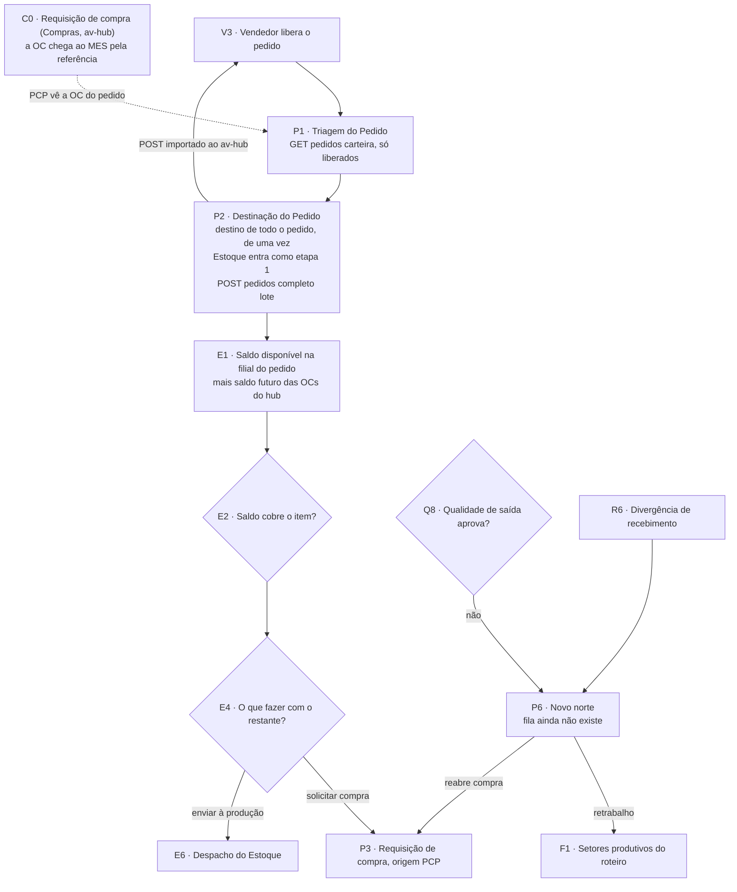

# Raia PCP: Triagem e Destinação do Pedido (P1, P2, P6)

**Em uma frase:** o PCP (planejamento e controle da produção) vê os pedidos que o vendedor liberou e decide, para cada item, para onde ele vai, quanto vai agora e por quais setores passa.

**Quando consultar:** dúvidas sobre o PCP: como o pedido liberado é triado e para onde cada item vai (estoque, compra ou produção).

**Onde estamos no fluxo:** ← [[03-Pedido-de-Venda-e-Liberacao]] | [[05-Estoque-Atendimento]] → · nós desta nota: `P1`, `P2`, `P6`

## Como funciona, passo a passo

1. O PCP abre a Triagem do Pedido e vê os pedidos liberados, por mês, ano e filial. A Triagem não mostra o saldo do Estoque (N16-138). `P1`
2. Para cada item, escolhe o destino: uma fábrica de fabricação ou a Revenda. `P2`
3. Define o destino de todos os itens do pedido, cada um com um destino só, e a prioridade. A Destinação é do pedido inteiro, de uma vez (N16-162).
4. Cada destino ganha uma ordem com o Estoque fixo como primeira etapa. A Destinação cria a ordem só com o Estoque (`develop`, desde 22/10). O roteiro dos demais setores é montado depois, na tela Montagem do Roteiro (`/montagem-roteiro`), que libera a OP (Ordem de Produção). Roteiro de fabricação precisa de uma inspeção de qualidade antes da expedição. Na `main` do MES o roteiro ainda é montado nesta mesma tela.
5. O sistema grava a Destinação de uma vez, com uma ordem por destino. Se uma falhar, nenhuma grava. Cada item vira uma parcial no Estoque, com 100% da quantidade. Enquanto o roteiro não é liberado, a parcial só sai do Estoque para compra (`develop`).
6. Toda ordem de destino de fabricação é uma OP, emitida na criação. Ela é numerada `pedido/N`, tem PDF e o botão "Imprimir OP" (2ª via). Revenda não gera OP ([[Contratos-da-v2|LOG-53]]).
7. O MES avisa o av-hub que importou o pedido, e a marcação do vendedor trava. Se o aviso falhar, ele tenta de novo a cada 10 minutos, por 7 dias.
8. O Estoque responde se há saldo. Essa pergunta não é do PCP. `E1`
9. Se a Qualidade de saída reprova um item, ou o Recebimento reabre a compra, o PCP decide o novo rumo: retrabalho ou nova compra. No retrabalho, o PCP escolhe o setor de volta (N16-141). Essa fila ainda não existe. `P6`

## Exemplo

O pedido de 100 flanges de aço carbono do Cliente Exemplo S.A. aparece na Triagem assim que o vendedor o libera. O PCP manda as 100 para um destino de fabricação. O roteiro (montado em seguida) leva o Estoque primeiro e uma inspeção de saída antes da expedição. As 100 flanges viram uma parcial no Estoque, esperando o almoxarife. Numa emergência, o PCP poderia mandar algumas para a Revenda e o resto para a fabricação, em ordens diferentes.

## Quem atua

| Quem | O que faz |
|---|---|
| PCP | Escolhe destino, quantidade, prioridade e roteiro. Decide o novo rumo quando algo reprova |
| Vendedor | Só libera o pedido, na etapa anterior |
| Almoxarife | Recebe a parcial no Estoque, na etapa seguinte |
| Robert | Dono do código do MES (sistema de chão de fábrica) |

## Regras que valem

As decisões de 29/10/2026 sobre esta etapa estão no lote N16-120 a N16-143 do [[Registro-de-Decisoes]].

- Fabricação ou revenda não é do produto. É o tipo da fábrica escolhida na Destinação.
- Só pedido liberado vira ordem. Sem liberação, o sistema recusa.
- O Estoque é sempre a primeira etapa. O PCP não inclui nem retira.
- Compras e Estoque não entram no roteiro montado pelo PCP.
- Roteiro de fabricação exige inspeção de qualidade antes da expedição.
- A soma das ordens de um produto não passa do total do pedido de venda.
- A Destinação é do pedido inteiro, cada item com um destino só, e é tudo ou nada (N16-162).
- Saldo zero exige clique do almoxarife.
- O clique vale sempre, mesmo depois do marco zero do Estoque, em 13/11 (N16-139).
- A Triagem não mostra o saldo do Estoque. Quem decide sobre saldo é o Estoque, na etapa dele (N16-138).
- No retrabalho, o PCP escolhe o setor para onde o item volta (N16-141).
- Pedido anterior à data de corte fica fora do MES e termina no sistema antigo (N16-142).
- Se o Compras já emitiu OC (ordem de compra) para o pedido, o PCP deveria ver isso no MES. Na `develop` o MES já lê as OCs e as requisições do Compras com pedido de venda aparecem na Triagem (23/10); a OC do pedido ainda não aparece (BL-049).

## O que já existe e o que falta

O que aparece como "develop" nesta nota não está na `main` do MES, parada em 08/10 (merge BL-035).

- ✅ Triagem, Destinação, gravação da Destinação em lote e confirmação ao av-hub com reenvio.
- ✅ A Destinação é do pedido inteiro, cada item pela quantidade que resta e com um destino só, como a `develop` faz desde 22/10 (`api-pcp` `src/pedidos/pedidos.service.ts:482`, `exigirPedidoInteiroDestinado`) e a validação local de 10/11/2026 confirmou. A rodada parcial e a divisão de emergência saíram do desenho na N16-162 (fecha a PS-052).
- 🟡 Nomes técnicos antigos no código: `/carteira`, `ordemProducao`, prefixo `OP-`. Os rótulos novos já estão na tela.
- 🟡 Pedido manual fica fora da espinha.
- ✅ (`api-pcp`, `app-pcp`) Na `develop` (27/10): Ordem de Produção como documento impresso, com 2ª via (BL-052). [[Contratos-da-v2|LOG-53]] ✅ está na `develop` do MES desde 27/10/2026 (`api-pcp` `ab3318d`, `app-pcp` `b9e8cb1`).
- ✅ (`api-pcp`, `app-pcp`) Na `develop` (22/10): Montagem do Roteiro separada da Destinação; roteiro individual do item lido pelo motor.
- 🔴 Mostrar a OC do pedido na Triagem, na Destinação e no Atendimento (BL-049).
- 🔴 Fila "Novo norte" (P6).
- Retrabalho (N16-141): hoje o código volta sempre ao setor anterior.
- 🟡 Matéria-prima: a `develop` baixa no "Atender pelo estoque" (19/10); a decisão é baixar na retirada (N16-140) 🔴.
- 📝 Pedido anterior à data de corte: decidido, falta a mensagem no lugar do 404 (N16-142).

Entrada: [[03-Pedido-de-Venda-e-Liberacao]]. Próxima raia: [[05-Estoque-Atendimento]].

## Detalhe técnico

Nós do [[00-Fluxo-Mestre-0b]]: `P1` Triagem do Pedido, `P2` Destinação do Pedido, `P6` Novo norte. O nó `P3` (requisição de compra de origem PCP) fica em [[06-Circuito-de-Compra]]. Entrada: [[03-Pedido-de-Venda-e-Liberacao]]. Saída: [[05-Estoque-Atendimento]]. Selos em [[Regras-do-Vault]].

### Quem atua (onde)

| Quem | Papel | Onde |
|---|---|---|
| PCP | Escolhe destino, quantidade, prioridade e roteiro; decide "novo norte" | MES, Triagem (`/carteira`) e Destinação (`/ordens-producao/novo`) |
| Vendedor | Só libera (raia anterior) | HUB |
| Almoxarife | Recebe a parcial no Estoque (raia seguinte) | MES |
| Robert | Dono do código do MES | `api-pcp`, `app-pcp` |

### Regras decididas

| # | Regra | Selo |
|---|---|---|
| 1 | A natureza do item (fabricação ou revenda) **não é do produto**: é o `Fabrica.tipo` do destino escolhido na Destinação. A divisão de emergência entre Revenda e fabricação (24/09) saiu do desenho na N16-162: cada item tem um destino só (`app-pcp` `app/(protected)/ordens-producao/novo/page.tsx:147`, `const itensSemDestino`) | 📝 ✅ `fabricas.prisma:1-8` |
| 2 | Só pedido **liberado** vira ordem: a Destinação consulta `GET /pedidos_liberados/:numero/itens` e recusa com 409 se o vendedor não liberou | 📝 ✅ `pedidos.service.ts:240-249` |
| 3 | O setor Estoque (código `estoque`) é **sempre a etapa 0/1** do roteiro, inserido pelo backend; o PCP monta só o restante e **não** pode incluí-lo | 📝 ✅ `pedidos.service.ts:226-232`, `:459-463` |
| 4 | Circuito de compra (`REQUISICAO`, `COMPRAS`, `LOGISTICA_ENTRADA`) e o Estoque ficam **fora** do roteiro; tentar pô-los no roteiro dá 409 | 📝 ✅ `pedidos.service.ts:500-506` |
| 5 | Roteiro de **fabricação** exige um setor tipo `QUALIDADE` (inspeção de saída, EC-06) antes da primeira etapa `EXPEDICAO` | 📝 ✅ `pedidos.service.ts:512-525` |
| 6 | A Destinação é do **pedido inteiro**: cada item pela quantidade que resta, com um destino só; a soma de todas as ordens do produto não passa do total (409 se ultrapassa). A rodada parcial saiu do desenho (N16-162, fecha a PS-052) | 📝 ✅ (`api-pcp` `src/pedidos/pedidos.service.ts:482`, `exigirPedidoInteiroDestinado`; `app-pcp` `app/(protected)/ordens-producao/novo/page.tsx:551`, `destine todos para salvar`), desde o commit `fe11538` do Robert (22/10/2026) |
| 7 | Grão do item no MES = **produto**: linhas repetidas do mesmo produto somam num item só (09/10) | 📝 ✅ `pedidos.service.ts:41-61` |
| 8 | A rodada é **atômica**: todas as ordens (uma por destino) gravam numa transação só; erro em qualquer uma desfaz tudo | ✅ `api-pcp` `src/pedidos/pedidos.service.ts:227` (`criarCompletoLote`), `:322` (`this.prisma.$transaction(`) |
| 9 | Numeração: ordem = `pedidoVenda/N` (N = contagem de ordens do pedido + 1); colisão (P2002) refaz a transação até 3 vezes | ✅ `pedidos.service.ts:30`, `:272-278`, `:408-420` |
| 10 | Toda parcial nasce `CRIADO` no setor Estoque com 100% da quantidade | ✅ `pedidos.service.ts:361-373` |
| 11 | **Saldo zero exige clique**: nenhuma parcial passa sozinha pelo Estoque (#31b, 08/10) | 📝 ✅ `itens-parciais.service.ts:588-590` |
| 12 | Confirmação de importação ao av-hub depois de gravar; falhou, o MES reenvia a cada 10 min por 7 dias (20 por rodada) | ✅ `pedidos.service.ts:63-122`, `:399-406` |
| 13 | O PCP **decide o novo norte** (retrabalho ou reabrir compra) quando a Qualidade de saída reprova ou o Recebimento reabre | 📝 🔴 sem tela de fila |
| 14 | **Ordem de Produção (OP)** é uma **entidade** do sistema e também um **documento para impressão** (formalidade), emitido **só para o que será fabricado** (revenda e o que o Estoque atende não geram OP). Na `develop` a OP é a própria ordem do destino de fabricação (`Pedidos`, `pedidoVenda/N`), com emissão gravada (`opEmitidaEm`, `opImpressoes`) e PDF `GET /pedidos/:id/op` | 📝 N14-22, #74 ✅ `develop` (27/10, `ab3318d`); na `main` do MES o campo `ordemProducao` é só o texto do pedido (`producao.prisma:97`) |
| 15 | **Se o Compras já emitiu OC vinculada ao pedido de venda, o PCP vê, no MES, que existe ordem de compra para aquele pedido** (número da OC, situação, quantidade, previsão), na Triagem, na Destinação e no Atendimento do Estoque. Fonte: a referência da OC do hub, item com `destino` do tipo `pedido_venda` | 📝 N14-20; ✅ (`api-pcp`) o MES já lê a referência da OC (K4, `develop`, 15/10) e as requisições do hub aparecem na Triagem (API-009, 23/10); 🔴 a OC do pedido ainda não aparece nas telas (BL-049). **N14-28:** a requisição do Compras com pedido de venda aparece antes da OC ("Requisição aberta no Compras", BL-064 e BL-065), e o MES avisa ao requisitar se já há requisição ou OC para o item |

#### Matriz de destinação (eixo 1 × eixo 2)

O diagrama antigo tratava Estoque, Revenda e Fabricação como três ramos. O modelo vigente tem **três eixos independentes**: (1) natureza, escolhida pela fábrica da rodada; (2) disponibilidade física, resolvida **no setor Estoque**; (3) destinação da reserva (a tabela `Reserva`, ver [[05-Estoque-Atendimento]]). A matriz abaixo diz o que acontece com cada célula.

| | **Pronto em estoque** (lote `LIBERADO` livre na filial do pedido) | **Matéria-prima em estoque** | **Sem estoque** |
|---|---|---|---|
| **Revenda** (`Fabrica.tipo = REVENDA`) | Estoque atende: split + reserva; a parte atendida vai à primeira etapa `EXPEDICAO` do roteiro ✅ | Beneficiamento é setor `PRODUTIVO` opcional do roteiro da Revenda; **consumo de matéria-prima não existe** 🔴 | O restante **sempre** vai para compra ("Solicitar compra": setor `REQUISICAO`) ✅ `itens-parciais.service.ts:721-730`. Volta pelo circuito: Recebimento, Qualidade, **de volta ao mesmo Estoque** ✅ |
| **Fabricação** (`Fabrica.tipo = FABRICACAO`) | Estoque atende a parte pronta; igual à Revenda ✅ | `destinoRestante = ROTEIRO`: o restante segue o roteiro produtivo; sem baixa de matéria-prima 🔴 | Escolha na tela: "Restante segue o roteiro" ou "Solicitar compra" (matéria-prima) ✅ `AtenderEstoqueModal.tsx:332-345` |

Regra de bolso: **o PCP escolhe o destino; o Estoque decide quanto sai do saldo e para onde vai o restante.** Pedido pode misturar as três situações ao mesmo tempo, item a item.

### Estados

| Estado | Valores | Onde |
|---|---|---|
| `StatusPedido` da ordem | `AGUARDANDO` (nasce assim), `EM_PRODUCAO`, `BLOQUEADO`, `ENTREGUE` | `producao.prisma:11-16`; `EM_PRODUCAO` nunca é gravado, a produção é derivada das parciais (`pedidos-carteira.service.ts:231-236`) |
| Envio do pedido (Triagem) | `NAO_ENVIADO`, `PARCIAL` (X de Y itens), `TOTAL`, `INDISPONIVEL` (itens do Omie não lidos) | `pedidos-carteira.service.ts:25`, `:190-229` |
| Produção do pedido (Triagem) | `AGUARDANDO`, `EM_PRODUCAO`, `CONCLUIDA` | `pedidos-carteira.service.ts:26`, `:237-253` |
| `Prioridade` | `BAIXA`, `NORMAL`, `ALTA`, `URGENTE` (padrão `NORMAL` na tela) | `producao.prisma:3-8`; `ordens-producao/novo/page.tsx:231` |
| `SistemaOrigem` | `OMIE`, `MANUAL` | `producao.prisma:23-26` |
| `TipoFabrica` | `FABRICACAO`, `REVENDA` | `fabricas.prisma:5-8` |
| `TipoSetor` | `PRODUTIVO`, `ESTOQUE`, `COMPRAS`, `EXPEDICAO`, `REQUISICAO`, `LOGISTICA_ENTRADA`, `QUALIDADE` | `fabricas.prisma:17-32` |
| Parcial | `CRIADO`, `RECEBIDO`, `EM_ANDAMENTO`, `EM_TRANSITO`, `PAUSADO`, `REPROVADO`, `CONCLUIDO`, `CANCELADO` (completo em [[Estados-e-Status]]) | `producao.prisma:29+` |

### Telas

| Nome atual | Nome antigo | Rota | App | Slug de permissão |
|---|---|---|---|---|
| Triagem do Pedido | Carteira de Pedidos | `/carteira` | app-pcp | `carteira` (visualizar) ✅ `pedidos.controller.ts:101` |
| Destinação do Pedido | Nova Ordem de Produção | `/ordens-producao/novo` | app-pcp | `ordens-producao` (criar) ✅ `ordens-producao/novo/page.tsx:517` |
| Acompanhamento dos Pedidos | Ordens de Produção | `/ordens-producao`, `/ordens-producao/[id]` | app-pcp | `ordens-producao` (visualizar) |
| Montagem do Roteiro | — | `/montagem-roteiro`, `/montagem-roteiro/[id]` | app-pcp | `montagem-roteiro` (só na `develop`, 22/10) |
| Produtos em Produção | — | `/produtos-em-producao` | app-pcp | `produtos-em-producao` (só na `develop`, 20/10) |
| Divergências de Recebimento | Decisões do PCP | `/decisoes-pcp` | app-pcp | `decisoes-pcp` (ver [[07-Recebimento]]) |
| Filas de Produção | Movimentações | `/movimentacoes` | app-pcp | `movimentacoes` |

A Triagem lista por mês, ano e **filial** (`codigoEmpresa`), mostra a coluna Qualidade ("Acompanha" ou "Não", `carteira/page.tsx:284-291`), o chip de envio e o de produção, e abre a Destinação com `router.push('/ordens-producao/novo?...')` (`carteira/page.tsx:155`). A Destinação distribui os itens entre destinos, com quantidade a enviar por item (começa cheia), prioridade, observação e montador de roteiro por destino (Estoque fixo travado no topo). Item sem destino **não vai na rodada** e continua na Triagem para a próxima (`ordens-producao/novo/page.tsx:359-366`, `:494-504`).

### Endpoints e contratos

| Método e rota | Permissão | Uso | Código |
|---|---|---|---|
| `GET /pedidos/carteira?mes&ano&codigoEmpresa&page&pageSize` | `carteira:visualizar` | Triagem: lista os liberados do av-hub e cruza com o MES | `pedidos.controller.ts:101-105`, `pedidos-carteira.service.ts:62-87` ✅ |
| `GET /pedidos/consulta-omie/:numeroPedido?codigoEmpresa` | `ordens-producao:criar` | Itens do pedido (via `GET /pedidos_liberados/:numero/itens`) | `pedidos.controller.ts:69-76` ✅ |
| `GET /pedidos/itens-existentes/:pedidoVenda` | `ordens-producao:criar` | Quanto já foi enviado do produto | `pedidos.controller.ts:111-118` ✅ |
| `GET /pedidos/unidades` | `ordens-producao:criar` | Filiais (do av-hub) | `pedidos.controller.ts:83-86` ✅ |
| `GET /pedidos/setor-estoque-fixo` | `ordens-producao:criar` | Mostra a etapa 1 travada | `pedidos.controller.ts:91-95` ✅ |
| `POST /pedidos/completo/lote` | `ordens-producao:criar` | Cria todas as ordens da rodada de uma vez | `pedidos.controller.ts:57-64` ✅ |
| `GET /pedidos`, `GET /pedidos/:id`, `PATCH /pedidos/:id`, `DELETE /pedidos/:id` | `ordens-producao` | Acompanhamento; excluir exige motivo e grava `PedidoExcluido` | `pedidos.controller.ts:211-222` ✅ |
| `GET /pedidos_liberados`, `GET /pedidos_liberados/:numero/itens`, `POST /pedidos_liberados/:numero/importado` | chave `API_KEY` do MES | Lado av-hub do contrato | [[Contratos-da-v2\|LOG-26]] ✅ ver [[Integracao-AvHub-MES]] INT-01 |

O `POST /pedidos/completo` singular foi apagado (PR #50); só o `/lote` existe.

### Como está no código

- ✅ **Triagem.** `PedidosCarteiraService.listar` lê a página do av-hub (`listarCarteiraIntegracao`), busca os itens de cada pedido com concorrência 8 (`pedidos-carteira.service.ts:48`, `:94-116`) e cruza com as ordens do MES **na mesma filial** (`:132-148`). Falha de um pedido vira `INDISPONIVEL`, não derruba a página.
- ✅ **Criação.** Valida todos os destinos (fábrica, roteiro, liberação no av-hub, `pedidos.service.ts:207-260`) e depois grava numa transação com timeout de 30 s (`:396`): `Pedidos` com `acompanhamentoQualidade` e `codigoPedidoOmie` copiados do av-hub (`:250-253`, `:282-285`), `ItensPedido`, `Roteiros` (Estoque ordem 0) e uma `ItemParcial` por item.
- ✅ **Excluir ordem** devolve reservas ATIVAS (`liberarReservas`), enfileira o cancelamento das requisições no av-hub (`enfileirarCancelamentosDoPedido`, 409 se já tem OC) e apaga com snapshot (`pedidos.service.ts:773-807`).
- ✅ **Reenvio do `importado`** com `AVHUB_REENVIO_IMPORTADO_MIN` (padrão 10; 0 desliga) (`pedidos.service.ts:80-85`).
- 🟡 **Nomes técnicos antigos:** a rota é `/carteira`, o campo é `ordemProducao`, os códigos são `OP-`. Os rótulos novos já estão na tela (09/10, `9bb47e4`).
- ✅ **Ordem de Produção como entidade e documento (N14-22), só na `develop`.** Desde 27/10 (`ab3318d`) toda ordem de destino de fabricação é emitida na criação e tem PDF (`src/pedidos/ordem-producao-pdf.ts`, `GET /pedidos/:id/op`, `opImpressoes` conta as 2ªs vias). Registro de 14/10 (superado na `develop`): `ordemProducao` era só o texto do pedido (`producao.prisma:97`).
- 🔴 **OC do pedido na Triagem e na Destinação (N14-20).** O MES já lê a referência da OC do hub (K4, `develop`, 15/10) e mostra as requisições do Compras com pedido de venda (`GET /pedidos/requisicoes-hub/:pedidoVenda`, 23/10), mas ainda não mostra a OC ao lado do pedido e do item (BL-049); do lado do hub já existem o vínculo `ordens_compra_itens_vinculos`, a view `vw_pedido_venda_itens_compra` e `GET /compras/pedidos-venda/:numero/compras` ✅ (`api-pcp`) ([[06-Circuito-de-Compra]]).
- 🔴 **P6 Novo norte:** a Qualidade de saída pode reprovar e abrir retrabalho (`PATCH /itens-parciais/:id/reprovar`, `/resolver`, `/retrabalho`, `itens-parciais.controller.ts:205-239`), mas **não existe a fila "Novo norte"** nem o `RoteiroItem` (C8, EC-03). A única fila de decisão do PCP existente é a de divergência de recebimento.

### O que falta desenvolver

| # | O quê | Dono | Nó | Selo |
|---|---|---|---|---|
| 1 | Fila "Novo norte" (P6): decidir retrabalho ou reabrir compra depois de reprovação de saída ou recompra | Robert | P6 | 🔴 |
| 2 | `RoteiroItem` (roteiro por item, C8, EC-03) | Robert | P2, P6 | 🔴 |
| 3 | Renomear rota, campo e prefixo (`/carteira`, `ordemProducao`, `OP-`) para os nomes novos (BL-036) | Robert | P1, P2 | 🔴 |
| 4 | Baixa de matéria-prima na retirada do Estoque (J2, J3; N16-140). Na `develop` há a baixa imediata no "Atender pelo estoque" (19/10) | Robert | P2, E4 | 🟡 baixa imediata ✅ (`api-pcp`); 🔴 retirada |
| 5 | Pedido manual (`SistemaOrigem.MANUAL`) fora da espinha; ver anexo [[Pedido-Manual]] | Nathan | P2 | 🟡 |
| 6 | Pedido liberado anterior à data de corte não aparece na Triagem (404 nos itens) | Nathan | P1 | 📝 decidido em 29/10 (N16-142): ficam fora do MES e terminam no sistema antigo; falta a mensagem no lugar do 404 (ver [[03-Pedido-de-Venda-e-Liberacao]]) |
| 7 | **Ordem de Produção: entidade e documento imprimível**, só para o que será fabricado (BL-052): feito na `develop` (27/10); falta o merge do MES para a `main` (BL-035) | Robert | P2 | 📝 N14-22 ✅ (`api-pcp`) `develop` |
| 8 | **Mostrar a OC do pedido** (Triagem, Destinação, Atendimento) lendo a referência da OC do hub (BL-049; a leitura, BL-001, já existe na `develop`) | Robert | P1, P2, E1 | 🔴 📝 N14-20 |

### Pendências

- Nathan: o saldo zero continua exigindo clique mesmo depois do marco zero do Estoque (13/11)? Hoje vale o clique sempre (#31b). **Decidido em 29/10/2026 (N16-139): sim, o clique vale sempre, também depois do marco zero.**
- Nathan e Robert: a Triagem deve mostrar o saldo do Estoque por item (hoje não mostra; a decisão de saldo é só no Estoque). Com N14-20, ela também mostraria o saldo futuro e a OC do pedido. **Decidido em 29/10/2026 (N16-138): a Triagem não mostra o saldo do Estoque; o Estoque decide na etapa dele.**
- Robert: a OP é uma entidade por destino de fabricação, por item ou por rodada? Na `develop` a OP é a ordem por destino de fabricação (`pedidoVenda/N`); confirmar com o Robert se é essa a decisão final.
- Robert: se `ensureEtapasPorTipo` deve aceitar roteiro de Revenda **sem nenhuma** etapa além do Estoque (o front exige roteiro não vazio, `ordens-producao/novo/page.tsx:376-379`).

### Subfluxo

