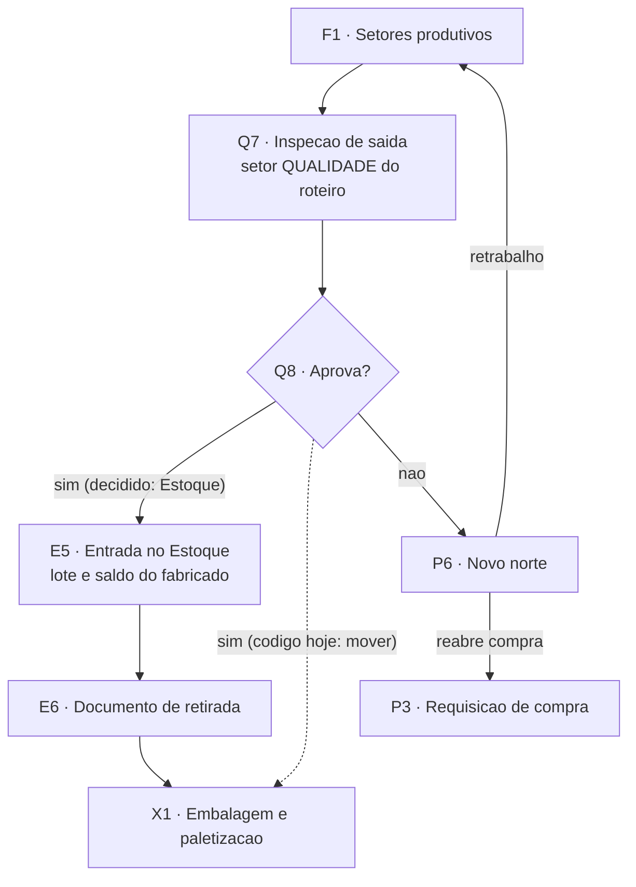

# Qualidade de saída (Q7, Q8)

**Em uma frase:** é a inspeção do que a produção fabricou: o inspetor aprova ou reprova com um clique e um motivo, e nada segue adiante sem essa conferência. Nós `Q7` (inspeção) e `Q8` (aprova?) do [[00-Fluxo-Mestre-0b]].

**Quando consultar:** dúvidas sobre a inspeção do que a produção fabricou: aprovação e reprovação antes de seguir adiante.

**Onde estamos no fluxo:** ← [[10-Producao-e-Roteiro]] | [[12-Estoque-Despacho]] → · nós desta nota: `Q7`, `Q8`

Recebe a parcial concluída pela produção ([[10-Producao-e-Roteiro]]). A inspeção de entrada, por lote, é outra raia ([[08-Qualidade-Entrada]]).

## Como funciona, passo a passo

1. A produção conclui a parcial e ela cai na fila da Qualidade. `Q7`
2. O inspetor recebe a parcial e inicia a inspeção. `Q7`
3. Ele decide com um clique e um motivo. Não há laudo nem checklist (N16-129). `Q8`
4. Aprovado: o item volta ao Estoque e vira lote quando o almoxarife informa a localização (na `develop`, e na `main` do MES desde 17/11). `Q8`
5. Reprovado: o sistema abre uma divergência com o motivo. `Q8`
6. A parcial reprovada tem duas saídas na fila: falso alarme ou retrabalho. Na tela, o falso alarme aparece como "Aprovar": ele não aprova, só desfaz a reprovação e devolve o item à inspeção, sem confirmação nem motivo. Não confundir com "Aprovar na inspeção de saída", que é o "sim" do passo 4. Decisões maiores, como ajustar o roteiro ou reabrir a compra, são o novo norte do PCP (`P6`), que ainda não tem tela. `P6`

## Exemplo

As 100 flanges chegam à inspeção de saída. O inspetor as confere.

- Estando boas, ele as aprova (tudo ou só uma quantidade). Elas voltam ao Estoque e viram lote (`develop`, e na `main` do MES desde 17/11).
- Havendo problema, ele reprova com um motivo. Pela decisão N16-128, pode ser só 5 das 100. Hoje são as 100.
- O PCP vê a divergência e escolhe entre falso alarme e retrabalho. Se o problema for da compra, a reabertura da compra é decisão do novo norte (`P6`).

## Quem atua

| Quem | O que faz |
|---|---|
| Inspetor da Qualidade | Recebe, inicia, reprova ou segue com a parcial |
| PCP | Decide retrabalho ou reabertura de compra |
| Operador do setor anterior | Recebe o item em retrabalho |

## Regras que valem

As decisões de 29/10/2026 (bloco N16-120 a N16-143) que tocam esta raia estão abaixo, com o ID.

- Todo roteiro de fabricação tem um setor de Qualidade antes da Expedição. Revenda não exige.
- Só se reprova em setor de Qualidade, com a inspeção em andamento.
- **Sem laudo nem checklist** (N16-129, 29/10/2026). A inspeção de saída é um clique e um motivo, como o código já faz. Nenhuma tela de laudo. A inspeção de entrada é diferente: lá a reprovação exige motivo e evidência.
- **Pode reprovar só parte** (N16-128): por exemplo, 5 de 100 peças. Hoje o código reprova a parcela inteira.
- **O que acontece com o reprovado:** na fila, só duas ações: falso alarme (volta à inspeção) ou retrabalho (volta a um setor). Pela N16-141, no retrabalho o PCP escolhe o setor de volta; hoje volta ao setor anterior. Ajustar o roteiro ou reabrir a compra é o novo norte do PCP (`P6`), fora da fila.
- Reprovação de saída não gera RNC (Registro de Não Conformidade) nem nota de devolução. RNC é do lote comprado.
- O fabricado aprovado vira lote e saldo no Estoque ([[Contratos-da-v2|LOG-53]]). A baixa acontece na retirada ([[Contratos-da-v2|LOG-54]]).

## O que já existe e o que falta

- ✅ (`app-pcp`) Telas de inspeção e fila da Qualidade; reprovar, falso alarme e retrabalho.
- ✅ (`api-pcp`) Na `develop` (27/10): o "sim" leva ao Estoque, com lote e saldo, por uma ação explícita de aprovar (`aprovar-saida`, com quantidade aprovada; o resto continua na inspeção).
- O "sim" (`aprovar-saida`) e o lote do fabricado estão na `develop` do `api-pcp` e do `app-pcp` (27/10/2026, `ab3318d`) e foram publicados na `main` do MES em 17 e 18/11/2026 (BL-035).
- 📝 ✅ (`api-pcp`) Sem laudo na saída (N16-129): é o que o código faz. A reprovação de saída pede só o motivo. Nada falta aqui.
- 🔴 Reprovar só uma parte (N16-128): a reprovação continua sendo da parcela inteira.
- 🔴 Escolha do setor de volta no retrabalho (N16-141): hoje volta ao anterior.
- 🔴 Tela do novo norte do PCP; fila de inspeção de processo; reabrir divergência.
- ❓ Uso real da tela em ambiente; regra de sucata e refugo.

## Detalhe técnico

### Como a inspeção entra no roteiro e divergência entre código e decisão

Nada fabricado ou beneficiado segue sem inspeção. A inspeção é **um setor do roteiro** (tipo `QUALIDADE`), por parcial, não por lote. Reprovado: o PCP decide o novo norte (P6).

**Código e decisão.** A decisão do Nathan de 14/10 é que o "sim" do Q8 leva o item ao **Estoque** (`E5`: vira lote e saldo, sai pelo documento de retirada). Na `develop` do MES isso foi feito em 27/10 (`ab3318d`): `PATCH /itens-parciais/:id/aprovar-saida` leva a parcela ao Estoque e `receber-fabricado` cria o lote. 🔴 A saída pelo documento de retirada ainda não existe. Na `main` do MES ainda vale o desenho antigo (registro de 14/10): não havia ação de aprovar; o inspetor usava `mover` e a parcial caía na próxima etapa do roteiro, de tipo `EXPEDICAO` (`itens-parciais.service.ts:426-435`, regra de ordem em `pedidos.service.ts:520-525`).

### Quem atua (onde)

| Quem | Papel | Onde |
|---|---|---|
| Inspetor da Qualidade | Recebe, inicia, **reprova** ou segue (`mover`) | `/qualidade/inspecao-saida` |
| PCP | Decide retrabalho ou reabertura de compra depois da reprovação | MES (sem tela dedicada) |
| Operador do setor anterior | Recebe o retrabalho | fila do setor |
| Vendedor | Marcou "Qualidade acompanha desde o início" (V2); nada consome o flag ainda | av-hub |

Perfis são dados do banco; o inspetor precisa de `PerfilSetor.podeAtuar` no setor `QUALIDADE` do roteiro (`itens-parciais.service.ts:1014`).

### Regras decididas

| # | Regra | Selo |
|---|---|---|
| 1 | Todo roteiro de **fabricação** tem um setor tipo `QUALIDADE`, antes da primeira `EXPEDICAO` (EC-06). Revenda não exige | 📝 ✅ `pedidos.service.ts:512-525` |
| 2 | `reprovar` só em setor tipo `QUALIDADE` e a partir de `EM_ANDAMENTO` | ✅ `itens-parciais.service.ts:966-989`, `:1017-1021` |
| 3 | Reprovar grava histórico e abre `Divergencia` tipo `QUALIDADE`, `ABERTA`, com motivo | ✅ `:1036-1058` |
| 4 | Na fila, reprovado só tem duas saídas: `resolver` (falso alarme, volta a `EM_ANDAMENTO`) ou `retrabalho` (volta ao setor anterior; pela N16-141, de 29/10, o PCP passará a escolher o setor). Mover, concluir, pausar e devolver somem. Ajustar roteiro e reabrir compra são do novo norte (`P6`, sem tela; item 3 de "O que falta desenvolver") | ✅ `app-pcp` `app/(protected)/movimentacoes/acoes.ts:76` (`REPROVADO: ['retrabalho'`) |
| 5 | Aprovado volta ao Estoque: **lote e saldo do fabricado**, retirada depois ([[Contratos-da-v2\|LOG-53]], [[Contratos-da-v2\|LOG-54]]) | 📝 ✅ (`api-pcp`) lote e saldo na `develop` (27/10); 🔴 retirada |
| 6 | Reprovação de inspeção de saída **não** gera RNC nem nota de devolução: RNC é conceito do lote comprado | ✅ `rncs` só em `api-pcp` `src/qualidade/qualidade.service.ts:205` (`await tx.rnc.create({`) |
| 7 | Inspeção de saída sem laudo nem checklist: um clique e um motivo (N16-129, 29/10, responde a pergunta T-04 da inspeção documental, ciclo 2). Hoje não há laudo na saída | 📝 ✅ (`api-pcp`) |
| 8 | Pode reprovar só parte da parcial (N16-128, 29/10) | 📝 🔴 |

### Estados

A raia usa os estados do item parcial ([[Estados-e-Status]]): `EM_ANDAMENTO` (inspecionando), `REPROVADO`, e a saída por `EM_TRANSITO`. A divergência usa `StatusDivergencia`: `ABERTA`, `EM_ANALISE`, `RESOLVIDA`, `CANCELADA` (`producao.prisma:77-82`), e `TipoDivergencia` (`QUALIDADE`, `QUANTIDADE`, `PRAZO`, `DANO`, `DOCUMENTACAO`, `OUTRO`, `:67-74`). Reprovar usa só `QUALIDADE`.

Etapa vista pelo vendedor: parcial em setor `QUALIDADE` que não é `qualidade-entrada` é `qualidade.inspecao`; `REPROVADO` em qualquer setor é `qualidade.reprovado` (`integracao-avhub.service.ts:172`, `:182-186`).

### Telas

| Nome atual | Nome antigo | Rota | App | Slug | Estado |
|---|---|---|---|---|---|
| Inspeção de saída | — | `/qualidade/inspecao-saida` | app-pcp | `inspecao-saida` | ✅ `qualidade/inspecao-saida/page.tsx:1-18`: `ModuloSetores` com `tipos={['QUALIDADE']}` e `excluirCodigos` do setor `qualidade-entrada` |
| Fila do setor Qualidade | Movimentações | `/movimentacoes/[setorId]` | app-pcp | `movimentacoes` | ✅ mesma `FilaSetor`; botão Reprovar só com `setor.tipo === 'QUALIDADE'` (`fila/CartaoItemParcial.tsx:305`) |
| Qualidade (índice) | — | `/qualidade` | app-pcp | ❓ | ✅ `qualidade/page.tsx` |

Não existe tela de laudo, checklist nem formulário de resultado de inspeção de saída: a decisão é um clique e um motivo.

### Endpoints e contratos

| Método e rota | Uso | Código |
|---|---|---|
| `PATCH /itens-parciais/:id/receber`, `/iniciar` | inspetor assume a parcial | `service:224`, `:299` ✅ |
| `PATCH /itens-parciais/:id/aprovar-saida` `{ observacao?, quantidade? }` | **"aprova"**: a parcela (ou só a `quantidade`) volta ao Estoque `EM_TRANSITO`, marcada como fabricado aprovado | `develop` (27/10, `itens-parciais.controller.ts`) ✅ |
| `PATCH /itens-parciais/:id/receber-fabricado` `{ idLocalizacao }` | o Estoque recebe o fabricado e cria o lote `PRODUCAO` | `develop` (27/10) ✅ (`api-pcp`) ([[09-Estoque-Entrada-do-Lote]]) |
| `PATCH /itens-parciais/:id/mover` | na `main` do MES era o "aprova": segue ao próximo setor do roteiro | `service:366` ✅ |
| `PATCH /itens-parciais/:id/reprovar` `{ motivo }` | reprova e abre divergência | `controller:205-213`, `service:1011` ✅ |
| `PATCH /itens-parciais/:id/resolver` | falso alarme | `service:1067` ✅ |
| `PATCH /itens-parciais/:id/retrabalho` `{ motivo }` | volta ao setor anterior, `retrabalho = true` | `service:1124` ✅ |
| `GET /divergencias` | consulta divergências | `divergencias.controller.ts:38-43` ✅ |

Contrato com o av-hub: só a etapa do item ([[Contratos-da-v2|API-005]], [[Contratos-da-v2|API-006]]).

### Como está no código

- ✅ O falso alarme aparece na tela como "Aprovar" (rótulo da ação `resolver`, `app-pcp` `app/(protected)/movimentacoes/components/fila/CartaoItemParcial.tsx:150`, `resolver: 'Aprovar'`): **não** aprova a inspeção, só desfaz a reprovação (`REPROVADO` → `EM_ANDAMENTO`). O "sim" é a ação explícita `aprovar-saida`, com o rótulo "Aprovar na inspeção de saída" (`:496`, `Aprovar na inspeção de saída`). A validação local em Docker de 10/11/2026 viu os dois botões e confirmou que o "Aprovar" depois da reprovação devolve o item à inspeção.
- Como a Qualidade é um setor comum no roteiro, `ehUltimaEtapa` é falso nela (a Expedição vem depois), então a tela oferece `mover`, não `concluir` (`fila/CartaoItemParcial.tsx:301-302`).
- Na `main` do MES (registro de 14/10), o fabricado aprovado nunca passa pelo Estoque, e `mover` leva a parcial direto à primeira etapa `EXPEDICAO`. Na `develop`, a reserva do lote `PRODUCAO` nasce em `receber-fabricado`.
- `ensureLotesCompradosLiberados` só barra envio a setor `ESTOQUE` com lote comprado pendente (`service:862-874`); não protege este caso.
- `Pedidos.acompanhamentoQualidade` (V2) é gravado (`api-pcp` `prisma/models/producao.prisma:104` (`acompanhamentoQualidade Boolean?`)) e mostrado na Triagem, mas nenhuma fila consome ([[03-Pedido-de-Venda-e-Liberacao]], item 7).
- ❓ Ninguém conferiu o uso real da tela em ambiente.

### O que falta desenvolver

| # | O quê | Dono | Nó | Selo |
|---|---|---|---|---|
| 1 | O "sim" do Q8 leva ao Estoque, com lote e saldo do fabricado: feito na `develop` (27/10). Falta o documento de retirada | Robert | Q8, `E5`, `E6` | ✅ (`api-pcp`) lote; 🔴 retirada |
| 2 | Ação explícita de aprovar na inspeção, com quantidade aprovada: feita na `develop` (`aprovar-saida`). Falta a quantidade reprovada (reprovação parcial, N16-128). O motivo já existe; laudo e evidência não entram (N16-129) | Robert | Q7 | ✅ (`api-pcp`) aprovar; 🔴 reprovar em parte |
| 3 | Tela do novo norte para a reprovação (P6): retrabalho, ajustar roteiro, reabrir compra. `/decisoes-pcp` só trata recebimento | Robert, Nathan | P6 | 🔴 |
| 4 | Laudo ou evidência na reprovação de saída: resolvido pela N16-129 (sem laudo nem checklist; a de entrada exige motivo e evidência, a de saída só motivo, e assim fica) | Robert, Qualidade | Q7 | 📝 ✅ (`api-pcp`) |
| 5 | Fila de inspeção de processo que usa `acompanhamentoQualidade` (ciclo 2, 22/01/2027) | Robert | V2 | 🔴 |
| 6 | Reabertura de divergência encerrada | Robert | P6 | 🔴 |
| 7 | Escolha do setor de volta no retrabalho (N16-141) | Robert | P6 | 🔴 |

### Pendências

- Nathan: sucata e refugo da produção: como entram no saldo e no custo?

Respondidas em 29/10: a reprovação parcial na saída (parte aprovada segue, parte reprovada vai a retrabalho) existe (N16-128); a inspeção de saída não exige laudo (T-04, N16-129).

### Subfluxo

Raias vizinhas: [[10-Producao-e-Roteiro]], [[09-Estoque-Entrada-do-Lote]] (o fabricado aprovado vira lote), [[12-Estoque-Despacho]], [[13-Expedicao]].
