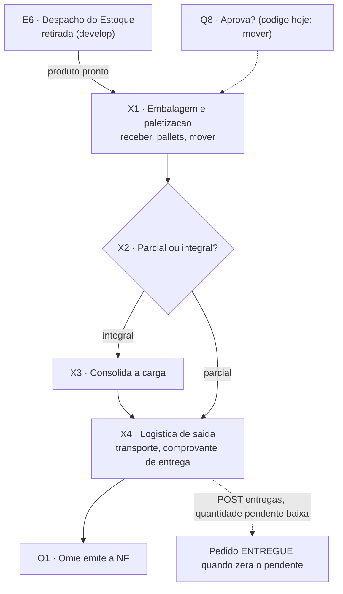

# Expedição e logística de saída (X1 a X4)

**Em uma frase:** a Expedição recebe o que está pronto, embala em pallets, decide se o pedido sai inteiro ou por partes, monta a carga e registra a entrega ao cliente. Nós `X1` a `X4` do [[00-Fluxo-Mestre-0b]]: embalagem e paletização, parcial ou integral, consolida a carga e transporte. Termina na emissão da nota no Omie ([[14-Fiscal-Omie]]). O sistema nunca emite nota fiscal.

**Quando consultar:** dúvidas sobre a saída ao cliente: embalagem, pallets, entrega parcial ou integral, carga e transporte.

**Onde estamos no fluxo:** ← [[12-Estoque-Despacho]] | [[14-Fiscal-Omie]] → · nós desta nota: `X1`, `X2`, `X3`, `X4`

## Como funciona, passo a passo

1. A parcial pronta chega à Embalagem. O operador confirma o recebimento, que só passa depois que o Estoque concluiu a retirada (N16-122); a baixa do saldo acontece na retirada ([[12-Estoque-Despacho]]). `X1`
2. O operador cadastra cada pallet com nome, peso e unidades. `X1`
3. Ele passa a parcial da Embalagem para a Logística. `X1`
4. O pedido sai por partes ou inteiro. Quem decide é o vendedor, pela marca "pode faturar em partes" (N16-130). Hoje não há campo no sistema: esperar o pedido inteiro é prática da Expedição. `X2`
5. Pedido inteiro: reúne-se a carga. Ainda não existe tela. `X3`
6. Define-se o transporte, com frota própria ou terceirizada. Ainda não existe tela. `X4`
7. O operador da Logística confirma a entrega: informa a quantidade e, se quiser, a NF e um comprovante, canhoto ou nota. O comprovante é opcional na tela: a entrega se confirma sem ele. `X4`
8. O sistema marca o pedido como entregue quando nada mais está pendente. `X4`
9. A Expedição avisa o faturista por fora. O Omie emite a nota. Pela decisão, a Logística avisa o Fiscal ao fechar a carga (N16-132). `X4`

## Exemplo

As 100 flanges do Cliente Exemplo S.A. chegam à Embalagem, que registra os pallets. Se só 60 estiverem embaladas, a soma fica em 60 e isso é válido. A Logística registra a entrega e anexa o canhoto assinado. Com todos os itens entregues, o pedido passa a entregue.

## Quem atua

| Quem | O que faz |
|---|---|
| Operador da Embalagem | Recebe a parcial e lança os pallets |
| Operador da Logística | Confirma a entrega; o comprovante, canhoto ou nota é opcional |
| PCP | Acompanha pedido, embalagens e entregas |
| Vendedor | Vê o status final no av-hub e decide parcial ou integral |
| Cliente | Recebe a mercadoria |
| Faturamento (Omie) | Emite a nota |

## Regras que valem

- Embalagem e Logística de saída são os dois últimos setores de todo pedido. Pallets valem em qualquer um deles.
- A soma das unidades dos pallets não passa da quantidade da parcial. Soma menor vale.
- O peso dos pallets só se edita na Embalagem. Depois viaja com a peça, só para leitura.
- A entrega é livre, item a item e por quantidade. Não há trava de "pedido inteiro pronto".
- Só entrega parcial concluída, até o que ainda está pendente.
- O pedido só vira entregue quando nada mais está pendente.
- A nota é do Omie. O sistema guarda só o número digitado.
- O despacho é no Estoque, pelo documento de retirada (decidido em 14/10). Contrato: [[Contratos-da-v2|LOG-54]].

Decisões de 29/10/2026 (bloco N16-120 a N16-143):

- A retirada nasce do atendimento e só o Estoque confirma (N16-120); a lista de separação é um PDF A4 (N16-193).
- A reserva é consumida junto com a baixa (N16-121).
- A Embalagem só recebe depois da retirada confirmada (N16-122).
- O vendedor decide se o pedido sai inteiro ou por partes, pela marca "pode faturar em partes" (N16-130). A Expedição segue essa marca.
- Item que nunca chega num pedido integral é decisão manual, sem prazo automático (N16-131).
- A Logística avisa o Fiscal ao fechar a carga (N16-132). Isso depende da consolidação de carga (`X3`), que não existe.
- Pedido faturado antes da entrega no MES só gera aviso, sem bloqueio (N16-133).

## O que já existe e o que falta

- ✅ (`app-pcp`, `api-pcp`) Fila, pallets, confirmar entrega e fechamento do pedido. O comprovante é opcional e é um link (URL), sem envio de arquivo; a validação local em Docker de 10/11/2026 confirmou a entrega sem anexo.
- 🟡 Escolha parcial ou integral: decidida, falta o campo na tela.
- 🟡 NF da entrega é texto livre, sem ligação com o número do Omie.
- ✅ Retirada e baixa na retirada; recebimento travado até a retirada concluir (`api-pcp` PR #96, 23/11).
- 🔴 Consolidação de carga (`X3`) e transporte (`X4`).
- 🔴 Aviso ao Faturamento dentro do sistema (fila de sinalização, ligação do `O1`).
- 🔴 Registro de remessa de produtos, no Ciclo 2.

## Detalhe técnico

### Objetivo (original)

A Expedição tem **duas portas de entrada** na `main` do MES de 08/10 (antes do merge de 17/11, BL-035): a parcial atendida pelo Estoque (`atendidoPeloEstoque`) e a parcial que a Qualidade moveu (fabricado, [[11-Qualidade-Saida]]). Na `develop` (27/10, `ab3318d`) o fabricado aprovado já volta ao Estoque antes de seguir ([[09-Estoque-Entrada-do-Lote]]); ❓ conferir se ainda sobra alguma porta direta. Pela decisão de 14/10 haverá uma só: o **documento de retirada do Estoque**, porque tudo que é fabricado ou comprado passa pelo Estoque ([[12-Estoque-Despacho]]).

O sistema **nunca emite nota fiscal**. Ele sinaliza a necessidade e o Omie emite. No v1 eram as telas 10.1 a 10.4; na v3 elas se chamam pelos nós `X1` a `X4`.

### Quem atua (com telas)

Papéis como no resumo do topo; aqui só onde cada um atua.

| Quem | Onde |
|---|---|
| Operador da Embalagem | `/logistica/expedicao`, setor tipo `EXPEDICAO` (lança pallets: nome, peso, unidades) |
| Operador da Logística | idem, último setor (NF além de comprovante e canhoto) |
| PCP | `/ordens-producao/[id]` |
| Vendedor | HUB |
| Cliente | externo |
| Faturamento (Omie) | [[14-Fiscal-Omie]] |

### Regras decididas

| # | Regra | Selo |
|---|---|---|
| 1 | Embalagem e Logística de saída são os dois últimos setores de todo pedido, de tipo `EXPEDICAO`; pallets valem em qualquer setor `EXPEDICAO` (29/09) | 📝 ✅ `fabricas.prisma:13-14`, `itens-parciais.service.ts:966-973` |
| 2 | A soma das unidades dos pallets não pode passar da quantidade da parcial; soma menor é válida (embalagem incompleta) | ✅ `itens-parciais.service.ts:946-951` |
| 3 | O peso dos pallets só é editável no setor `EXPEDICAO`; nos seguintes viaja com a peça, só leitura | ✅ `fila/CartaoItemParcial.tsx:435-444` |
| 4 | Entrega é **livre, item a item e por quantidade**: não existe trava de "pedido inteiro pronto". O pedido só vira `ENTREGUE` quando zera o pendente de todos os itens ativos e não resta parcial ativa | ✅ `entregas.service.ts:17-24`, `:104-130` |
| 5 | Só entrega parcial `CONCLUIDO`, com quantidade até o pendente do item e até a quantidade da parcial | ✅ `entregas.service.ts:44-63` |
| 6 | Parcial ou integral é decisão humana: do vendedor, pela marca "pode faturar em partes" (N16-130). Faturamento integral travado por um item que nunca chega (T-06): decisão manual, sem prazo automático (N16-131) | 📝 🔴 sem campo |
| 7 | **Despacho é no Estoque**: quem precisa da mercadoria (Expedição ou Produção) gera um **documento de retirada**; a baixa do saldo acontece na retirada | ✅ `api-pcp` `src/itens-parciais/itens-parciais.service.ts:280` (`retiradaPendenteDaParcial`) |
| 8 | Nota fiscal de saída é do Omie. O MES guarda só o número digitado na entrega | 📝 ✅ `entregas.service.ts:82` |
| 9 | Remessa de produtos (registro de remessa) vai ao Ciclo 2 (22/01/2027), item 27 do registro de 07/10 | 📝 |

### Estados

Parcial: `RECEBIDO` ao entrar na Embalagem, `EM_ANDAMENTO` ao iniciar, `CONCLUIDO` no último setor, depois entregas. Etapa vista no av-hub (`etapaDoItem`, `integracao-avhub.service.ts:158-184`): `expedicao.embalagem` (qualquer status em setor `EXPEDICAO`) e `expedicao.concluido` (`CONCLUIDO`). Rótulos no HUB: "Embalagem", "Pronto para expedição" (`lib/domain/etapas-item.ts:44-45`).

Pedido: `StatusPedido` `AGUARDANDO`, `EM_PRODUCAO`, `BLOQUEADO`, `ENTREGUE`. Todo pedido nasce `AGUARDANDO`; o único valor gravado depois é `ENTREGUE`, pelo `EntregasService` (`item-parcial-status.constants.ts:31-41`); `EM_PRODUCAO` e `BLOQUEADO` nunca são gravados. `TipoAnexo` do comprovante: `NOTA`, `CANHOTO`, `DESENHO`, `PEDIDO`, `ORDEM_PRODUCAO`, `COMPROVANTE_ENTREGA` (`producao.prisma:57-64`). Enums completos em [[Estados-e-Status]].

### Telas

| Nome atual | Nome antigo | Rota | App | Slug | Estado |
|---|---|---|---|---|---|
| Expedição | — | `/logistica/expedicao` | app-pcp | `expedicao` | ✅ `logistica/expedicao/page.tsx:1-16`: `ModuloSetores` com `tipos={['EXPEDICAO']}` (Embalagem e Logística) |
| Fila do setor | Movimentações | `/movimentacoes/[setorId]` | app-pcp | `movimentacoes` | ✅ paletes e entrega pelo mesmo `FilaSetor` |
| Editar pallets / Ver pallets | — | modal na fila | app-pcp | `movimentacoes` | ✅ `PalletsModal.tsx` (248 linhas) |
| Confirmar entrega | — | modal na fila | app-pcp | `movimentacoes` | ✅ `app-pcp` `app/(protected)/movimentacoes/components/ConfirmarEntregaModal.tsx:34` (`NF e anexo de comprovante são opcionais`): quantidade, NF opcional, observação opcional, anexo opcional `COMPROVANTE_ENTREGA`, `CANHOTO` ou `NOTA` por URL, gravado só se preenchido (`:92`, `if (mostrarAnexo && urlAnexo.trim())`) |
| Acompanhamento dos Pedidos, seção Embalagens | Ordens de Produção | `/ordens-producao/[id]` | app-pcp | `ordens-producao` | ✅ `EmbalagensSection.tsx` |
| Consolidação de carga (`X3`) | — | — | — | — | 🔴 não existe |
| Transporte e roteiro (`X4`) | — | — | — | — | 🔴 não existe |
| Fila de sinalização de faturamento (ligação do `O1`) | — | — | — | — | 🔴 [[14-Fiscal-Omie]] |

### Endpoints e contratos

| Método e rota | Uso | Permissão | Código |
|---|---|---|---|
| `PATCH /itens-parciais/:id/receber` | Embalagem recebe; **consome a reserva** se `atendidoPeloEstoque` | `movimentacoes:editar` | `itens-parciais.service.ts:224-289` ✅ |
| `PATCH /itens-parciais/:id/pallets` `{ pesosPallets[], nomesPallets[], unidadesPallets[] }` | arrays paralelos por pallet | idem | `controller:182-190`, `service:927` ✅ |
| `PATCH /itens-parciais/:id/mover`, `/concluir` | passa da Embalagem à Logística e conclui no último setor | idem | `service:366`, `:520` ✅ |
| `POST /entregas` `{ idItemPedido, idItemParcial, quantidade, numeroNf?, observacao? }` | confirma entrega; baixa `quantidadePendente`; pode marcar o pedido `ENTREGUE` | idem | `entregas.controller.ts:34-38`, `entregas.service.ts:25` ✅ |
| `GET /entregas`, `GET /entregas/:id` | consulta | `movimentacoes:visualizar` | `entregas.controller.ts:40-44` ✅ |
| `POST /pedido-anexos` | comprovante, canhoto, NF da entrega (via `criarPedidoAnexo`) | ❓ | `ConfirmarEntregaModal.tsx:94` ✅ |
| `/pedido-embalagens` e `/pedido-embalagem-pallets` (CRUD) | embalagens e pallets por pedido, total em sincronia | `ordens-producao` | `api-pcp` `src/pedido-embalagens/pedido-embalagens.controller.ts:28` (`@Post()`), `pedido-embalagem-pallets.controller.ts:28` ✅ |

Não há contrato com o av-hub para a Expedição além da etapa do item ([[Contratos-da-v2|API-005]]). A baixa do item ("faturado") volta pelo pipeline do Omie, sem contrato.

### Como está no código

#### X1 · paletes ✅ (`app-pcp`, `api-pcp`)

Dois modelos coexistem:

- **Por parcial** (usado na fila): `ItemParcial.pesosPallets`, `nomesPallets` e `unidadesPallets`, arrays alinhados por índice (`producao.prisma:420-434`). Atualizado por `atualizarPallets`, que exige setor tipo `EXPEDICAO` e o mesmo tamanho dos três arrays (`itens-parciais.service.ts:1640-1674`).
- **Por pedido** (usado na seção Embalagens do detalhe): `PedidoEmbalagem` (identificação e `totalUnidades`) com `PedidoEmbalagemPallet` (identificação, `peso Decimal(10,3)`, `unidades`). `totalUnidades` é derivado e atualizado por delta a cada pallet (`producao.prisma:294-338`).

#### Baixa do saldo hoje 🔴

A baixa do Estoque acontece **quando a Embalagem recebe** a parcial:

- `receber()` recusa com 409 enquanto a retirada da parcial não conclui (`itens-parciais.service.ts:280`, `retiradaPendenteDaParcial`). Só a parcial atendida antes de 23/11, sem retirada, ainda consome a reserva aqui (`itens-parciais.service.ts:332`, `await consumirReservasDaParcial(tx, {`).
- `desfazerRecebimento` e `devolver` ao Estoque estornam a baixa (`estornarConsumosDaParcial`, helpers `:287`; service `:1450`, `:1587`).
- `EntregasService.create` consome de novo o que ainda estiver reservado, como garantia (`entregas.service.ts:87-94`).

A **retirada** existe desde 23/11 (tabelas `retiradas` e `retirada_itens`): a baixa é registrada na confirmação do Estoque, com a linha da retirada no movimento ([[12-Estoque-Despacho]]).

#### X2 · parcial ou integral 🟡

Não há campo nem tela para a escolha. A entrega parcial é permitida por padrão (regra 4). O "integral" é só a prática da Expedição de esperar. Pela N16-130, a Expedição vai seguir a marca do vendedor. T-06 (item que nunca chega) não tem gatilho: compra e produção têm `CANCELADO` como saída, a consolidação não.

#### X3 · consolidação de carga 🔴 e X4 · transporte 🔴

Nenhuma entidade (carga, romaneio, veículo, transportadora de saída) existe em `api-pcp/prisma/models`. O levantamento do PCP legado (romaneios de carga: criar, conferir, fechar, imprimir) está em [[Backlog-por-Frente]]. O comprovante de entrega (`X4`) está feito ✅, opcional na tela.

#### Fechamento do pedido

`EntregasService.create` marca `ENTREGUE` só se `pendentes === 0` e `parciaisAtivas === 0` (status fora de `CONCLUIDO` e `CANCELADO`). A segunda condição existe porque retrabalho pode deixar parcial ativa depois de entrega (`entregas.service.ts:104-130`).

### O que falta desenvolver

| # | O quê | Dono | Nó | Selo |
|---|---|---|---|---|
| 1 | **Documento de retirada** do Estoque (solicitante: Expedição ou Produção; itens, lotes, quantidades) e baixa do saldo na retirada; remover a baixa em `receber()` | Nathan (N16-180) | `E6`, X1 | ✅ `api-pcp` PR #96 (BL-007) |
| 2 | Entrada única na Expedição: tudo vem do Estoque pelo documento de retirada (na `develop` o fabricado passa pelo Estoque e a retirada existe; falta confirmar se sobra porta direta) | Robert | X1 | 🟡 |
| 3 | Decisão e campo parcial x integral por pedido, com gatilho de saída para item travado (T-06) | Nathan, Comercial, Expedição | X2 | 🔴 (decidido em 29/10, N16-130 e N16-131; falta o campo) |
| 4 | Consolidação de carga: visão por pedido, espera dos itens, romaneio | Robert | X3 | 🔴 |
| 5 | Transporte e roteiro: frota própria ou terceirizada | Robert | X4 | 🔴 |
| 6 | Sinalização do MES ao Omie (ligação do `O1`) com acompanhamento do retorno da NF | Robert, Gustavo | O1 | 🔴 |
| 7 | NF da entrega só é texto livre (`numeroNf VarChar(30)`); ligar ao número que o Omie devolve | Robert | X4, O1 | 🟡 |
| 8 | Registro de remessa de produtos | Robert | X4 | 🔴 Ciclo 2 |

### Pendências

- Nathan: a retirada exige conferência física dupla? Segue aberto. (Quem confirma: N16-120; o que a lista imprime: N16-193.)
- Respondido em 29/10/2026: pedido integral é opção do vendedor, não regra do cliente nem decisão da Expedição (N16-130); não há prazo máximo de espera automático, o item que não chega é decisão manual (N16-131).
- Expedição: frota própria e terceirizada usam o mesmo fluxo de carga?
- Robert: `PerfilSetor` por filial (hoje inexistente) afeta quem vê a carga.

### Subfluxo

Raias vizinhas: [[12-Estoque-Despacho]], [[11-Qualidade-Saida]], [[14-Fiscal-Omie]].
