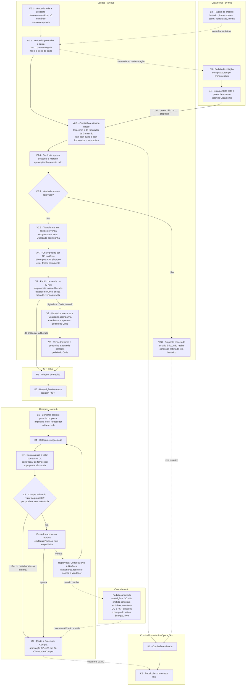

# Proposta de venda: detalhe técnico (2/2)

**Em uma frase:** detalhe técnico da nota [[01-Proposta-de-Venda]] (parte 2 de 2): Como estava no módulo de teste do Pablo (🔴 `av-hub/api-comercial`, removido em 06/11/2026); O Omie nesta raia ([[Estudo-Omie-API]]); Dados 🟡; Quem vê o quê; A tela da proposta (N16-19); O que falta desenvolver; Pendências; Diagrama do subfluxo.

**Onde estamos:** ← [[01-Proposta-de-Venda]] (resumo e índice) · partes: [[01-Proposta-de-Venda-Detalhe-Tecnico-1]] · **01-Proposta-de-Venda-Detalhe-Tecnico-2**

## Como estava no módulo de teste do Pablo (🔴 `av-hub/api-comercial`, removido em 06/11/2026)

Tudo abaixo é do `api-comercial` (pasta `av-hub/api-comercial`), serviço **só de teste** (N14-15), depois legado só para leitura (N16-117) e **removido do av-hub em 06/11/2026 (PR #261, `dd9d729`)**; o código fica legível em `git show f7d8d7f:api-comercial/<arquivo>`. pelo F3, o que só existe nele é 🔴 "sem API e sem banco". No `av-hub` `develop` (2e5456d) o BFF já não fala com ele: as rotas que ainda não existem na API do Hub respondem 503 `RECURSO_NAO_MIGRADO` (`lib/api/comercialApi.ts`, N16-111). Parte disto já foi refeita na `api-acos-vital` (rotas da proposta, `develop`, 29/10; ver o quadro de endpoints); o que não foi segue 🔴 lá. As regras antigas de fechamento parcial, perda, reabrir e pedido digitado no Omie saíram do front em 28/10 (`av-hub` `2008344`).

- 🔴 (só no módulo de teste) **Proposta completa:** modelo `Proposta` (`prisma/models/vendas.prisma:45-109`) com cliente, empresa emissora, itens, moeda, incoterm, frete, condição, totais, `valorFechado`, `acompanhamentoQualidade`, `numeroPedidoOmie`; itens com snapshot de custo (`PropostaItem`, `:111-166`: `custo`, `margemPct`, `origemCusto`, `idOferta`, `fornecedor`, `custoLiquidoUnit`, `margemRealPct`).
- 🔴 (só no módulo de teste) **Revisão:** `atualizar` só roda em `ABERTA` (`propostas.service.ts:478-481`); se o conteúdo comercial muda, `revisao + 1` e uma linha em `propostas_versoes` com o snapshot (`:483-515`); evento `REVISADA`.
- 🔴 (só no módulo de teste) **Numeração atômica** (`proximoSequencial`, `propostas.service.ts:313-322`), mas com formato `CO-AV2026-0012-R03` (`domain/numeracao/numeroProposta.ts:3-12`), por empresa e ano: **diverge de N16-04 e N16-26** 🔴.
- 🔴 (só no módulo de teste) **Comandos de status:** `perder` (`:555-575`), `reabrir` (`:578-606`), `fechar` com fechamento parcial por item (`:609-649`) e `calcularFechamento`. **Divergem de N16-02, N16-03 e N16-24** 🔴: reabrir e fechar em parte deixam de existir.
- 🔴 (só no módulo de teste) **Pedido no Omie à mão:** `pedidoOmie` monta o resumo para o vendedor digitar (`:663-691`), com planilha (`pedidoOmie.ts`), e `registrarPedidoOmie` grava o número e a marcação da Qualidade (`:694-725`); `exigirGanha` aceita `FECHADA` e `PARCIAL` (`:652-656`). Sai com N16-02 🔴.
- 🔴 (só no módulo de teste) **Duplicar e copiar para outra empresa** (`propostas.service.ts:853-903`).
- 🔴 (só no módulo de teste) **PDF e e-mail da proposta** (HUB gera o PDF; `emailProposta.ts`; evento `PDF_GERADO`).
- 🔴 (só no módulo de teste) **Capacidades** derivadas das telas do hub: `propostas`, `propostas-valores`, `custo-item`, `painel-comprador`, `propostas-delegacao` (`domain/permissoes/capacidades.ts:47-56`).
- O pedido de custo no módulo de teste está em [[02-Orcamento-Base-de-Preco-Detalhe-Tecnico-2#Orçamento visto da proposta (B2 a B4)]].
- 🔴 (só no módulo de teste) **Simulador do Hub** lê a proposta ligada ao pedido para pré-preencher o lado da compra (`simulador.routes.ts`, PR #207). Não é a comissão estimada da proposta.

No HUB (branch `feat/menu-orcamento-vendas-compras`, `5aa5311`): as páginas de Vendas já estão em `app/(protected)/vendas/*` ✅ (`av-hub`).

No av-hub (API do hub), o que serve de padrão: contador por `(unidade, tipo)` (`contadores_documento`, `fn_proximo_numero_documento`, Dump Avhub 8110-8140, 16552-16564); fila da OC para o Omie (`GET /compras/ordens/fila-omie`, `PATCH …/sincronizacao`, `POST …/reenviar`, `ordens_compra.route.js:857`, `:1267`, `:1321`); liberação (`pedidos_vendas_liberacao`, Dump 18285).

## O Omie nesta raia ([[Estudo-Omie-API]])

- ✅ (Omie, [[Estudo-Omie-API]]) O `IncluirPedido` aceita o **nosso código de integração** do pedido e do item: o hub grava a liberação na **resposta** da inclusão e liga o item da proposta ao `codigo_item_omie`. Etapa inicial `"10"`. A pipeline precisa **gravar** `codigo_pedido_integracao`.
- 🟡 Pode ser possível **mandar o nosso `numero_pedido`**, e o pedido criado por API pode nascer **bloqueado** na tela do Omie: ❓ só teste.
- ✅ **A categoria do pedido decide se ele gera comissão.** A regra do grupo G6 compara o código `'1.01.96'` (refaturamento em Mogi) e a `vw_comissao_master` só lê `grupo IS NULL`; a categoria que o Hub manda em `informacoes_adicionais.codigo_categoria` entra direto nessa regra. 🔴 Em Uberaba o refaturamento é o `1.01.99` e **não** cai em G6 ([[Riscos]], RS-022). 🟡 A tela deve mostrar essa consequência na hora de escolher a categoria; ver [[Mapa-IncluirPedido-Omie]], seção 5.3.1.
- O cancelamento do pedido no Omie (`CancelarPedidoVenda`, quem cancela) está em [[03-Pedido-de-Venda-e-Liberacao-Detalhe-Tecnico-2#Pedido que nasce da proposta: liberação e cancelamento]].
- ✅ Devolução de **venda**: a total vem do Omie; a **parcial** só chega marcada, sem valor, item nem quantidade. Fiscal ou Controladoria informam o que voltou (N16-74).

## Dados 🟡

Schema (proposta, pedido de venda do hub, numeração, custo realizado por item): o modelo está no banco (contratos removidos em 29/10/2026). ⚠️ A N16-116 (27/10) decidiu que não existirá `core_comercial` e que a proposta fica em `core_vendas_faturamento`; o dump e o código de 29/10 criam e usam `core_comercial.propostas` e `core_comercial.fn_proposta_*`. Divergência a fechar com o Nathan e o Gustavo ❓. Aqui só o que o fluxo exige:

| Dado | Regra |
|---|---|
| `propostas.status`, `revisao`, `aprovada_em`, `aprovada_por`, `aprovada_revisao` | aprovação grava quem, quando e **qual revisão** |
| `propostas.acompanhamento_qualidade` | obrigatório no `V0.6`, copiado ao pedido |
| `pedidos_venda_hub.numero`, `numero_omie`, `codigo_pedido_integracao`, `status_sincronizacao_omie`, `id_proposta`, `cancelado_em`, `cancelado_por`, `motivo_cancelamento` | 1 para 1 com a proposta (único); o cancelamento é guardado **no hub**, mesmo que o Omie exclua o pedido |
| `contadores_documento.tipo` | ganha `proposta` e `pedido_venda` (o `CHECK` hoje só aceita `ordem_compra` e `requisicao_compra`, Dump 16560) |
| Item da proposta ↔ item do pedido ↔ `codigo_item_omie` ↔ item da OC | chave do custo real |

## Quem vê o quê

| Dado | Vendedor | Auxiliar | Gerente de equipe | Orçamento | Compras | PCP | Controladoria |
|---|---|---|---|---|---|---|---|
| Proposta (venda, preço, desconto) | só as dele | dos titulares | todas da equipe | só o pedido de custo, sem preço de venda 🟡 | a parte de compras, quando há requisição do pedido | não | só a tela da comissão (mesma estrutura da proposta), não edita a proposta |
| Custo e margem | os que ele pôs (`propostas-valores`, `custo-item`) | idem | equipe | custo que preenche | custo e valor correto | não | sim (custo real e diferença) |
| **Aviso de compra acima do valor** | **sim, só o dos produtos dele**, com margem atual, margem considerada, motivo e fornecedor | idem 🟡 | 🟡 OQ-21 | não | **sim, a lista dos reprovados** | não | sim |
| Comissão estimada | só a que ele pôs | idem | 🟡 OQ-21 | não | não | não | sim |
| Pedido de venda do hub | os dele | idem | equipe | não | o vinculado à requisição | liberado; **avisado do cancelamento** | não |

A matriz completa por perfil estava no contrato removido em 29/10/2026; o Robert cria o novo.

## A tela da proposta (N16-19)

A tela de criar e revisar a proposta segue a do **Simulador de Comissão atual** (`09-Diagramas/fontes/tela-simulador-comissao.png`; `av-hub/app/(protected)/comissoes/simulador/page.tsx`). Blocos, na ordem da imagem:

1. **Pedido** → na proposta: unidade, número da proposta (automático, N16-04), cliente, vendedor e quantidade de itens.
2. **Condições comerciais** (um conjunto por proposta, como no Simulador): estado de destino com ICMS, condição de pagamento com encargo ("o encargo financeiro entra no preço sugerido"), chave "Com impostos", frete na compra (rateio pelo percentual de logística), valor ST (venda), imposto retido ou DIFAL e frete na venda ("entra na NF, mas fica fora da margem"). Os parâmetros vigentes ("Parâmetros: Maio/23" na imagem, que continuam valendo, N16-39) são gravados com o cálculo. 🟡 O `SimularImpostos` do Omie pode alimentar a ST e o DIFAL da venda sem digitação ([[Estudo-Omie-API]]).
3. **Itens**: bloco Compra (fabricação, quantidade, unidade, preço, origem, % IPI, ST, frete e fornecedor: o vendedor preenche), bloco Venda (quantidade e preço) e bloco Resultado (custo líquido, sugerido, margem e letra: o sistema calcula).
4. **Rodapé de totais**: custo, venda, total da NF, sugerido, mark-up real, mark-up sobre a compra, margem e letra.

As colunas e as condições **vêm das mesmas entradas do motor atual** (`simulacoes`, `simulacao_itens`, `simulador_parametros` e a view `vw_simulacao_resolvida`, ver [[01-Motor-Atual-Como-Calcula]]); o `core_comercial` (itens da proposta) e o `core_comissao` casam com elas, sem colunas paralelas. Hoje o Simulador calcula no navegador (`calcularSimulacao`, `simulador/page.tsx:1020`) e a proposta não calcula comissão; o cálculo passa à API ([[03-Modelo-Novo-core_comissao]]).

**Três visões da mesma tela** (detalhe e tabela por bloco em [[15-Custo-Real-e-Comissao]]): (a) o vendedor, na proposta, preenche o custo e vê margem, letra e a comissão estimada que ele colocou; (b) Compras vê o cotado do vendedor ao lado do valor da OC e usa o valor correto na OC, sem alterar a proposta; quando o valor é maior, o vendedor aprova em Meus Pedidos; (c) a Controladoria vê estimado e real lado a lado, com o drill-down por evento de custo (cada evento com as suas condições, N16-20), e decide com justificativa.

## O que falta desenvolver

Os itens 7 e 12 (`C6`, `C7`, `C8`) estão em [[06-Circuito-de-Compra-Detalhe-Tecnico-2#C6, C7 e C8: a parte de compras do pedido da proposta]].

| # | O quê | Dono | Nó | Selo |
|---|---|---|---|---|
| 1 | Migrar o módulo de propostas para a `api-acos-vital`: feito para criar, listar, revisar, aprovar, cancelar, copiar e transformar (29/10). Falta a numeração só de dígitos (hoje `CO-{AV\|AU\|HRM}{AAAA}-{NNNN}-R{RR}`, formato decidido: só dígitos, ano mais sequência, N16-148 e PS-038; diverge da N16-04 e da N16-26, e a mudança é do Gustavo), versões, importação de itens e o cálculo no servidor | Robert, Gustavo | `V0.1` | ✅ rotas; 🔴 numeração e o resto |
| 2 | Estado `APROVADA`, trava de ajuste e aprovar com a revisão: rotas feitas (29/10). Falta ligar o BFF e a tela, e conferir no banco a regra "incompleta" | Robert, Nathan | `V0.4`, `V0.5` | ✅ (`api-acos-vital`) API; 🔴 tela |
| 3 | Cancelar com motivo: rota feita (29/10). Falta o histórico da comissão estimada | Robert | `V0C` | ✅ (`api-acos-vital`) API; 🔴 histórico |
| 4 | Botão "Transformar em pedido" e marcação da Qualidade obrigatória: rota `transformar` feita (grava o pedido do Hub `pendente`). Faltam a tela, a fila do pedido e o retorno da pipeline | Robert (API), Nathan (tela e pipeline), Gustavo (banco) | `V0.6`, `V0.7` | ✅ (`api-acos-vital`) API; 🔴 tela e envio |
| 5 | Pipeline: `IncluirPedido` por fila, espelho do `envioOrdensCompra.ts`, com `codigo_pedido_integracao` e `codigo_item_integracao`; gravar esses códigos no hub | Nathan | `V0.7` | 🔴 |
| 8 | Trocar a AwesomeAPI pela PTAX do hub: o front já lê o câmbio do Hub (`GET /cambio` para `/cotacoes_moeda/atual`, 27/10) | Robert | `V0.1` | ✅ (`av-hub`) front; ❓ API |
| 9 | Aprovar com perfil da Gerência no sistema | — | `V0.4` | próximo ciclo (N16-12) |
| 10 | Tela da proposta no formato do Simulador, com o motor na API (porta de `lib/simulador/motor.ts`) e a comissão estimada | Robert (tela de proposta e API), Nathan (`K1`), Gustavo | `V0.2`, `V0.3`, `K1` | 🟡 |
| 11 | Visão de Compras (leitura) e visão da Controladoria (custo real, drill-down por evento) da mesma tela | Nathan | `C6`, `C7`, `K4` | 🔴 |
| 14 | **Pipeline do Omie:** gravar os códigos de integração, ampliar o espelho e o envio da OC com os impostos, recurso novo de recebimento de NF-e, cancelamento e devolução da NF | Nathan, Gustavo | vários | 🔴 ([[Estudo-Omie-API]]) |

O item 15 (página do produto) está em [[02-Orcamento-Base-de-Preco-Detalhe-Tecnico-2#Orçamento visto da proposta (B2 a B4)]].

Os itens 6 (liberação) e 13 (cancelamento) estão em [[03-Pedido-de-Venda-e-Liberacao-Detalhe-Tecnico-2#Pedido que nasce da proposta: liberação e cancelamento]].

## Pendências

| # | Pergunta | Dono |
|---|---|---|
| 1 | 📝 Alçada de desconto e margem: tudo fisicamente (N16-75; OQ-04 fechada) | Nathan (feito) |
| 2 | Perfis do Orçamento e de quem vê a equipe (OQ-21); o Moisés é uma das pessoas do setor (N16-104) | Nathan, Gustavo |
| 3 | Testes no Omie: campos obrigatórios, `numero_pedido` próprio, pedido bloqueado, `ExcluirPedido` (OQ-16, OQ-48). Roteiro: pedido mínimo, `ConsultarPedido`, comparar com um digitado à mão, `ExcluirPedido`, com cadastros TESTE. Espera a unidade, a categoria e a decisão da conta corrente | Nathan |
| 5 | Quem cadastra produto novo, e em quanto tempo (OQ-36) | Fiscal |

As pendências 4 e 8 (cancelamento) estão em [[03-Pedido-de-Venda-e-Liberacao-Detalhe-Tecnico-2#Pedido que nasce da proposta: liberação e cancelamento]].

As pendências 6 e 7 (aviso e e-mail de Compras) estão em [[06-Circuito-de-Compra-Detalhe-Tecnico-2#C6, C7 e C8: a parte de compras do pedido da proposta]].

Lista completa em [[Perguntas-Proposta-Pedido-Comissao]].

## Diagrama do subfluxo

Próxima raia no desenho: [[06-Circuito-de-Compra]] (para `P3`, `C6`, `C7`, `C8`) e [[02-Orcamento-Base-de-Preco]].
