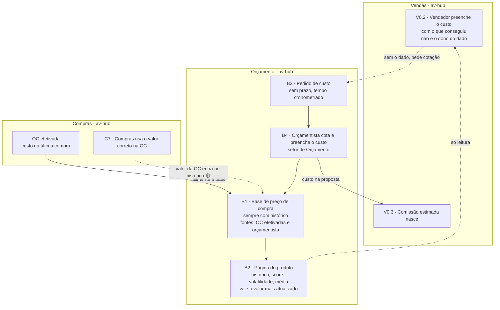

# Orçamento e base de preço de compra: detalhe técnico (2/2)

**Em uma frase:** detalhe técnico da nota [[02-Orcamento-Base-de-Preco]] (parte 2 de 2): Como estava no módulo de teste do Pablo (🔴 `av-hub/api-comercial`, removido em 06/11/2026); Dados 🟡; Quem vê o quê; Orçamento visto da proposta (B2 a B4); O que falta desenvolver; Pendências; Diagrama do subfluxo; O que foi do antigo anexo `Orcamento.md`.

**Onde estamos:** ← [[02-Orcamento-Base-de-Preco]] (resumo e índice) · partes: [[02-Orcamento-Base-de-Preco-Detalhe-Tecnico-1]] · **02-Orcamento-Base-de-Preco-Detalhe-Tecnico-2**

## Como estava no módulo de teste do Pablo (🔴 `av-hub/api-comercial`, removido em 06/11/2026)

**O `api-comercial` foi removido do av-hub em 06/11/2026 (PR #261, `dd9d729`)**; o código fica legível em `git show f7d8d7f:api-comercial/<arquivo>`. pelo F3, o que só existe nele é 🔴 "sem API e sem banco". No `av-hub` `develop` (2e5456d) o BFF já não fala com ele: as rotas que ainda não existem na API do Hub respondem 503 `RECURSO_NAO_MIGRADO` (`lib/api/comercialApi.ts`, N16-111).

- 🔴 (só no módulo de teste) **Oferta imutável com histórico:** `Oferta` (`prisma/models/suprimentos.prisma:138-183`): preço, unidade, IPI, ST, origem do ICMS, frete, `prazo` (**texto**), mínimo, `dataCotacao`, `validaAte`, `custoLiquidoUnit`, `status`, invalidação com motivo e quem. Chave única `(fonte, idDocumentoFonte, idProduto, idFornecedor)` para importar sem duplicar. Já havia `validaAte` e `custoLiquidoUnit`, que apoiam o "dado recente" e a Nota Preço.
- 🔴 (só no módulo de teste) **Média "bolsa de valores":** `mediasDoProduto` e `GET /produtos/:id/precos` com janela de 7 a 730 dias, média ponderada pela quantidade comprada, mínimo, máximo, último preço e `delta_media_pct` por fornecedor (`suprimentos.routes.ts:823-875`; `domain/custo/medias.ts`).
- 🔴 (só no módulo de teste) **Pedido de custo:** `SolicitacaoCusto` (`suprimentos.prisma:216-245`) com `prazoResposta` obrigatório (**sai**), comprador que assumiu, oferta que respondeu, justificativa quando não há fornecedor; prazo padrão de 2 dias úteis (`custos.routes.ts:378`, **sai**); número `SC-AAAA-NNNN` (`custos.routes.ts:384-386`, com letras).
- 🔴 (só no módulo de teste) **Resposta com oferta no Painel do Comprador:** PR #201 (`33f21d3`).
- 🔴 (só no módulo de teste) **Mapa de cotação importado:** `importarMapa.ts`, `mapaCotacao.ts` (oferta com fonte `MAPA_COTACAO`).
- 🔴 (só no módulo de teste) **Ofertas do Omie:** `PEDIDO_OMIE` nasce de pedidos de compra lidos direto do Omie; no desenho do LOG-52 isso vira derivado de `pedidos_compras_itens` da pipeline (LOG-52 seção 3.4, Q1 ❓). É a fonte "OC efetivada" da base (N16-41).
- 🔴 **Não existe:** score, ranking por categoria e volatilidade; prazo de entrega em dias; frequência de vitória; matriz de preços; página do produto sem acesso a custo; vínculo do valor correto da OC (`C7`) com o histórico; cronômetro do pedido de custo; migração para a `api-acos-vital` (BL-062).

## Dados

Desde 17/11/2026 (`LOG-60`, migration `2026-11-17_orcamento_cotacoes_pedidos_custo`, aplicada pelo Gustavo):
- `core_comercial.solicitacoes_custo`: pedido de custo com `aberta_em`, `assumida_em` e `respondida_em` (cronômetro), e produto obrigatório;
- `core_comercial.ofertas`: cotação imutável com `prazo_entrega_dias` numérico e `valida_ate` obrigatória;
- a última compra continua vindo de `core_vendas_faturamento.pedidos_compras_itens`, gravada pela pipeline.

O schema `core_orcamento`, do desenho de 16 a 21/10, foi abandonado em 26/10. As tabelas `core_compras.orc_*` seguem no banco sem consumidor; a aposentadoria é a fase 7 do LOG-52, com o Gustavo.

## Quem vê o quê

| Dado | Vendedor | Orçamento | Compras | Gerência |
|---|---|---|---|---|
| Página do produto e preços de compra (B2) | sim, só leitura | sim | sim | sim |
| Score, top fornecedores e volatilidade | sim, só leitura 🟡 | sim | sim | sim |
| Ofertas e fornecedores (editar) | não | sim | leitura | leitura |
| Pedido de custo | cria e acompanha os dele | responde todos | não | vê |
| Matriz de preços | leitura 🟡 | edita | leitura | leitura |

Hoje a regra do código é mais restrita: `veCusto` vem de `custo-item` ou de ser comprador (`capacidades.ts:77`). Dar a página do produto ao vendedor exige tela ou permissão nova (OQ-21).

## Orçamento visto da proposta (B2 a B4)

Trechos que estavam na nota de proposta e pedido da v2 (a nota 11 da tag `v2-antes-da-v3`), movidos em 05/11/2026 para cá, a nota dona de `B1` a `B4`. A numeração das regras e dos itens é a da nota de origem. A proposta em si está em [[01-Proposta-de-Venda]].

### Regras decididas

| # | Regra | Selo |
|---|---|---|
| 21 | O pedido de custo ao Orçamento **não tem prazo fixo**; o tempo é **cronometrado**. O setor é novo (o Moisés é uma das pessoas) e o sistema funciona sem orçamentista | 📝 N16-58, N16-59, N16-104 |

### Telas

| Nome atual | Rota | App | Quem | Nó | Estado |
|---|---|---|---|---|---|
| **Página do produto** (histórico, top fornecedores com score, flutuação, volatilidade, média) | a definir 🟡 | HUB | Vendedor | `V0.2`, `B2` | 🔴 ([[02-Orcamento-Base-de-Preco]]) |

### Endpoints do módulo de teste

| Método e rota | Uso | Nó | Estado |
|---|---|---|---|
| `GET /produtos/:id/precos` | histórico, média e fornecedores | `B2` | 🔴 sem API e sem banco (só no módulo de teste, `suprimentos.routes.ts:823`; a `api-acos-vital` não tem a rota) |
| `POST /solicitacoes_custo` e `responder`, `assumir`, `liberar`, `cancelar` | pedido de custo (o prazo obrigatório de 2 dias úteis **sai**: N16-58) | `B3`, `B4` | 🔴 só no módulo de teste: `custos.routes.ts:304-510`; 🔴 ajuste |

### Como está no código (módulo de teste)

- ✅ **Pedido de custo** com prazo padrão de 2 dias úteis (`custos.routes.ts:378`) e rótulos `ATRASADA`, `VENCE_HOJE`, `NO_PRAZO` (`:338`): **saem** com N16-58 (cronômetro, sem prazo). `GET /produtos/:id/precos` (`suprimentos.routes.ts:823-875`).

### O que falta (numeração da nota de proposta)

| # | O quê | Dono | Nó | Selo |
|---|---|---|---|---|
| 15 | Página do produto e regras do score | Nathan, Robert, Pablo | `V0.2`, `B2` | 🔴 ([[02-Orcamento-Base-de-Preco]]) |

## O que falta desenvolver

Atualizado em 17/11/2026, depois da entrega do `LOG-60`:

| # | O quê | Dono | Nó | Selo |
|---|---|---|---|---|
| 1 | Migrar suprimentos e custos para a `api-acos-vital` | Nathan, Gustavo | `B1` a `B4` | ✅ `LOG-60` (`src/schemas/core_comercial/index.js:54`, `comercial.use(solicitacoesCusto);`) |
| 2 | Página do produto para o vendedor | Nathan | `B2` | ✅ `components/Orcamento/ProdutoPagina.tsx:259` (`<KpiCotacaoVigente vigentes`); ❓ o acesso do perfil de vendas em produção, com o Gustavo |
| 3 | Score, ranking por categoria e dado recente com parâmetros | — | `B2` | Fora do escopo, para o futuro (N16-174); a volatilidade está ✅ (`src/utils/precosProduto.js:20`, `JANELA_VOLATILIDADE_DIAS = 90`) |
| 4 | Prazo de entrega em dias na oferta e na OC; data real de recebimento | Gustavo, Nathan | `B1`, `B2` | 🟡 na oferta ✅ (`ofertas.route.js:123`, `prazo_entrega_dias`); na OC e o `dRec` 🔴 |
| 5 | Base com as duas fontes (OC efetivada e orçamentista) | Nathan | `B1` | ✅ as duas fontes lado a lado, e o vendedor escolhe (N16-172): `components/Orcamento/ProdutoPagina.tsx:259` (`<KpiCotacaoVigente vigentes`) |
| 6 | Matriz de preços | Nathan | `B1`, `B2` | ✅ virou a aba Cotações (N16-173): `components/Orcamento/ProdutoPagina.tsx:343` (`valor: 'cotacoes' as const`) |
| 7 | Cronômetro do pedido de custo | Nathan | `B3` | ✅ `src/schemas/core_comercial/aggregates/solicitacoes_custo/solicitacoes_custo.route.js:118` (`router.get("/solicitacoes_custo"`) |
| 8 | Perfil "orçamentista" | Gustavo | — | 🟡 aplicada no banco pelo Gustavo (migration `2026-11-17_orcamento_cotacoes_pedidos_custo`, fora dos repositórios); ❓ conferir num dump novo; ❓ as pessoas no perfil |
| 9 | O valor correto da OC (`C7`) no histórico de compras | Nathan, Gustavo | `B1` | 🟡 conferir |
| 10 | Cadastro das telas em produção | Gustavo | — | 🟡 aplicada no banco pelo Gustavo (migration `2026-11-17_orcamento_cotacoes_pedidos_custo`, fora dos repositórios); ❓ conferir num dump novo |
| 11 | Aviso ao vendedor e ao Orçamento | Gustavo, Nathan | `B3`, `B4` | 📝 `LOG-61` (Central de Avisos, N16-175) |
| 12 | A proposta pedindo custo no item e mostrando as duas fontes | Robert | `V0.2`, `B2` | 🔴 a API aceita `id_proposta` e `id_item_proposta`; falta a tela da proposta |

## Pendências

OQ-21 (perfis), PS-031 e PS-032 de [[Pontas-Soltas]] (quem escreve o módulo; `vinculados`). Quem opera o Orçamento: setor novo; o Moisés é uma das pessoas (N16-104). Produtos duplicados dividem o histórico de preço de um mesmo produto: ligar com a frente de **Prováveis Duplicatas**.

## Diagrama do subfluxo

## O que foi do antigo anexo `Orcamento.md`

O anexo `10-Anexo-Fora-do-Fluxo/Orcamento.md` (14/10) dizia que o orçamento era "por fora" ([[Comercial-Suprimentos]]) e descrevia a tela antiga. O que aconteceu com cada item:

| Item do anexo antigo | O que acontece |
|---|---|
| 5 telas `orcamento/categorias`, `fornecedores`, `historico-produtos`, `sem-cadastro`, `vinculos` | **Removidas do av-hub em 16/10** (`ededeea`): páginas, estilos, tipos, services (`categoriasOrcamento`, `fornecedores`, `historicoPrecos`, `vinculosOrcamento`) e rotas BFF `app/api/orcamento/{categorias,fornecedores,historico-precos,vinculos}`; no banco o SQL de produção desativa os slugs antigos (`deleted_at`) |
| Rotas BFF órfãs `app/api/historicoProdutos/*` | Removidas (`5aa5311`, 16/10) |
| JSON `lib/orcamento/data/*.json` (6 arquivos, 4,4 MB de fornecedores com CNPJ, e-mail e telefone) | **Saíram os 6** ✅ (av-hub `develop` 2e5456d): `categorias.json`, `historicoPrecos.json`, `vinculos.json` (`ededeea`) e depois `familias.json`, `fornecedores.json`, `produtos.json` e o `lib/orcamento/dados.ts` que os lia, com as rotas BFF `app/api/orcamento/{familias,produtos,todos-fornecedores}` que os serviam ao cadastro de produtos e ao simulador de comissão (`c851cda`, 16/10, "remove the legacy Orcamento module"). Registro anterior (v2): "ficam 3 … `fornecedores.json` (CNPJ, e-mail, telefone) continua versionado no git 🔴". Os arquivos seguem no histórico do git |
| Marcas `GAMBIARRA` O1 e O2 (`lib/orcamento/dados.ts`) | **Saíram** ✅: o arquivo `lib/orcamento/dados.ts` foi removido inteiro (av-hub `c851cda`, 16/10); as funções O1 e O2 foram removidas junto das telas |
| Tabelas `orc_*` e views `orc_vw_*` no schema `core_compras` (13.896 linhas carregadas em 02/10, dump de 07/10) | **Seguem no banco** e as rotas `/orcamento/*` da `api-acos-vital` seguem montadas (`orcamento.route.js`), **sem consumidor**. Aposentadoria: fase 7 do LOG-52 ("só depois do Nathan confirmar o corte do orçamento", agora confirmado por N16-14 e N16-16), a cargo do Gustavo 🔴 |
| Decisão "migrar a tela para a API ou removê-la" | Resolvida: removida (N16-14); o módulo novo é o do Pablo (N16-07, N16-15) |
| Contratos [[Contratos-da-v2\|LOG-42]] e `LOG-07a` | LOG-42 encerrado (N16-14); a metade de coordenadores segue pendente e ganha item no backlog ([[Backlog-por-Frente]]) |
