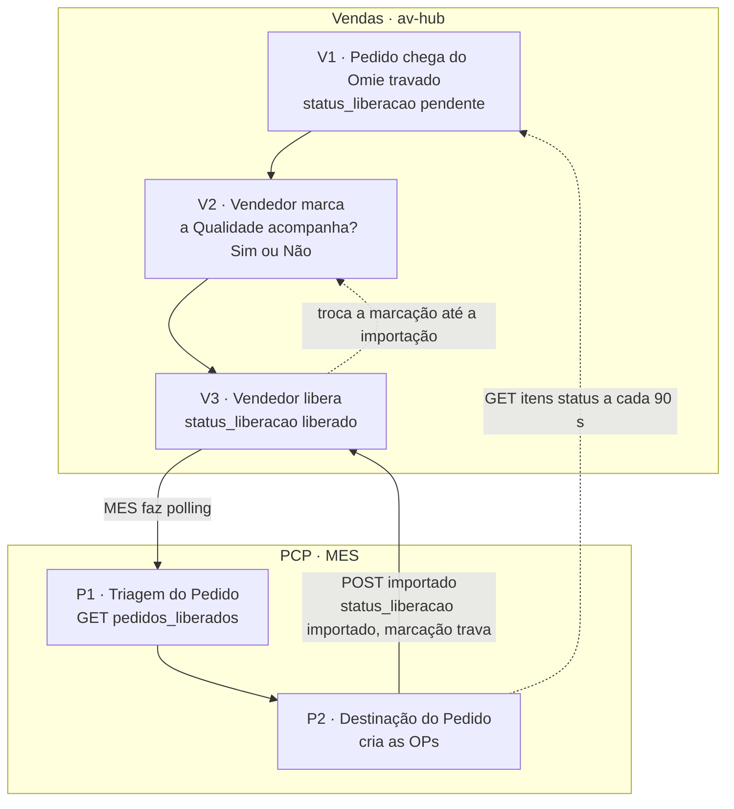

# Raia Vendas: liberação do pedido (V1 a V3): detalhe técnico (2/2)

**Em uma frase:** detalhe técnico da nota [[03-Pedido-de-Venda-e-Liberacao]] (parte 2 de 2): Dados; Quem vê o quê; Pedido que nasce da proposta: liberação e cancelamento; O que falta desenvolver; Pendências; Diagrama do subfluxo.

**Onde estamos:** ← [[03-Pedido-de-Venda-e-Liberacao]] (resumo e índice) · partes: [[03-Pedido-de-Venda-e-Liberacao-Detalhe-Tecnico-1]] · **03-Pedido-de-Venda-e-Liberacao-Detalhe-Tecnico-2**

## Dados

| Tabela ou view | Schema | Colunas que importam |
|---|---|---|
| `parametros_vendas` | `core_vendas_faturamento` | linha única (`id = 1`); `data_inicio_liberacao date` (compara com `data_inclusao >=`); sem linha, a view fica vazia |
| `pedidos_vendas_liberacao` | `core_vendas_faturamento` | PK (`codigo_empresa`, `numero_pedido`); `acompanhamento_qualidade boolean`; `liberado_por`, `liberado_em`; `updated_by`, `updated_at` (cursor do polling); `importado_mes_em`, `importado_mes_referencia`. Sem FK para `pedidos_vendas` (o pipeline recria linhas) |
| `pedidos_vendas_liberacao_historico` | `core_vendas_faturamento` | `acao` (`liberado`, `alterado`, `importado_mes`), `valor_anterior`, `usuario`, `referencia` |
| `vw_pedidos_liberacao` | `core_vendas_faturamento` | um pedido por linha; `status_liberacao`; sobre `vw_vendas_planilha` |
| `itens_pedido_status` (+ cursor) | `core_vendas_faturamento` | uma linha por parcial e etapa; alimentada pelo job de 90 s ([[Contratos-da-v2\|SQL-010]]) |
| `Pedidos.acompanhamento_qualidade`, `Pedidos.importado_avhub_em`, `Pedidos.codigo_pedido_omie` | `public` (MES) | cópia da marcação, selo de importação confirmada, id do pedido no Omie |

Modelo do banco do av-hub em [[Banco-AvHub]]; do MES em [[Banco-MES]].

### Data de corte

- Regra: `data_inclusao >= parametros_vendas.data_inicio_liberacao`. Pedido anterior não trava, **e também não aparece na Triagem**: os itens dele respondem 404 e o MES mostra "não encontrado" (observação do Robert, 30/09). Os pedidos anteriores à data de corte ficam fora do MES e terminam no sistema antigo 📝 (N16-142, 29/10/2026); falta uma mensagem clara no lugar do erro 404 🔴.
- Valor vigente no **banco de teste**: **`2026-09-01`** 📝 (Nathan, 09/11/2026: `SELECT data_inicio_liberacao FROM core_vendas_faturamento.parametros_vendas`, no mesmo banco em que rodou a medição do G6 para o contrato LOG-56). Bate com o `2026-09-01` do banco local; o `2026-07-28` que o contrato registrava na `api-test` (conferido em 01/10) não vale mais. **Produção:** a Liberação ainda não foi publicada; em produção só estão os dashboards da gerência (Nathan, 09/11/2026). O valor de produção será definido ao publicar, e o "01/09/2026 em produção" do vault anterior não se confirma. O Dump Avhub é de esqueleto e não traz o dado. A validação local em Docker de 10/11/2026, com os dados do tst, viu o mesmo 01/09/2026 no rodapé da Liberar Pedidos. O valor é **dado do banco, não do código**: a API só lê a linha `id = 1` de `parametros_vendas` (`api-acos-vital` `src/schemas/core_vendas_faturamento/aggregates/pedidos_liberacao/pedidos_liberacao.route.js:154`, `SELECT data_inicio_liberacao FROM core_vendas_faturamento.parametros_vendas`) e a tela mostra o que vier (`av-hub` `components/LiberarPedidos/LiberarPedidosLista.tsx:354`, `Entram aqui os pedidos incluídos no Omie a partir de`).

## Quem vê o quê

| Dado | Vendedor | Auxiliar | Gerente | PCP (MES) |
|---|---|---|---|---|
| Pedido `pendente` | só os dele | os dos titulares que auxilia | todos, em Liberação da Equipe | **não vê** |
| Pedido `liberado` ou `importado` | os dele | idem | todos | vê (Triagem) |
| Marcar e liberar | sim | sim | **não** (só leitura) | não |
| Etapa por item (cartão) | dos pedidos no escopo dele | idem | dos pedidos da equipe | não usa o cartão; vê o roteiro no MES |

Escopo (contrato 40, ✅ fixo na API): vale quando o usuário entrou por tela com escopo de vendedor e o perfil não tem escopo `todos`. No dump de 07/10 só o perfil "Gerencia PCP" tinha `todos`; os outros 20 perfis estavam `vinculados` (❓ conferir em produção). Detalhes de perfis e telas em [[RBAC-e-Permissoes]].

## Pedido que nasce da proposta: liberação e cancelamento

Trechos que estavam na nota de proposta e pedido da v2 (a nota 11 da tag `v2-antes-da-v3`), movidos em 05/11/2026 para cá, a nota dona do pedido de venda (`V1` a `V3`), junto com o cancelamento do pedido. A numeração das regras e dos itens é a da nota de origem. A proposta em si está em [[01-Proposta-de-Venda]].

### Passo a passo

8. O pedido nasce liberado e o PCP o vê na triagem. O pedido digitado direto no Omie segue o mesmo caminho: chega travado, com vendas pronta, e o vendedor responde e libera. `V1`, `V2`, `V3`

### Regras que valem

- O pedido criado pela proposta nasce liberado, porque a Qualidade já foi respondida na proposta.
- Pedido cancelado: a requisição e a OC ainda não emitida cancelam sozinhas. O que já foi comprado vai ao Estoque, livre.
- Pedido já faturado: o cancelamento não desfaz compra nem produção.

### O que já existe e o que falta

- ✅ (`av-hub`) Telas Liberar Pedidos e Liberação da Equipe.
- 🔴 Cancelamento do pedido, com tarja na requisição e na OC.

### Regras decididas

| # | Regra | Selo |
|---|---|---|
| 10 | O pedido criado pela proposta **nasce liberado**, sem `V3`. O `V1` tem duas origens, que seguem o mesmo fluxo e a mesma tela; o pedido digitado no Omie chega com a parte de vendas pronta (só se altera no Omie), e o vendedor responde `V2`/`V3` e preenche a parte de compras no Hub, sem travar o fluxo | 📝 N16-05, N16-106 |
| 22 | **Pedido cancelado:** a requisição do PCP e a OC ainda não emitida são **canceladas sozinhas, com tarja**; a OC e o PCP são avisados; o que já foi comprado vai ao **Estoque, livre**, como lote com o custo da OC | 📝 N16-68, N16-69, N16-70 |
| 23 | **Pedido já faturado:** o cancelamento não desfaz compra nem produção; fica só o abatimento da comissão e o saldo ainda não faturado, **parte por parte** | 📝 N16-71 |
| 26 | Se alguém mexer no pedido no Omie depois, o sistema só avisa e traz a mudança | 📝 N16-30 |
| 32 | **Pedidos de Venda e Notas Fiscais de Saída** ficam inativas também em produção | 📝 N16-33 |

### Liberação

O pedido da proposta nasce em `status_liberacao = liberado` (valores em [[03-Pedido-de-Venda-e-Liberacao]]); o histórico `liberado` é gravado **na resposta do `IncluirPedido`**, usando o `codigo_pedido_integracao` como chave ([[Estudo-Omie-API]]).

### Telas

| Nome atual | Rota | App | Quem | Nó | Estado |
|---|---|---|---|---|---|
| Pedidos de Venda (lista do Omie) | `/vendas/pedidos-de-venda` | HUB | Vendedor | `V1` | ✅ página no código; **inativada também em produção** (N16-33) |
| Notas Fiscais de Saída | `/vendas/notas-fiscais-saida` | HUB | — | — | ✅ (`av-hub`) página no código; **inativada também em produção** (N16-33) |
| **Tarja de pedido cancelado** na requisição e na OC | nas telas da requisição e da OC | HUB, MES | Compras, PCP | cancelamento | 🔴 |
| Liberar Pedidos, Liberação da Equipe | `/vendas/liberar-pedidos`, `/liberacao-equipe` | HUB | Vendedor, gerente | `V2`, `V3` | ✅ (`av-hub`) hoje; a resposta passa para a tela do pedido (N16-106) 🟡 |

### Endpoints

| Método e rota | Uso | Nó | Estado |
|---|---|---|---|
| `POST /pedidos_venda_hub/:id/cancelar` | registrar o cancelamento do pedido no hub; avisa OC e PCP, cancela requisição e OC não emitida, manda o comprado ao Estoque | cancelamento | 🔴 🟡 nome |

### O Omie e o cancelamento

- ✅ **Existe cancelar pedido por API** (`CancelarPedidoVenda`, serviço `/produtos/pedidovendafat/`), e também `ExcluirPedido` e `AlterarPedidoVenda`. **Quem cancela, edita e exclui é o vendedor** (N16-84), não o Fiscal. O `ListarEtapasPedido` (`/produtos/pedidoetapas/`) devolve, por pedido, cancelamento, devolução e faturamento. **O hub guarda o cancelamento por conta própria** (quem, quando, motivo) porque o `exclusionSync` apagaria do hub um pedido excluído no Omie.

### O que falta (numeração da nota de proposta)

| # | O quê | Dono | Nó | Selo |
|---|---|---|---|---|
| 6 | Liberação gravada na resposta do `IncluirPedido`, com histórico | Gustavo | `V1` | 🔴 |
| 13 | **Cancelamento:** registro no hub, requisição e OC não emitida canceladas com tarja, aviso à OC e ao PCP, comprado ao Estoque, ajuste do `exclusionSync` | Nathan, Gustavo, Robert (Estoque) | cancelamento | 🔴 |

### Pendências (numeração da nota de proposta)

| # | Pergunta | Dono |
|---|---|---|
| 4 | 📝 Quem cancela: o vendedor, por API (N16-84). Falta testar a diferença entre `CancelarPedidoVenda` e `ExcluirPedido` e quando cada um vale (OQ-17, OQ-48) | Nathan |
| 8 | Estado do item que vai ao Estoque quando o pedido cancela e a reserva do MES | Robert |

## O que falta desenvolver

| # | O quê | Dono | Nó | Selo |
|---|---|---|---|---|
| 1 | **L6: chave própria do MES**, de escrita, restrita a `/pedidos_liberados/*` e às rotas que ele usa. Hoje o MES usa a chave admin ou de banco; a única chave própria (`MES_INTEGRACAO_KEYS`) só abre o PUT do contrato 34 e o `POST /integracao/mes/avisos-compra` do LOG-58. Decidir: chave restrita ou seguir com a admin | Gustavo (decide), Robert (troca a variável `API_KEY`) | V3, P2 | 🔴 |
| 2 | **L3: mapear `auth.rotas_telas`** para `GET /pedidos_liberacao` (`liberar-pedidos` ou `liberacao-equipe`, `pode_visualizar`) e `PUT` (`liberar-pedidos.pode_editar`); confirmar que `/pedidos_liberados/*` fica como rota de serviço | Gustavo | V2 | 🔴 |
| 3 | **Testar o escopo do vendedor com usuário vendedor** (roteiro da seção 5 do contrato 40): nenhum teste rodou; sessão sem token responde 401 no BFF | Nathan e Gustavo | V2 | 🔴 |
| 4 | **Token expirado vira furo de acesso** quando o BFF para de filtrar: sem `req.usuario` a API não aplica escopo (`escopoVendedor.js`). Renovar o token antes de qualquer remoção de filtro | Gustavo | V2 | 🔴 |
| 5 | **Reabrir marcação depois da importação.** Hoje ninguém destrava. Decidir se a Gerência ou o PCP pode reabrir (rota nova, permissão `pode_aprovar`) | Nathan decide, Gustavo implementa | V3 | 🔴 |
| 6 | **Pedido parado.** Pedido que o vendedor nunca libera é invisível ao PCP. A tela do gerente mostra quem segura; falta alerta depois de N horas e definir quem recebe (decisão T-07 do v1) | Nathan | V3 | 🔴 |
| 7 | **Fila de inspeção de processo** que consome `Pedidos.acompanhamentoQualidade`: o dado chega e é gravado, mas nenhuma tela do MES o usa além da coluna da Triagem | Robert | V2 e raia de [[11-Qualidade-Saida]] | 🔴 |
| 8 | **Estados macro do vendedor** (os 8 do desenho): decidir se entram ou se o vendedor fica com `status_liberacao` mais 11 etapas; se entrarem, depende do feed do MES (`estado_macro`) | Nathan decide, Robert (feed) | V1 a O2 | 🔴 |
| 9 | **Cartão "Andamento na produção"** (antigo "Etapa dos itens"): teste ponta a ponta com a migration `api005` aplicada; `quantidade_na_etapa` tipado como número e a API pode mandar `null`; sem linha do tempo, SLA nem filtro por etapa; `compras.fechamento` ainda aparece como "Em compra" (sem cotação, aprovação ou trânsito) | Nathan (front), Gustavo (migration), Robert (etapa de compra mais fina) | V1 | 🔴 |
| 10 | **Migration `api005`** (função, tabela e mapa de rotas do status por item) não verificada no banco; DDL não versionado | Gustavo | V1 | ❓ |
| 11 | ✅ Marcas `GAMBIARRA(` de escopo removidas do front (`lib/api/pedidosVenda.ts`, `lib/api/portalPcp.ts`; `484dea6`, 15/10): contrato [[Contratos-da-v2\|LOG-50]] | Nathan | V2 | ✅ |
| 12 | **Valor da data de corte em produção** e documentar | Nathan e Gustavo | V1 | ❓ |
| 13 | Pedido manual ([[Contratos-da-v2\|LOG-45]]): o desenho só prevê pedido que chega do Omie; o risco do `exclusionSync` apagar pedido manual está em [[Riscos]] | Gustavo | V1 | 🔴 |

## Pendências

| # | Pergunta | Dono |
|---|---|---|
| 1 | Auxiliar pode liberar pelo titular? Está implementado que sim; confirmar a regra de negócio | Nathan |
| 2 | ✅ (`api-pcp`) Pedidos anteriores à data de corte ficam fora do MES e terminam no sistema antigo (N16-142). Falta só trocar o erro 404 dos itens por uma mensagem clara 🔴 | Robert (mensagem) |
| 3 | O vendedor confirma pedido a pedido ou existe liberação automática depois de um prazo? (T-07). Em parte respondida em 13/11: o pedido que vem de proposta é liberado sozinho depois que o Omie aceita (`api-acos-vital` `8265223`, banco pendente); o pedido que nasce no Omie continua com o vendedor | Nathan e Comercial |
| 4 | Quem avisa o vendedor quando o pedido já está importado e ele tenta trocar a marcação (hoje aparece o cadeado)? | Nathan |
| 5 | Perfil com escopo `todos`: só a Gerência PCP? Os demais perfis passam a ver só os vendedores vinculados, o que muda o dia a dia de comprador e diligenciador | Nathan e Gustavo |

## Diagrama do subfluxo

