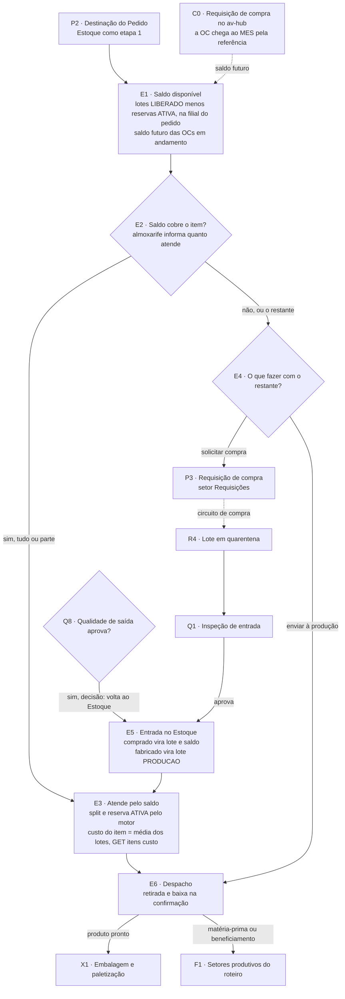

# Raia Estoque: atendimento (E1 a E4): detalhe técnico

**Em uma frase:** detalhe técnico da nota [[05-Estoque-Atendimento]]: Regras decididas; Estados; Telas; Endpoints e contratos; Como está no código; Dados; O que falta desenvolver; Pendências; Subfluxo.

**Onde estamos:** ← [[05-Estoque-Atendimento]] (resumo e índice)

## Regras decididas

As regras 9 e 11 (entrada do lote) estão em [[09-Estoque-Entrada-do-Lote]]; a regra 10 (despacho) em [[12-Estoque-Despacho]]. Arquivos do `api-pcp` salvo indicação.

| # | Regra | Selo |
|---|---|---|
| 1 | O Estoque (setor `estoque`) é a **etapa 1** de todo roteiro e o **único** Estoque do circuito (a compra volta a ele) | 📝 ✅ `src/pedidos/pedidos.service.ts:88` (`O setor Estoque fixo é sempre a ordem 0`), `src/compras/circuito-compra.ts:22` (`ESTOQUE: SETOR_ESTOQUE_FIXO_CODIGO`) |
| 2 | Saldo disponível = lotes `LIBERADO` − reservas `ATIVA`, na **filial do pedido** (DEC-1) | 📝 ✅ `src/estoque/operacao/estoque-operacao.helpers.ts:102` (`export async function reservarParaParcial`) |
| 3 | A leitura do saldo e a criação da reserva acontecem **no mesmo passo**, com o lote travado | 📝 ✅ `estoque-operacao.helpers.ts:121` (`await travarLotes(tx, idsLote);`) |
| 4 | **Saldo zero exige clique**: atender 0 é uma ação explícita | 📝 ✅ `src/itens-parciais/itens-parciais.service.ts:778` (`decide num clique`) |
| 5 | Reserva nasce `ATIVA`, **sem expiração**; libera por ação explícita (`LIBERADA`) ou quando a ordem é excluída | 📝 ✅ `prisma/models/estoque.prisma:41` (`enum StatusReserva`), `src/pedidos/pedidos.service.ts:765` (`await liberarReservas(tx`) |
| 6 | Na **Revenda** o restante **sempre** vai para compra | 📝 ✅ `itens-parciais.service.ts:1016` (`fabrica.tipo === 'REVENDA'`) |
| 7 | Na **Fabricação** o restante pode seguir o roteiro (`ROTEIRO`) ou ir à compra (`COMPRA`, matéria-prima) | 📝 🔴 a `develop` recusa `ROTEIRO` com 400 `itens-parciais.service.ts:932` (`destinoRestante === 'ROTEIRO'`); a #100 aceitou isso até o levantamento físico; ❓ OQ-49 |
| 8 | A parte atendida vai para a **primeira etapa `EXPEDICAO`** depois do Estoque; sem ela no roteiro, 409 | ✅ `itens-parciais.service.ts:1037` (`e.tipo === 'EXPEDICAO'`) |
| 12 | **Custo do item = média ponderada dos lotes** das reservas | 📝 ✅ `src/integracao-avhub/itens-custo.ts:62` (`export async function listarItensCusto(`); fabricado fora ([[Contratos-da-v2\|API-008]]) |
| 13 | **Carga inicial sem custo é recusada**; recebimento sem custo entra com `custo_pendente` e alerta "Custo a informar"; fabricado sem custo (N16-166) | 📝 N16-09, N16-181; ✅ `src/estoque/operacao/estoque-operacao.service.ts:642` (`a carga inicial não aceita lote sem custo`), `src/compras/recebimento.service.ts:1152` (`custoPendente: !custo.dados`); 🟡 BL-066 |
| 14 | Lote filho de cisão herda o custo do pai; transferência não muda o custo | 📝 ✅ `estoque-operacao.helpers.ts:648` (`copiarCustoParaFilho`) |
| 15 | Ajuste não pode comer o que está reservado; motivo obrigatório | ✅ `estoque-operacao.service.ts:1019` (`o motor não deixa o lote abaixo do reservado`) |
| 16 | Carga inicial (marco zero) nasce `LIBERADO` sem inspeção | 📝 ✅ `estoque-operacao.service.ts:667` (`statusQualidade: 'LIBERADO'`) |
| 17 | **Saldo futuro:** para OC de **estoque** aprovada, o MES mostra a parte que ainda vai chegar (saldo atual + saldo futuro, [[Glossario]]), pela referência da OC (`GET /ordens-compra/referencia`, `destino` `estoque`) | 📝 N14-20; ✅ `src/estoque/operacao/saldo-futuro.ts:68` (`export async function saldoFuturoPorProduto`) |
| 18 | OC **vinculada a pedido de venda** não entra no saldo futuro livre; o Estoque e o PCP veem que já existe OC para o pedido | 📝 N14-20 🔴 (BL-049) |
| 19 | **Motor único:** entrada, saída, saída do lote, transferência e ajuste passam por uma porta só, que trava o lote e grava saldo, movimento e custo do lote juntos | 📝 N16-184 ✅ `src/estoque/motor/motor-estoque.ts:57` (`export async function registrarEntrada`), com teste de arquitetura |
| 20 | **Travas no banco:** saldo ≥ 0, quantidades positivas, livro = saldo e reservado ≤ saldo no commit; movimento só se inclui | 📝 N16-184 ✅ `prisma/migrations/20261119150000_estoque_travas/migration.sql:103` (`CREATE TRIGGER "movimentos_estoque_imutavel"`), `:192` (`CREATE CONSTRAINT TRIGGER "saldos_estoque_livro"`); ⚠ PS-061 |
| 21 | **Idempotência:** a ação repetida com a mesma `Idempotency-Key` devolve a resposta guardada; 8 rotas exigem a chave | 📝 N16-184 ✅ `src/app.module.ts:89` (`IdempotenciaInterceptor`); `app-pcp` `lib/idempotencia.ts:6` (`CABECALHO_IDEMPOTENCIA = 'Idempotency-Key'`) |
| 22 | **Conferência do livro** (soma dos movimentos = saldo) uma vez por dia e sob pedido; divergência vira alerta | 📝 N16-184 ✅ `src/estoque/alertas/conferencia-livro.service.ts:75` (`async conferirSeDevida()`) |
| 23 | **Inventário:** endereço travado durante a contagem; recontagem cega do que diverge; acima de R$ 500 ou 2% (ou sem custo), aprova quem não contou | 📝 N16-183 ✅ `motor-estoque.ts:186` (`Endereço travado por inventário`), `src/common/constants/inventario.constants.ts:9` (`INVENTARIO_LIMITE_VALOR_PADRAO = 500`), `src/estoque/inventario/inventario.service.ts:33` (`espera aprovação de quem não contou`) |
| 24 | **Unidade e peso:** saldo na unidade do material; lote com peso real e kg por unidade; fator kg↔unidade = peso teórico do material | 📝 N16-182 ✅ `src/estoque/operacao/lote-v2.ts:24` (`export function pesoDoLote(`), `src/compras/compra-oc.ts:119` (`fator = kgPorUnidade`); 🟡 a saída não grava o peso proporcional |

## Estados

### Lote (`StatusQualidadeLote`, `OrigemLote`)

| `StatusQualidadeLote` | Conta no disponível? | Quem muda |
|---|---|---|
| `PENDENTE` | Não | Recebimento cria ([[07-Recebimento]]) |
| `LIBERADO` | **Sim** | Qualidade aprova, carga inicial ou fabricado recebido |
| `REPROVADO` | Não | Qualidade ([[08-Qualidade-Entrada]]) |
| `QUARENTENA` | Não | Reprovação parcial |

`OrigemLote` = `RECEBIMENTO`, `CARGA_INICIAL`, `PRODUCAO`. `TipoMovimentoEstoque` = `ENTRADA`, `SAIDA`, `TRANSFERENCIA`, `AJUSTE`. `OrigemCusto` = `CARGA_INICIAL`, `OC`, `MANUAL` (`prisma/models/estoque.prisma`). O status do inventário (`StatusInventario`) está em [[Modelo-Estoque-e-Custo-do-Lote]].

### Reserva (`StatusReserva`)

`ATIVA` nasce em "Atender pelo estoque" (`reservarParaParcial`); vira `CONSUMIDA` quando o Estoque confirma a retirada (saída pelo motor, [[12-Estoque-Despacho]]); a parcial atendida antes de 23/11, sem retirada, ainda consome no recebimento da Embalagem (`consumirReservasDaParcial`) ou `LIBERADA` (ordem excluída, parcial cancelada ou liberação com motivo na aba Reservas). O estorno (`estornarConsumosDaParcial`) devolve o saldo à mesma localização quando a Embalagem desfaz o recebimento ou devolve ao Estoque.

### Parcial no Estoque

Aceita agir em `CRIADO`, `EM_TRANSITO`, `RECEBIDO`, `EM_ANDAMENTO`. A parte atendida segue `EM_TRANSITO` com `atendidoPeloEstoque = true`; o restante vai ao setor `REQUISICAO` ou à próxima etapa.

## Telas

Todas em `app-pcp` `app/(protected)/estoque-operacao/`. O que foi juntado virou aba e manteve a permissão da tela antiga.

| Tela | Rota | Slug | Estado |
|---|---|---|---|
| Pendências | `/estoque-operacao/pendencias` | `pendencias` | ✅ `pendencias/page.tsx:70` (`title="Pendências"`): atender, custo a informar, inventário, mínimo, qualidade, reservas paradas, livro |
| Atender pedidos · Atendimento | `/estoque-operacao/atendimento` (aba `?aba=reservas`) | `atendimento`, `reservas` | ✅ `atendimento/page.tsx:67` (`title="Atender pedidos"`), fila própria `atendimento/FilaEstoque.tsx:62` (`export default function FilaEstoque`); `/estoque-operacao/reservas` redireciona para a aba |
| Movimentar | `/estoque-operacao/movimentar` | `movimentar` | ✅ `movimentar/page.tsx:93` (`title="Movimentar"`): transferência, ajuste e carga inicial (custo obrigatório, `saldo/EntradaLoteModal.tsx:155` (`A carga inicial exige o custo do lote`)) |
| Estoque · Saldo | `/estoque-operacao/saldo` (visões material, lote, endereço) | `saldo` | ✅ `saldo/page.tsx:233` (`title="Estoque"`); `/estoque-operacao/mapa-deposito` redireciona para a visão por endereço |
| Material | `/estoque-operacao/saldo/material/[id]` | `saldo` | ✅ `saldo/material/[id]/page.tsx:26` (`export default function MaterialPage`), com "A chegar por OC" |
| Lote | `/estoque-operacao/lotes/[id]` | `saldo` | ✅ `lotes/[id]/page.tsx:163` (`Lote ${lote.codigo}`): rastreabilidade, linha do tempo, custo, etiqueta |
| Movimentos · Movimentação | `/estoque-operacao/movimentacao` (aba Kardex em `/movimentacao/kardex`) | `movimentacao` | ✅ `movimentacao/page.tsx:172` (`title="Movimentos"`) |
| Inventário | `/estoque-operacao/inventario`, `/inventario/[id]` | `inventario`, `inventario-aprovar` | ✅ `inventario/page.tsx:78` (`title="Inventário"`) |
| Painel do Estoque | `/estoque-operacao/painel-estoque` | `painel-estoque` | ✅ `painel-estoque/page.tsx:242` (`title="Painel do Estoque"`), dados reais |

## Endpoints e contratos

Todos no `api-pcp`. As 8 rotas que exigem `Idempotency-Key`: atender (as duas), carga inicial, movimentos, liberar reserva, abrir inventário, encerrar contagem, aprovar.

| Método e rota | Permissão | Efeito | Código |
|---|---|---|---|
| `GET /estoque/saldo/disponivel-parcial/:idItemParcial` | `movimentacoes:visualizar` | Lotes `LIBERADO` com disponível, `outrasFiliais` e saldo futuro | ✅ `estoque-operacao.controller.ts:54` (`saldo/disponivel-parcial/:idItemParcial`) |
| `PATCH /itens-parciais/:id/atender-estoque`, `POST /itens-parciais/atender-estoque/lote` | `movimentacoes:editar` | Atende uma parcial ou a OP inteira | ✅ `src/itens-parciais/itens-parciais.controller.ts:186` (`@Patch(':id/atender-estoque')`), `:91` |
| `GET /estoque/saldo`, `/estoque/consulta/materiais`, `/materiais/:id`, `/lotes` | `saldo:visualizar` | Estoque nas 3 visões e o Material; custo só com `estoque-custo` | ✅ `src/estoque/consulta/consulta.service.ts:241` (`async materiais(`) |
| `GET /estoque/lotes/:id`, `/:id/historico`, `/:id/etiqueta`; `PATCH /estoque/lotes/:id/rastreabilidade` | `saldo` / `movimentacao:criar` | Lote, linha do tempo, etiqueta, peso e corrida | ✅ `src/estoque/operacao/estoque-operacao.controller.ts:118` (`@Patch('lotes/:id/rastreabilidade')`), `src/estoque/kardex/kardex.controller.ts:24` (`@Get('lotes/:id/historico')`); [[09-Estoque-Entrada-do-Lote]] |
| `POST /estoque/lotes/carga-inicial` | `movimentacao:criar` + `estoque-custo:editar` | Lote `LIBERADO` com custo obrigatório | ✅ `estoque-operacao.controller.ts:92` (`@Post('lotes/carga-inicial')`) |
| `PUT /estoque/lotes/:id/custo` | `estoque-custo:editar` | Custo à mão, com motivo e histórico; tira o `custo_pendente` | ✅ `estoque-operacao.controller.ts:106` (`@Put('lotes/:id/custo')`) |
| `GET`/`POST /estoque/movimentos`, `GET /estoque/consulta/movimentos`, `/enderecos`, `GET /estoque/kardex` | `movimentacao` | Transferência, ajuste, lista e kardex | ✅ `src/estoque/kardex/kardex.service.ts:87` (`async kardex(`) |
| `GET /estoque/reservas`, `/estoque/consulta/reservas`, `PATCH /estoque/reservas/:id/liberar` | `reservas` | Aba Reservas e liberação com motivo | ✅ `estoque-operacao.controller.ts:148` (`@Patch('reservas/:id/liberar')`) |
| `GET /estoque/pendencias` | `pendencias:visualizar` | Grupos de pendência | ✅ `src/estoque/consulta/pendencias.service.ts:54` (`async pendencias(`) |
| `/estoque/inventarios` (GET, `opcoes-abertura`, `:id`, POST, `contagens`, `itens` POST e DELETE, `encerrar-contagem`, `aprovar`, `reprovar`, `cancelar`) | `inventario`; aprovar e reprovar com `inventario-aprovar` | Ciclo do inventário | ✅ `src/estoque/inventario/inventario.controller.ts` |
| `GET /estoque/painel`, `GET /estoque/mapa` | `painel-estoque`, `mapa-deposito` | Painel e visão por endereço | ✅ `src/estoque/painel/painel.service.ts:85` (`async painel(`) |
| `GET /estoque/alertas/estoque-minimo`, `/rnc-pendentes`, `/custo-pendente`, `GET`/`POST /conferencia-livro` | `painel-estoque:visualizar` | Alertas | ✅ `src/estoque/alertas/alertas.controller.ts` |
## Como está no código

### E1 e E2: saldo disponível e decisão

✅ O modal busca `GET /estoque/saldo/disponivel-parcial/:id` e sugere lotes (primeiro os comprados para o item, depois o mais antigo). `E2` não é automático: o almoxarife informa quanto atende e de quais lotes, somando exatamente a quantidade atendida (`api-pcp` `src/estoque/operacao/estoque-operacao.helpers.ts:189`, `primeiro os comprados para este item`). Só é possível agir em setor tipo `ESTOQUE` (`src/itens-parciais/itens-parciais.service.ts:915`, `setor.tipo !== 'ESTOQUE'`).

✅ **Saldo futuro (N14-20, BL-050).** Parte `estoque` das OCs aprovadas menos o recebido (regra 17), pela referência da OC (K4, [[Integracao-AvHub-MES]]); OC em aprovação não entra (BL-028). Front: `app-pcp` `app/(protected)/movimentacoes/components/AtenderEstoqueModal.tsx:452` (`A chegar por OC de estoque:`).

### E3: atender pelo saldo (split e reserva)

✅ Numa transação: **tudo atendido** leva a própria parcial `EM_TRANSITO` à Expedição com a reserva; **parte atendida** cria uma parcial nova com `idParcialOrigem` (`api-pcp` `src/itens-parciais/itens-parciais.service.ts:1138`, `idParcialOrigem: id`), e a original segue com o restante. A soma das parciais continua igual ao total do item. A reserva valida lote `LIBERADO`, mesmo produto e filial, e disponível; o snapshot (pedido, ordem, item) sobrevive à exclusão da ordem. O custo do item segue a regra 12.

### E4: o restante

✅ `destinoRestante = COMPRA` (ou Revenda, sempre) move a parcial para o setor `REQUISICAO` `itens-parciais.service.ts:1056` (`setorDoCircuito(this.prisma, 'REQUISICAO')`), com a observação "Sem saldo no estoque: N vão para compra" (`:1158`, `Sem saldo no estoque`). O PCP abre a requisição lá ([[06-Circuito-de-Compra]], `P3`).

✅ **Enviar à produção** só existe com matéria-prima do estoque: as unidades cobertas seguem no roteiro e o restante vai para compra (`ConsumoMateriaPrima`): desde 23/11 a matéria-prima fica reservada e abre uma retirada para a Produção, que baixa na confirmação pela quantidade pedida (N16-140, N16-193): `api-pcp` `src/itens-parciais/itens-parciais.service.ts:1221` (`await reservarMateriaPrima(tx, {`). Parcial devolvida libera o que ainda estava reservado e cancela a retirada aberta; a sobra já retirada volta pela devolução da retirada. A genealogia (J4) segue sem código.

## Dados

| Tabela (todas em `public`, MES) | Papel |
|---|---|
| `depositos`, `localizacoes_estoque`, `perfil_depositos` | Depósito (de uma filial), endereço, permissão por perfil |
| `materiais` | Produto do av-hub espelhado; `peso_teorico_unitario` é o fator kg↔unidade |
| `lotes` | Status, origem, lote pai, NF, fornecedor; lote v2: `peso_real`, `kg_por_unidade`, medidas, `corrida`, `norma`, `grau`, `certificado_url`, `custo_pendente` |
| `saldos_estoque`, `movimentos_estoque` | Saldo por lote e endereço; movimento só de inclusão, com custo e `autorizado_por_id` |
| `reservas_estoque` | Lote, parcial, `quantidade`, `quantidade_consumida`, status, snapshot do pedido |
| `lote_custo`, `lote_custo_historico`, `lote_historico` | Custo 1:1, histórico do custo e histórico de peso e rastreabilidade (só inclusão) |
| `conferencias_livro_estoque`, `idempotencia_requisicoes` | Resultado da conferência do livro; respostas guardadas por chave |
| `inventarios`, `inventario_localizacoes`, `inventario_itens`, `inventario_contagens` | Inventário, endereços travados, foto do saldo e contagens por rodada |

Modelo completo e custo em [[Modelo-Estoque-e-Custo-do-Lote]] e [[Banco-MES]].

## O que falta desenvolver

O item 1 (documento de retirada) está em [[12-Estoque-Despacho]] e o item 2 (fabricado vira lote) em [[09-Estoque-Entrada-do-Lote]].

| # | O quê | Dono | Nó | Selo |
|---|---|---|---|---|
| 3 | `GET /itens/custo`: falta testar junto com o job do hub ([[Contratos-da-v2\|LOG-47]]) | Nathan, Gustavo | E3 | ✅ rota (`api-pcp` `src/integracao-avhub/integracao-avhub.controller.ts:29`, `@Get('itens/custo')`); 🔴 teste conjunto |
| 4 | Custo obrigatório (BL-066, N16-181): falta decidir o fim do lote recebido sem custo que fica em alerta | Nathan | R4 | 🟡 |
| 5 | Baixa de matéria-prima **na retirada** (N16-140), com genealogia (J2, J3, J4) | Nathan | E4, F1 | ✅ na retirada (`itens-parciais.service.ts:1221`, `reservarMateriaPrima`); 🔴 genealogia |
| 6 | Ponto de pedido preventivo (EB2 a EB5): só o alerta de mínimo (a contagem cíclica virou o inventário ✅, `api-pcp` `src/estoque/inventario/inventario.controller.ts:35`, `@Controller('estoque/inventarios')`) | Nathan | — | 🔴 |
| 7 | Transferência entre filiais (etapas 2 a 4); ver [[Transferencia-entre-Filiais]] | Nathan | E1 | 🔴 |
| 8 | Separação física (`ordem_separacao`) | Nathan | E3 | 🔴 |
| 9 | Cadastrar as telas novas em Acessos (tst e produção) e acertar o menu (PS-060) | Nathan | — | 🟡 |
| 10 | Importação de carga inicial em lote (BL-031; hoje um lote por vez) | Nathan | — | 🔴 |
| 11 | Saldo futuro no "Atender OP" (BL-090) | Nathan | E1 | 🟡 |

## Pendências

As pendências do despacho estão em [[12-Estoque-Despacho]] e as do fabricado em [[09-Estoque-Entrada-do-Lote]].

- Nathan: o setor Estoque aparece uma vez no roteiro (etapa 0); a parcial volta ao mesmo setor. Confirmar que o histórico mostra isso com clareza.

## Subfluxo

