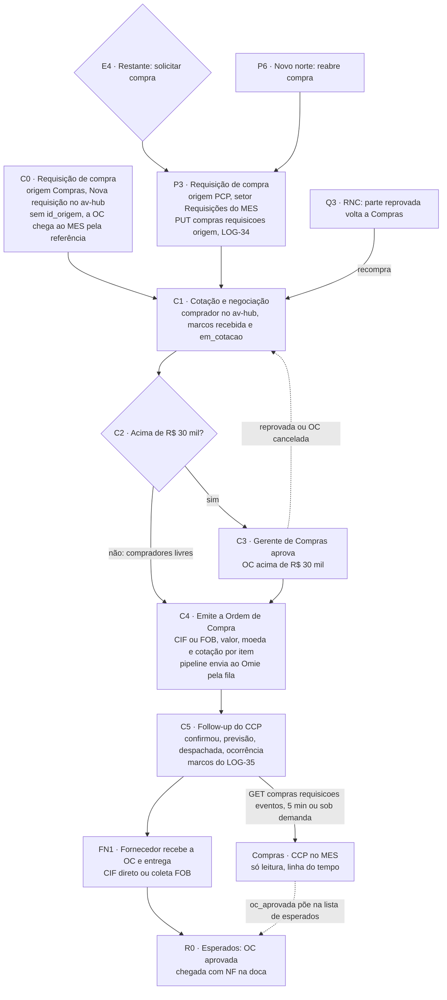

# Circuito de compra (P3, C0 a C5, FN1): detalhe técnico (2/2)

**Em uma frase:** detalhe técnico da nota [[06-Circuito-de-Compra]] (parte 2 de 2): Como está no código; C6, C7 e C8: a parte de compras do pedido da proposta; O que falta desenvolver; Pendências; Subfluxo.

**Onde estamos:** ← [[06-Circuito-de-Compra]] (resumo e índice) · partes: [[06-Circuito-de-Compra-Detalhe-Tecnico-1]] · **06-Circuito-de-Compra-Detalhe-Tecnico-2**

## Como está no código

### As duas origens da requisição

- ✅ **Origem 1, Compras (C0).** HUB: botão "Nova requisição" só com `can('pode_criar','compras')` (`ComprasRequisicoes.tsx:186`); o BFF exige `requirePermission('compras','pode_criar')` e repassa `POST {API_URL}/compras/requisicoes` com `created_by` da sessão (`app/api/compras/requisicoes/route.ts:79-95`). A API grava sem `id_origem`; o número vem do contador do banco por unidade (`requisicoes_compra.route.js:383-410`).
- ✅ **Origem 2, PCP (P3).** O almoxarife usa "Solicitar compra" em `E4` e a parcial vai ao setor `REQUISICAO` (`itens-parciais.service.ts:727-730`); o PCP abre a requisição com 1+ materiais (`compras.service.ts:135-218`), obrigatório prazo de necessidade, produto buscado no av-hub; a parcial vai `EM_TRANSITO` a Compras · CCP e o envio entra na fila **na mesma transação** (`:212`). Cada material vira uma requisição separada no av-hub (cada requisição do av-hub tem 1 material).
- 🟡 Fallback: em ordens montadas sem o setor Requisições, dá para requisitar já em Compras (`compras.service.ts:138-155`).

### Ida (LOG-34)

✅ `EnvioAvhubService` faz `PUT {API_URL}/compras/requisicoes/origem/{id_origem}`, com `id_origem` = id do `RequisicaoCompraItem`. Dispara após criar ou cancelar e a cada `AVHUB_ENVIO_INTERVALO_SEG` (60 s); espera 1, 2, 5, 10, 30 e 60 min (`envio-avhub.service.ts:21`, `:130`). Chave `AVHUB_MES_INTEGRACAO_KEY`, que só abre esse PUT (`apiKeyAuth.js:94-100`). 200/201 grava `ENVIADO` e espelha id, número e status do av-hub; 409 `REQUISICAO_COM_OC` vira `RECUSADO` (`:164-169`). Precisão: o MES guarda 4 casas e o hub 3.

### No av-hub: caixa do Compras (C1)

✅ `fn_requisicao_mes_aplicar` aplica a ida (Dump Avhub, linha 8680). A caixa lê as **duas origens** sem distinção (`GET /compras/requisicoes`). Trigger grava marcos `requisicao_recebida` (INSERT) e `em_cotacao` (`aberta → em_cotacao`) (Dump, linha 8966). Cotação e negociação com o fornecedor são **fora do sistema** 📝.

### C2 e C3: aprovação (✅ (`api-acos-vital`) código igual à decisão)

- ✅ (`api-acos-vital`) 📝 **Regra (N14-21):** OC que **excede R$ 30 mil** é aprovada pelo Gerente de Compras; OC **até R$ 30 mil** sai livre para os compradores. A Diretoria não participa.
- ✅ **Como o código faz:** a OC nasce `aguardando_aprovacao`; a trigger de recálculo **aprova automaticamente** a OC cujo total em BRL é **menor ou igual** ao limite da unidade (`parametros_compras.limite_aprovacao`, 30.000,00 por padrão) e deixa `aguardando_aprovacao` a que passa do limite; OC já aprovada que sobe acima do limite volta a `aguardando_aprovacao` (Dump, linhas 6779-6794; texto da função em `docs/ENVIAR - contrato-compras-backend.md:649-694` do HUB). O HUB avisa "Acima de {limite}, ela nasce Aguardando aprovação" (`FecharCompra/useFecharCompra.ts:488` (`precisaAprovacao(valorTotalBRL, limiteAprovacao)`), `FecharCompra/ResumoCompra.tsx:118` (`Acima de {toBRL`)). Quem aprova ou cancela uma OC aguardando é um usuário com `pode_aprovar` na tela `compras` (Gerência de Compras): `ordens_compra.route.js:1227-1237`. `condicoes_pagamento_compras.route.js:17` devolve o limite padrão 30.000,00 quando a unidade não tem linha.
- 🟡 **Regra provisória:** o Nathan precisa de algo funcional agora; a regra vai ficar mais rígida quando conversarem com o setor de Compras (por exemplo, finalidade, tipo de item ou aprovação do Gerente também abaixo do limite). Não há desenho nem data.
- 🟡 Segregação comprador ≠ aprovador: o `aprovado_por` vem do BFF (sessão), e a API só exige `pode_aprovar` na tela `compras`; **não** compara com `created_by` (`api-acos-vital` `src/schemas/core_vendas_faturamento/tables/ordens_compra/ordens_compra.route.js:1236`, `if (EXIGIR_PODE_APROVAR)`, e `:1241`, `usuarioTemPermissao(quem, "compras", "pode_aprovar")`). É o que a N16-123 decidiu. Na validação local em Docker de 10/11/2026, quem emitiu uma OC de R$ 35 mil aprovou a própria OC, como a N16-123 permite; a N16-161 confirmou em 12/11/2026 que quem emite pode aprovar. ❓ trava no banco não conferida. Evento `oc_enviada_aprovacao` só marca a mudança para `aguardando_aprovacao` (Dump, linha 6929).

### C4: emissão da OC e envio ao Omie

✅ A OC carrega fornecedor, transportadora, previsão de chegada, condição e parcelas, `tipo_frete`, `moeda` com `cotacao_moeda`/`cotacao_data`/`cotacao_origem` (PTAX), `valor_frete`, `valor_seguro`, `finalidade`, e por item: `valor_unitario`, `desconto`, `tipo_material` (acabado ou não), `id_requisicao` e `vinculos` ao pedido de venda (`ordens_compra.route.js:108-131`). Várias requisições do MES cabem numa OC (uma por item). ✅ A pipeline lê `fila-omie` e envia com `UpsertPedCompra` (`cCodIntPed` = número da OC), exclui OC cancelada que já estava no Omie com `ExcluirPedCompra`, e devolve `nCodPed` pelo `PATCH …/sincronizacao`; OC com erro **sai** da fila e só volta por "Reenviar" (`envioOrdensCompra.ts:18-40`). O evento `oc_no_omie` leva `numero_pedido_omie` ao MES.

✅ **Envio real testado:** o Nathan testou o envio da OC ao Omie em 14/10 e funciona em teste; produção ❓ (checklist de subida em [[Omie-Integracao-Estado]]). O Omie **não tem ambiente de teste**, por isso o Nathan criou cadastros **TESTE** (fornecedor, cliente e transportadora) para ninguém se confundir. 🟡 Cuidado: esses cadastros são do Omie de verdade, então a pipeline os traz para o av-hub e eles aparecem em listas, relatórios e conferências (por exemplo o CON-01). Ao emitir OC de verdade, não escolher o fornecedor nem a transportadora TESTE; ao conferir relatórios, filtrar ou ignorar esses cadastros.

### C5: follow-up do CCP

✅ (`av-hub`, `api-acos-vital`) HUB `/compras/followup` e tabelas `ordens_compra_acompanhamento`, `_contatos`, `_ocorrencias`. Marcos `fornecedor_confirmou`, `previsao_alterada`, `despachada` (data, NF do fornecedor, transportadora), `ocorrencia` (aberta ou resolvida) chegam ao MES. A ocorrência aberta espera a decisão do CCP: a rota de decidir exige `pode_aprovar` na tela `followup`, e a tela diz "aguardando decisão do CCP" (PR #284) ✅ `av-hub` `components/Compras/Followup/FollowupLista.tsx:101` (`hint="aguardando decisão do CCP"`). 🟡 Perfil exclusivo do CCP (só ele edita): o código trava pela tela `followup` ([[Contratos-da-v2|LOG-32]]); o cadastro do perfil está no item 4 de "O que falta desenvolver".

### Volta (LOG-35) e Compras · CCP

✅ Dois gatilhos: polling de 5 min e leitura sob demanda (a tela chama `POST /compras/requisicoes/sincronizar` ao abrir e no "Atualizar", `fila/compraAvhub.tsx:52-74`; rodada compartilhada, pulada se a última leitura boa tem menos de 30 s, `eventos-avhub.service.ts:31`, `:80`). Chave `API_KEY` do MES. Cada evento é gravado e aplicado numa transação; se falhar, o cursor não avança; evento que não aplica fica com `ERRO:` em `acao` (`:150-181`). O MES usa **todos os 14 marcos**; por marco: `etapaCompra`, `numeroOc`, `numeroPedidoOmie`, `previsaoChegada`, `despachadaEm`, `nfFornecedor`, `transportadora`, `ocorrenciaAberta` e o resumo da requisição (ABERTA ↔ EM_COMPRA). `requisicao_cancelada` com todos os materiais cancelados devolve a parcial a Requisições; `requisicao_reaberta` devolve a Compras · CCP. Migration 035b: `autor` e `comprador` em cada marco.

### Pontas soltas da requisição

0. 📝 **N14-28 (15/10/2026): a requisição do Compras com vínculo a pedido de venda também deve aparecer no MES, antes da OC**, e a OC vinculada vai ao MES pela referência. Proposta: leitura nova `GET /compras/requisicoes/referencia` (BL-064, Gustavo; só leitura, sem `id_origem` e sem mexer no contrato 35), lida pelo mesmo job (BL-065, Robert), com aviso de compra duplicada ao requisitar. A tela "Nova requisição" precisa do campo de pedido de venda (BL-041). O que é de estoque, uso interno ou compra por fora não entra na Torre. O trecho de N14-20 abaixo, "a requisição em si não chega ao MES", vale só para requisição sem pedido de venda. Perguntas em [[Pontas-Soltas]] PS-034.
1. 🔴 **A OC de uma requisição criada só no av-hub (C0) precisa ser lida pelo MES** (requisito de integração, N14-20). A requisição em si não chega ao MES (`id_origem` é `NOT NULL` em `requisicoes_compra_eventos`, Dump, linha 18683, então não gera marco), e isso fica assim: o MES lê a **OC**. Regra: (a) se o Compras vincula a requisição ou a OC a um pedido de venda, o PCP vê no MES que já existe OC para aquele pedido; (b) se a OC é para itens de **estoque** (sem pedido), o Estoque do MES mostra o **saldo futuro** ([[Glossario]]): saldo atual mais as OCs em andamento e a parte delas que preenche o estoque.
   - ✅ **O que o av-hub já tem:** `ordens_compra.finalidade` (`pedidos_venda`, `recompra`, `estoque`, `uso_interno`; só as duas primeiras ligam a pedido de venda, `ordens_compra.route.js:91-93`, `:571-577`; sem finalidade a OC nasce `estoque`, `:981`); a tabela `ordens_compra_itens_vinculos` (item da OC para pedido de venda, `src/schemas/core_vendas_faturamento/index.js:40` (`ordens_compra_itens_vinculos`)); a view `vw_pedido_venda_itens_compra` (vendido, pendente, em OC, saldo, `vw_pedido_venda_compras.route.js:12`, `:144`); `GET /compras/pedidos-venda/:numero` e `GET /compras/pedidos-venda/:numero/compras` (`src/schemas/core_vendas_faturamento/index.js:221` (`/compras/pedidos-venda`), `vw_pedido_venda_compras.route.js:52`); e `GET /ordens-compra/referencia`, cujo item traz `destino[]` com `pedido_venda` (com `numero_pedido_venda`) e `estoque`, somando a quantidade do item (`vw_ordens_compra_referencia_mes.swagger.json:61-88`), mais `finalidade` e `situacao` da OC (`vw_ordens_compra_referencia_mes.route.js:44-47`). Os eventos do contrato 35 não são o caminho (só existem para requisição com `id_origem`).
   - ✅ **Já feito no MES (`develop` do `api-pcp`):** o job que consome a referência (K4, `6914fe9`, 15/10; [[Contratos-da-v2|API-004]], [[Contratos-da-v2|API-007]]); o aviso de compra em andamento e o vínculo da parcial à OC ao requisitar (20/10, `c269aa7`); a entrada da mercadoria dessa OC no Recebimento, por OC e por NF (BL-051, ver [[07-Recebimento]]).
   - 🔴 **O que falta no MES:** mostrar a OC do pedido na Triagem, na Destinação e no Atendimento (BL-049); calcular e mostrar o saldo futuro no Atendimento e no Saldo (BL-050) ([[Contratos-da-v2|API-011]]). No hub, BL-028 (Gustavo) confere se a referência e uma consulta por produto e por pedido bastam.
2. 🔴 `GET /requisicoes-compra` do MES ([[Contratos-da-v2|API-003]], `integracao-avhub.controller.ts:20-24`) ficou **sem consumidor** (a ida é por PUT).
3. 🟡 O comentário "JOB DE POLLING do MES" em `requisicoes_compra.route.js:30-33` está velho.
4. ✅ **Fornecedor da OC no MES:** a referência traz o fornecedor desde a `api007b` (26/10) e o MES o projeta (`fornecedorDasOcs`, `compras.service.ts`, `develop`). O registro de 14/10 (`RequisicaoCompra.fornecedor` vazio) está superado; a conferência ainda aceita o que a doca digita.
5. 🟡 A regra de aprovação é provisória: endurece depois da conversa com Compras (item C2/C3 acima).
6. ❓ O SQL de `fn_requisicao_mes_aplicar` (migration 034) está em produção mas não versionado (Gustavo).
7. ✅ **Travas da requisição do Compras, fixas desde 05/11/2026 (`1654f65`):** o `POST /compras/requisicoes` exige `finalidade` (400 `FINALIDADE_INVALIDA`), `material` que seja produto ativo do cadastro da unidade (400 `PRODUTO_INEXISTENTE`) e, se vier pedido de venda, que ele exista na unidade (400 `PEDIDO_VENDA_INEXISTENTE`) (`api-acos-vital` `requisicoes_compra.route.js:493-514`); o `PATCH` confere o pedido novo; e o `POST /compras/ordens` liga a trava "o pedido do vínculo é da unidade da OC" (`ordens_compra.route.js:1137-1140`). Antes dependiam da chave `COMPRAS_REQUISICAO_EXIGIR_CADASTRO`, padrão desligada, que o código não lê mais (contrato [[Contratos-da-v2|API-010]], N14-30, N14-31, N14-33).
7. ✅ Recompra por RNC (LOG-58): o MES envia o aviso (`api-pcp` PR #80), a API do av-hub o recebe (`POST /integracao/mes/avisos-compra`), a tela do Compras o trata e a OC de recompra aponta o aviso (ver [[08-Qualidade-Entrada]]).
8. 🟡 Um item cancelado pelo Compras volta a Requisições com motivo, e o PCP decide: abrir outra requisição ou devolver ao Estoque (`compras.service.ts:222-227`).

## C6, C7 e C8: a parte de compras do pedido da proposta

Trechos que estavam na nota de proposta e pedido da v2 (a nota 11 da tag `v2-antes-da-v3`), movidos em 05/11/2026 para cá, a nota dona de `C6`, `C7` e `C8`. A numeração das regras e dos itens é a da nota de origem. A proposta em si está em [[01-Proposta-de-Venda]].

### Passo a passo (pedido que vem da proposta)

9. Compras recebe a requisição. O sistema puxa da proposta impostos, frete e fornecedor. Compras confere, edita e usa o valor correto na OC. A proposta não muda. `C6`, `C7`
10. Se Compras comprar por mais que o valor da proposta, o vendedor recebe um aviso em Meus Pedidos. Ele aprova ou reprova, produto por produto. `C8`

### Regras que valem

- Compras não altera a proposta. O preço fechado com o cliente não muda.
- Compra acima do valor da proposta: o vendedor aprova ou reprova, por produto, sem tolerância e sem tempo limite.
- Se ele reprova, Compras leva o caso à Gerência pessoalmente. A Gerência não cancela no sistema.
- Aviso favorável (a margem sobe) é só informativo.

### Regras decididas

| # | Regra | Selo |
|---|---|---|
| 14 | Compras confere a parte de compras da proposta (`C6`): o sistema **puxa os dados da proposta**; Compras confere os impostos, edita no hub, pode usar o fornecedor do vendedor ou outro, e usa o valor correto na OC (`C7`) | 📝 N16-08, N16-38, N16-53 |
| 15 | Compras **não altera** a proposta; o preço fechado com o cliente não muda | 📝 N16-08, N16-17 |
| 16 | **Compra acima do valor da proposta (`C8`):** o vendedor é avisado em **Meus Pedidos** e **aprova ou reprova, por produto, sem tolerância e sem tempo limite**. Aprovada, o processo continua e a margem e a comissão dele caem. **Supera** a regra antiga de que o vendedor não recebe aviso | 📝 N16-60, N16-61, N16-63, N16-64 |
| 17 | O aviso traz PV e OC, **margem atual** (do simulador), **margem considerada** (da compra real), **motivo escrito por Compras** (obrigatório), diferença de custo e fornecedor com prazo e pagamento | 📝 N16-62 |
| 18 | Aviso **favorável** (a margem sobe) é só informativo | 📝 N16-65 |
| 19 | Vendedor reprova: **Compras leva o caso à Gerência (João Vitor ou Sérgio Vital), fisicamente**, e, se preciso, fala com o vendedor. A Gerência **não cancela** no sistema e a aprovação dela **é conversa**, não botão. Compras resolve (busca valor melhor) e notifica o vendedor, que só vê a notificação e resolve fisicamente | 📝 N16-61, N16-65, N16-66, N16-67 |
| 20 | Compras tem uma **lista dos casos reprovados ainda sem solução** e um mecanismo para registrar a solução | 📝 N16-73; 🟡 o desenho |
| 30 | Compras vê a mesma tela em **leitura** (cotado do vendedor ao lado do valor da OC, em `C6`); o valor correto entra na **OC** (`C7`), não na proposta | 📝 N16-08, N16-19 |

### Pedido de aprovação do vendedor (`C8`) ✅ (`av-hub` `components/Pedidos/DivergenciasDoVendedor.tsx:76` (`Para você responder`))

Estados (N16-66, N16-73; no banco de teste desde 12/11, com `INFORMATIVA` para a compra abaixo do cotado): `PENDENTE` (na lista do vendedor, sem tempo limite), `APROVADO` (a compra segue), `REPROVADO` (em tratativa: entra na **lista de Compras**) e `RESOLVIDO` (Compras registrou a solução: novo valor, novo fornecedor, mantido ou pedido cancelado; o vendedor foi notificado). O tempo em cada estado é cronometrado.

### Telas

| Nome atual | Rota | App | Quem | Nó | Estado |
|---|---|---|---|---|---|
| **Meus Pedidos**, com o andamento da venda e **o que está aberto para o vendedor** (aprovar ou reprovar compra acima do valor) | `/meus-pedidos` | HUB | Vendedor | `C8` | ✅ `av-hub` `app/(protected)/vendas/meus-pedidos/page.tsx:9` (`topo={<DivergenciasDoVendedor />}`) |
| **Lista de casos reprovados pelo vendedor** (sem solução) | `/compras/divergencias` | HUB | Comprador | `C8` | ✅ `av-hub` `app/(protected)/compras/divergencias/page.tsx:8` (`<DivergenciasLista />`) |
| Cotado na proposta, ao lado do valor da OC (leitura, com "Usar o preço da proposta") | dentro de `/compras/nova` | HUB | Comprador | `C6`, `C7` | ✅ `av-hub` `components/Compras/FecharCompra/ItemOrdem.tsx:248` (`<CotacaoDaProposta`) |

### Endpoints

| Método e rota | Uso | Nó | Estado |
|---|---|---|---|
| `GET /meus-pedidos/divergencias`, `POST /meus-pedidos/divergencias/:id/aprovar` e `/:id/reprovar` | aviso ao vendedor e decisão dele | `C8` | ✅ `api-acos-vital` `src/schemas/core_comercial/tables/divergencias_compra/divergencias_compra.route.js:235` (`meusPedidosDivergencias.post("/:id/aprovar"`) |
| `GET /compras/divergencias`, `POST /compras/divergencias/:id/solucao` | lista de Compras e solução | `C8` | ✅ `api-acos-vital` `src/schemas/core_comercial/tables/divergencias_compra/divergencias_compra.route.js:167` (`comprasDivergencias.post("/:id/solucao"`) |
| `GET /compras/avisos-mes`, `/:id`, `PATCH /:id`; `POST /integracao/mes/avisos-compra` (só o MES) | avisos de recompra por RNC e de recebimento reaberto | `C1` | ✅ `api-acos-vital` `src/schemas/core_vendas_faturamento/tables/avisos_mes_compra/avisos_mes_compra.route.js:251` (`comprasAvisosMes.patch("/:id"`) |

### Dados

| Dado | Regra |
|---|---|
| `divergencias_compra` (pedido, produto, valor da proposta, valor da compra, motivo, estado, quem decidiu e quando, solução, tempos) | uma linha por item da OC e PV (N16-63); estados `PENDENTE`, `APROVADO`, `REPROVADO`, `RESOLVIDO` e `INFORMATIVA` ✅ no banco de teste ([[Dump-AvHub-Teste-2026-11-12]]) |

### O que falta (numeração da nota de proposta)

| # | O quê | Dono | Nó | Selo |
|---|---|---|---|---|
| 12 | **`C8`:** a margem considerada no aviso (BL-078) e o PV digitado no Omie (N16-102, segunda etapa). O resto do LOG-57 está na `develop` desde 12/11; o item 7 (`C6` e `C7`, API-019) saiu, entregue em 12/11; o imposto gravado na OC segue no BL-053 | Robert na margem; Nathan | `C8` | 🟡 |

### Pendências (numeração da nota de proposta)

| # | Pergunta | Dono |
|---|---|---|
| 6 | O e-mail de Compras ao vendedor deixa de ser necessário? (N16-64) | Nathan, Compras |
| 7 | Quem recebe o aviso quando a Gerência quer falar com Compras sobre um caso (fora do sistema) | — |

## O que falta desenvolver

| # | O quê | Dono | Nó | Selo |
|---|---|---|---|---|
| 1 | **Endurecer a regra de aprovação** depois da conversa com Compras (a regra atual já funciona); sem desenho nem data. Pendência cadastral: vincular usuários à Gerência de Compras (PS-008) | Nathan, com Compras | C2, C3 | 🟡 |
| 2 | **MES ler as OCs do hub:** a leitura e a entrada da mercadoria no Recebimento estão na `develop` (K4, BL-051). Falta a OC do pedido para o PCP (BL-049) e o saldo futuro no Estoque (BL-050); BL-028 no hub | Robert (MES), Gustavo (API) | C0, R0 | ✅ (`api-pcp`) leitura e recebimento; 🔴 BL-049 e BL-050 |
| 3 | Job do contrato 004/007 no MES (projeção da OC com fornecedor e valores, custo do lote): feito na `develop` (15 e 19/10, `6914fe9`, `97b9adc`). Falta o merge do MES para a `main` (BL-035) | Robert | C4, R4 | ✅ (`api-pcp`) `develop` |
| 4 | **Perfil CCP:** edição só pelo CCP. O código já trava pela tela `followup`; falta o cadastro: SQL pronto e testado no Docker em 12/11 (`../Perguntas-e-Respostas/perfil-CCP-followup.sql`, fora do vault), para o Gustavo aplicar no tst e na produção | Gustavo, Nathan | C5 | 🟡 |
| 5 | Remover ou arquivar `GET /requisicoes-compra` (contrato 003) e o comentário velho | Gustavo, Robert | — | 🟡 |
| 6 | **Versionar** `fn_requisicao_mes_aplicar` (migration 034) | Gustavo | P3 | ❓ |
| 7 | Contrato de **recompra por RNC** (decidido: o Compras é avisado no av-hub, N16-127) e da **reabertura do recebimento** (N16-137): LOG-58 (12/11). **Pronto em 12/11:** API, banco, tela do av-hub e envio do MES (`api-pcp` PR #80); falta o teste no tst | Nathan, Gustavo, Robert | Q3, C1 | ✅ |
| 8 | Aviso ao PCP e ao vendedor quando a previsão de chegada atrasa o pedido de venda | Nathan | C5 | 📝 decidido: a mudança de data do CCP só avisa o vendedor, em Meus Pedidos (N16-64, N16-91); a previsão de faturamento é derivada (N16-88, N16-97); o PCP vê a vigente e todas as datas (N16-104); e-mail e notificações ficam para o futuro (N16-113) |
| 9 | Dois formulários ou um para origem PCP e origem Compras (T-03): o MES exige pedido e prazo; o HUB aceita sem pedido | Nathan | P3, C0 | 🟡 |
| 10 | Teste ponta a ponta do circuito com `AVHUB_MES_INTEGRACAO_KEY` e `API_KEY` reais | Robert, Gustavo | P3, C5 | ❓ |

## Pendências

- Nathan e Compras (🟡, futuro): como endurecer a regra de aprovação (só valor, finalidade, tipo de item, aprovação abaixo do limite). O limite é por unidade (o código já tem assim).
- Nathan: segregação comprador ≠ aprovador vale se o Gerente também compra? **Decidido em 29/10/2026 (N16-123): não há trava; o Gerente de Compras pode aprovar a OC que ele mesmo emitiu.** Reaberta na OQ-52 depois da autoaprovação vista na validação local de 10/11/2026 e confirmada na N16-161 (12/11/2026): só a OC acima do limite precisa de aprovação.
- ✅ Resolvido em 12/11 (BL-086, av-hub PR #281): a "Nova ordem de compra" oferece a requisição na fila e a OC ligada a fecha. Desde 13/11 a API filtra por `numero_pedido_venda` (PR #309) e a tela usa o filtro (av-hub PR #295).
- Compras: prazo máximo de OC sem confirmação do fornecedor até destacar na fila do CCP.
- Compras: quem avisa quando uma OC é cancelada depois de aprovada e a parcial já estava esperada no Recebimento (o MES tira da lista, mas ninguém avisa a doca).
- Robert e Gustavo: o MES vê a OC de requisição do Compras só pela referência; `requisicoes_compra_eventos.id_origem` continua `NOT NULL` e não precisa mudar.

## Subfluxo

