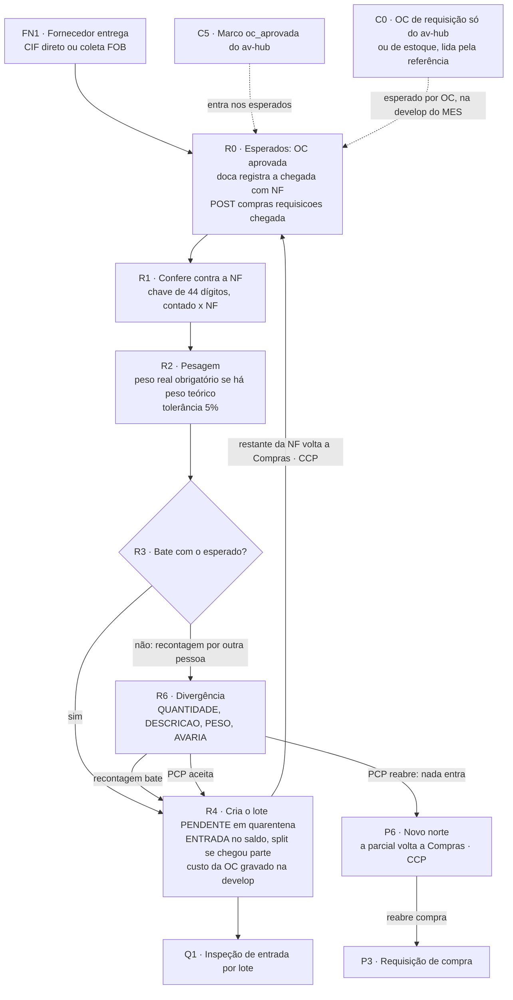

# Raia Recebimento (R0 a R6): detalhe técnico (2/2)

**Em uma frase:** detalhe técnico da nota [[07-Recebimento]] (parte 2 de 2): Como está no código; Dados; Mercadoria de OC sem requisição do MES (C0); O que falta desenvolver; Pendências; Subfluxo.

**Onde estamos:** ← [[07-Recebimento]] (resumo e índice) · partes: [[07-Recebimento-Detalhe-Tecnico-1]] · **07-Recebimento-Detalhe-Tecnico-2**

## Como está no código

### R0: esperados e chegada com NF

✅ O marco `oc_aprovada` grava `ocAprovadaEm` no item da requisição (`requisicao-avhub.eventos.ts:275-280`). `podeReceber` = `liberadaRecebimentoEm` preenchido **ou** algum item com `ocAprovadaEm` e `etapaCompra ≠ CANCELADA` (`compras.service.ts:318-326`). Os esperados saem ordenados por `previsaoEntrega` (`:346-350`). Na chegada, o service exige: requisição não cancelada, `podeReceber`, parcial do mesmo item do pedido, parcial **em Compras · CCP** e aguardando, e `pode_atuar` no setor Recebimento (`:362-382`). A parcial vai `EM_TRANSITO` ao Recebimento com a observação "Chegou a NF … aguardando a conferência" (`:386-398`). `oc_cancelada` tira dos esperados e devolve ao comprador (`requisicao-avhub.eventos.ts:300-307`).

### R1: conferência contra a NF

✅ `RecebimentoService.conferir` valida que cada item pertence à requisição e entra uma vez só, que a localização existe, e que algo foi contado (`recebimento.service.ts:148-163`). Para cada item calcula `pendente = max(quantidade − quantidadeRecebida, 0)` e avalia **contado × NF** (`:164-171`, `:373-381`). Grava `Recebimento` (`RB-AAAAMMDD-NNNN`), `RecebimentoItem` e `RecebimentoDivergencia` (`:452-504`, `:548-552`).

### R2: pesagem

✅ Peso teórico = `Material.pesoTeoricoUnitario × contado`; sem peso teórico o item não é pesado; com ele, o peso real digitado é obrigatório (400 se falta) e o desvio acima de `toleranciaPeso` vira `PESO` (`recebimento.service.ts:317-333`). Balança sem saída digital: o peso é digitado.

### R3: bate com o esperado?

✅ "Bate" = nenhuma divergência calculada nem informada. Não bate: `AGUARDANDO_RECONTAGEM`. A recontagem exige **todos** os itens (`:263-265`), mantém `DESCRICAO` e `AVARIA` já apontadas (`:275-277`) e reavalia quantidade e peso. Se ainda diverge: `AGUARDANDO_DECISAO`.

### R4: cria o lote em quarentena

✅ `ComprasService.registrarRecebimento` (`compras.service.ts:472-616`), numa transação com retry de código (`LT-AAAAMMDD-NNNN`):
1. Lote `PENDENTE`, `origem RECEBIMENTO`, `quarentenaDesde`, com `idRequisicaoItem`, NF, fornecedor (`:541-554`).
2. `SaldoEstoque` (`aplicarDeltaSaldo`) e `MovimentoEstoque` `ENTRADA` na localização (`:557-568`).
3. `quantidadeRecebida` do item incrementa; a requisição vira `RECEBIDA` (todos os itens cobertos) ou `RECEBIDA_PARCIAL` (`:569-579`).
4. A parcela que o recebimento cobre avança: na revenda, o que chegou do **produto final**, `min(parcial, produtoFinal)`; só com matéria-prima, a parcial inteira quando tudo chegou (`:508-526`). Se é a parcial toda, `moverParcial`; se é parte, `splitParaDestino` (nasce parcial nova) para o setor `QUALIDADE` com `idLoteCompra` apontando o lote (`:590-601`).
5. O restante volta a **Compras · CCP** `EM_TRANSITO`, com "falta N" (`:604-611`).

✅ **Custo da OC gravado (na `develop`, 19/10, `97b9adc`).** O lote do Recebimento nasce com `idOcItem` e com `lote_custo` de `origem = OC` (`compras.service.ts` e `recebimento.service.ts` chamam `loteCusto.create` com o custo calculado de `compra-oc.ts`). Unidade diferente da OC ou OC fora da projeção gera lote sem custo e sinalizado (D2). Registro de 14/10 (superado): não havia `loteCusto.create` no recebimento. 🔴 Falta o custo obrigatório em todo lote (BL-066, N16-09).

### R6: divergência e decisão do PCP

✅ `REABRIR`: recebimento `REABERTO`; a parcial volta ao setor Compras com "reaberto pelo PCP: motivo — volta a Compras (devolução ao fornecedor / nova compra)" (`recebimento.service.ts:341-352`). `ACEITAR`: entra a quantidade recontada (ou a contada); se nada foi contado, 400 "use Reabrir compra" (`:354-360`). 🔴 Não existe "reabrir divergência de produção" (o 0b prevê o vazio de P6) e a reabertura não avisa o av-hub: a OC segue `atendida` ([[06-Circuito-de-Compra]], ponta solta 7).

## Dados

| Tabela (`public`, MES) | Campos que importam |
|---|---|
| `requisicoes_compra` | `pedido_compra`, `fornecedor`, `previsao_entrega`, `comprado_em`, `liberada_recebimento_*`, `motivo_liberacao`, `nf_chegada`, `chave_nf_chegada`, `chegada_em` (`compras.prisma:84-104`) |
| `requisicoes_compra_itens` | `quantidade`, `quantidade_recebida`, `etapa_compra`, `numero_oc`, `oc_aprovada_em`, `previsao_chegada`, `despachada_em`, `nf_fornecedor`, `transportadora`, `ocorrencia_aberta` (`:119-164`) |
| `recebimentos` | `codigo`, `status`, `numero_nf`, `chave_acesso_nf`, `fornecedor`, `laudo_url`, `conferido_por_id`, `recontado_por_id`, `decidido_por_id`, `motivo_decisao` (`:168-210`) |
| `recebimentos_itens` | `quantidade_pendente`, `_nf`, `_contada`, `_recontada`, `peso_teorico`, `_real`, `_recontado`, `tolerancia_peso`, `id_localizacao`, `id_lote` (`:212-240`) |
| `recebimentos_divergencias` | `tipo`, `descricao`, `evidencia_url`, `etapa` (`:242-257`) |
| `lotes` | `PENDENTE`, `id_requisicao_item`, `numero_nf`, `fornecedor` ([[05-Estoque-Atendimento]]) |

Migrations: `20261006140000_recebimento_conferencia`, `20261014120000_compras_ccp`. Modelo geral em [[Banco-MES]].

## Mercadoria de OC sem requisição do MES (C0)

✅ (`api-pcp`) **Feito na `develop` do MES (16 a 20/10/2026, BL-051):** a mercadoria de OC sem requisição do MES entra pelos esperados por item de OC (`GET /compras/recebimentos/oc-esperadas`) e pela conferência por OC (`POST /compras/recebimentos/nf`, `itensOc`), com o lote ligado ao item da OC e ao custo; o uso interno vira `EntradaUsoInterno`, sem lote nem saldo (N14-30). Ver [[Contratos-da-v2|API-011]]. O texto abaixo é o registro do desenho e do estado de 14/10.

📝 N14-20: o MES passa a ler as OCs do hub. A mercadoria de uma OC criada a partir de requisição só do av-hub (ou de uma OC de estoque, sem requisição) precisa ter entrada no Estoque, mas o Recebimento do MES, em 14/10, **exigia requisição do MES**: a chegada pede requisição não cancelada, `podeReceber`, parcial do mesmo item do pedido **em Compras · CCP** e `pode_atuar` no Recebimento (`compras.service.ts:878-898`), e a conferência valida que cada item pertence à requisição (`recebimento.service.ts:148-163`). Uma OC sem `id_origem` não tem parcial nem requisição no MES, então não cai nos esperados.

Caminho necessário 🟡 (proposta; o desenho é do Robert):
1. O job do contrato 004/007 (BL-001) grava a projeção da OC aprovada; o item traz `id_requisicao` nulo ou sem `id_origem` e o `destino` (pedido de venda ou estoque) ✅ `api-acos-vital` `src/schemas/core_vendas_faturamento/views/vw_ordens_compra_referencia_mes/vw_ordens_compra_referencia_mes.swagger.json:44` (`"id_requisicao"`), `:72` (`"destino"`).
2. A OC aprovada sem requisição do MES entra nos **esperados** do Recebimento como "esperado por OC", sem parcial, com fornecedor, quantidade, previsão e destino vindos da referência.
3. A doca registra a chegada com a NF e confere contra a NF (regra de hoje, N14-04); o lote nasce `PENDENTE`, em quarentena, e segue para a Qualidade como qualquer outro.
4. O que o `destino` marca como **pedido de venda** reserva o lote para aquele pedido e avisa o PCP; o que é **estoque** vira saldo livre; o que era "saldo futuro" deixa de ser futuro e passa a saldo atual ([[05-Estoque-Atendimento]]).
5. Receber parte da OC mantém o restante como esperado (como o split de hoje).

📝 **N14-28 (15/10/2026):** o Recebimento recebe produtos para **pedido de venda, estoque e uso interno**, e tudo aparece no Estoque. **Proposta do Robert:** os esperados passam a ser **por item da OC**, com ou sem requisição do MES; o lote nasce ligado à OC (`id_item_oc`) já com o custo (K5), o que também resolve o D1 do 008; se a OC tinha destino em pedido de venda, a parcial daquele item segue o caminho normal. **Torre:** lote de estoque, uso interno ou compra por fora não gera evento de fluxo (só o item de pedido de venda). Perguntas em aberto em [[Pontas-Soltas]] PS-034 (uso interno, chave do cruzamento, rateio entre destinos, reserva).

📝 **Uso interno (N14-30, 15/10/2026):** a OC de uso interno entra nos esperados pelo mesmo caminho da OC sem requisição do MES; a doca confere contra a NF; **não cria lote nem saldo**, é registrada como entrada de uso interno, entregue ao setor que pediu e visível no Estoque como entrada registrada; fica fora do saldo futuro (o MES separa pela `finalidade` da OC, pois o `destino` vem como estoque); o custo vai para despesa; sem quarentena, salvo categoria que o Nathan pedir (EPI). Estimativa do Robert: 0,5 pd.

Pontos a decidir pelo Robert: se o "esperado por OC" é entidade própria ou uma requisição sintética criada pelo job; como evitar entrada duplicada (a mesma OC com requisição do MES e a referência); e a quantidade já recebida por OC, necessária também ao cálculo do saldo futuro (BL-050).

## O que falta desenvolver

| # | O quê | Dono | Nó | Selo |
|---|---|---|---|---|
| 1 | Gravar o custo da OC no lote (`lote_custo`, `origem OC`, `id_item_oc`): feito na `develop` (19/10). Falta o custo obrigatório em todo lote (BL-066) | Robert | R4 | ✅ (`api-pcp`) gravação; 🔴 obrigatório |
| 2 | **Cruzar a conferência com a OC** (quantidade comprada, preço, fornecedor, N16-135): a referência da OC já chega ao MES (K4), mas a divergência contra a OC não existe; hoje só NF | Robert | R1, R3 | 🔴 |
| 3 | Caminho de entrada da mercadoria de OC sem requisição do MES (BL-051): feito na `develop` (16 a 20/10). Falta o rateio da chegada entre destinos da OC e o teste em homologação (API-011); ver "Mercadoria de OC sem requisição do MES" abaixo | Robert | R0 | ✅ (`api-pcp`) entrada; 🔴 rateio |
| 4 | Reabertura de divergência de produção e o `P6` novo norte | Robert | R6, P6 | 🔴 |
| 5 | Leitor de código de barras da chave da NF e posto de recebimento (impressora, leitor) | Robert | R1 | 🔴 |
| 6 | Avisar o av-hub quando o PCP **reabre** o recebimento (devolução ao fornecedor, nova compra) | Nathan, Gustavo, Robert | R6 | 🔴 |
| 7 | Aviso à doca quando uma OC esperada é cancelada no av-hub | Robert | R0 | 🟡 |
| 8 | Teste ponta a ponta de "Receber com NF" e da lista de esperados com OC real | Robert | R0 | ❓ |
| 9 | Alerta de OC esperada que passou da previsão sem chegar | Compras, Robert | R0 | 🔴 |

## Pendências

- Nathan: tolerância de peso de 5% vale para toda categoria (decisão provisória do v1), ou por material? O código guarda por material (`toleranciaPeso`, padrão 0,05). **Decidido em 29/10/2026 (N16-134): 5% por padrão, ajustável por material.**
- Nathan: quando existir o cruzamento com a OC, a divergência de quantidade contra a OC bloqueia (como a da NF) ou só avisa? **Decidido em 29/10/2026 (N16-135): bloqueia.**
- Robert: conferência de NF com **várias OCs** ou várias requisições na mesma nota. **Decidido em 29/10/2026 (N16-136): uma nota pode trazer várias OCs, conferidas por item da OC.** Na `develop` do MES já existe (`POST /compras/recebimentos/nf`, `conferencias[]`).
- Robert: na conferência por OC, o fornecedor digitado vale e, sem ele, fica o da OC (`oc.nomeFornecedor`, `api007b`); confirmar que os dois não conflitam.

## Subfluxo

Próxima raia: [[08-Qualidade-Entrada]].
