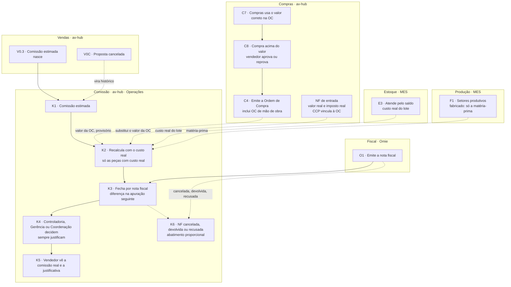

# Custo real e comissão no fluxo (K1 a K6): detalhe técnico (2/2)

**Em uma frase:** detalhe técnico da nota [[15-Custo-Real-e-Comissao]] (parte 2 de 2): A tela da comissão: três visões da mesma tela (N16-19); Casos de borda do custo real; Estados da comissão; Quem vê o quê; Estado no código e o que falta; Diagrama do subfluxo.

**Onde estamos:** ← [[15-Custo-Real-e-Comissao]] (resumo e índice) · partes: [[15-Custo-Real-e-Comissao-Detalhe-Tecnico-1]] · **15-Custo-Real-e-Comissao-Detalhe-Tecnico-2**

## A tela da comissão: três visões da mesma tela (N16-19)

A tela da proposta é **semelhante à do Simulador de Comissão** que o Nathan mandou em 16/10 (`09-Diagramas/fontes/tela-simulador-comissao.png`; código em `av-hub/app/(protected)/comissoes/simulador/page.tsx`). Mesmo motor e mesmas regras, em **tabelas novas** (N16-21). A Controladoria tem a mesma tela com a verdade na tabela: o custo real e afins.

### Blocos da tela e o que cada visão mostra

| Bloco do Simulador (imagem) | (a) Vendedor, na proposta (`V0.2`, `V0.3`) | (b) Compras (`C6`, `C7`, `C8`) | (c) Controladoria (`K4`) |
|---|---|---|---|
| **Pedido:** Unidade, Número do pedido (busca pelo número exato), Cliente, Vendedor, Itens | Unidade, **número da proposta** (automático, só dígitos, sem busca), cliente, vendedor, itens | Pedido, proposta ligada, requisição do PCP | NF, pedido, proposta, vendedor, cliente |
| **Condições comerciais**, com "Parâmetros: Maio/23": estado de destino e ICMS, condição de pagamento e encargo, "Com impostos", frete na compra, valor ST, imposto retido ou DIFAL, frete na venda | Preenche. Os parâmetros vigentes são gravados com o cálculo (`id_parametros`, [[03-Modelo-Novo-core_comissao]]) | Lê as da proposta (só leitura) | As da venda (um conjunto por pedido) e, no drill-down, **as de cada evento de custo** (N16-20) |
| **Itens:** "Compra: você preenche", "Resultado: o sistema calcula"; colunas COMPRA, VENDA, RESULTADO | Preenche a compra (custo cotado) e a venda; vê custo líquido, sugerido, margem e letra | Vê o **cotado do vendedor** ao lado do **valor da OC** e do fornecedor; edita os campos de imposto da OC; **não altera a proposta** (N16-08) | **Estimado × real, lado a lado**: custo líquido real, margem real, letra real, comissão real, por item e por evento |
| **Chip** "Comissão: após a aprovação de Compras" | Não aparece. O vendedor vê a comissão estimada que ele colocou; a real só depois da decisão | **O passo de Compras aprovar o percentual fica desligado** (provisório; o valor estimado por Compras vem do Omie, sem digitação; N16-51) | Substituído pela decisão |
| **Rodapé:** custo, venda, total da NF, sugerido, mark-up real, mark-up s/ compra, margem e letra | Estimados | Estimados e reais | Estimados e reais, com a queda por custo |
| **Botões:** Recomeçar, Salvar rascunho, Enviar | Salvar a proposta; "Enviar" vira marcar aprovada e transformar em pedido (`V0.4` a `V0.6`) | Registrar a OC e tratar a lista dos casos reprovados | **Aprovar, desaprovar, bloquear, desbloquear, cortar ou alterar**, sempre com justificativa |

### O passo "aprovação de Compras" do motor atual

Hoje (✅ `api-acos-vital` `src/schemas/core_comissionamento/tables/simulacoes/simulacoes.route.js:34` (`const TRANSICOES = {`); `av-hub` `components/Comissoes/Simulador/useSimuladorComissao.ts:858` (`const aprovarCompras = async`)): o vendedor envia o simulador; Compras abre e, se o custo está errado, cria uma segunda versão (origem `COMPRAS`) com o custo correto, ou devolve; o pedido inteiro é pago pela versão de menor comissão, a do vendedor ou a de Compras (N16-190; [[01-Motor-Atual-Como-Calcula]], R5 e R6).

No fluxo novo (N16-51, OQ-28 em parte): o **percentual de Compras** deixa de ser uma digitação e passa a ser o cálculo `REAL`, gerado a cada evento de custo (`K2`); o passo "Compras aprova o percentual" **sai do fluxo e fica pronto no sistema, desligado**, até Compras validar. O percentual final continua sendo o **menor** entre os dois; no desenho do módulo novo, ainda por item (o motor atual compara a versão inteira do pedido, N16-190).

### Telas e menu que a imagem mostra

| Item do menu na imagem | O que é hoje | Alinhamento 🟡 |
|---|---|---|
| Comissões › Simulador, Análise de Simuladores, Minhas Comissões, Visão Geral, Parâmetros, Bloqueio de Comissões | Módulo atual (`app/(protected)/comissoes/*`), **não muda** (N16-11) | O módulo novo fica em Operações |
| Operações › "Custo real por item" | `app/(protected)/orcamento/custo-itens/page.tsx` (`CustoItens`; a rota antiga `custo-itens` foi para o menu Orçamento em 27/10): custo real por pedido, KPIs, lotes e simulador de margem **sem imposto** (BL-023, `544ee0b`; [[Contratos-da-v2\|LOG-47]]). Lê o custo real de `GET /itens_pedido_custo`; os dados de exemplo só entram com `CUSTO_ITENS_FIXTURES=on` ou, fora de produção, quando a API falha (`av-hub` `lib/api/custoItensFixtures.ts:19`, `NODE_ENV === 'production' ? 'off' : 'fallback'`). O problema é acesso e filial (BL-088): a rota passa pelo escopo de vendedor (`api-acos-vital` `src/middlewares/escopoVendedor.js:89`, `itens_pedido_custo:`), e só o perfil com escopo `todos` escapa (`:182`); a API exige `codigo_empresa` em UUID (`src/schemas/core_vendas_faturamento/tables/itens_pedido_custo/itens_pedido_custo.route.js:91`, `codigo_empresa é obrigatório e deve ser um uuid`), mas a tela chama o campo de "Filial (opcional)" e pede o UUID digitado (`av-hub` `components/CustoItens/CustoItens.tsx:227`, `placeholder="Filial (opcional)"`). Na validação local em Docker de 10/11/2026, só o perfil de testes tinha a tela e até ele recebeu 403 `PEDIDO_FORA_DO_ESCOPO` no pedido de outro vendedor (dado do tst) | Pode ser a entrada do drill-down por evento da Controladoria; precisa ligar ao custo por evento e ao imposto, e resolver quem vê e com qual escopo (OQ-51) | Pode ser a entrada do drill-down por evento da Controladoria; precisa ligar ao custo por evento e ao imposto |
| Dashboards › "Matriz de preços" | O BFF cita o slug `matriz-precos`; a tela ainda não existe | É a matriz de preços do Orçamento ([[02-Orcamento-Base-de-Preco]]) |

Os contratos com o detalhe das telas e das regras foram removidos em 29/10/2026; o Robert cria os novos.

### Relatórios da Controladoria (N16-50)

A lista por mês, vendedor, unidade e status (com exportação para Excel), mais: (1) **markup real** (Venda ÷ Custo − 1) de todos os pedidos, por vendedor, com consolidado; (2) **Faturamento × Compras por pedido**, com markup real, percentual de comissão e valor a pagar. Nos dois, separar **Revenda, Industrializado e Projeto** e sinalizar **recompra no mesmo pedido**. O **valor retido** das comissões bloqueadas aparece no resumo mensal, separado do valor a pagar. ❓ Projeto e recompra aguardam a OQ-44.

## Casos de borda do custo real

| Caso | O que acontece |
|---|---|
| OC cancelada antes de receber | A linha de custo dela é estornada; o item volta a parcial |
| NF de entrada diferente da OC (peso da balança) | O valor da NF substitui o da OC (N16-40) |
| Item sem nenhuma linha quando a NF de saída sai | `K3` fecha só as peças com custo real; o resto espera (N16-48); a Controladoria vê "custo parcial" |
| Unidade de medida diferente entre proposta, OC e lote (KG × PC) | **Sem conversão no sistema** (Compras); o CCP liga a NF de entrada à OC (N16-86, que corrige a N16-57); linha marcada "unidade diferente" |
| Pedido digitado no Omie | O `K1` nasce quando o vendedor preenche a parte de compras do pedido (a simulação, N16-104, N16-106); a nota que sair antes **espera**, e a Controladoria já vê a margem real (N16-105); com as duas, fecha pelo menor |
| Proposta ou pedido **cancelado** | A estimada vira histórico. O que já foi comprado vai ao **Estoque, livre**, como lote com o custo da OC, e **deixa de ser custo** do pedido cancelado (N16-68, N16-69) |
| Pedido **faturado** e depois cancelado | O cancelamento não desfaz compra nem produção; fica o abatimento da comissão (`K6`) e o saldo não faturado, parte por parte (N16-71) |
| Devolução de **venda** | Total vem do Omie; parcial só chega marcada e o Fiscal ou a Controladoria informam item, quantidade e valor (N16-74) |
| Devolução de **compra** (NF de entrada devolvida ao fornecedor) | ❓ Como aparece no Omie e o efeito na linha de custo: adiado (OQ-42) |
| Pedido manual (`MAN-`) | Nunca entra no custo (D6 do 008, [[Contratos-da-v2\|LOG-45]]) |

## Estados da comissão

Os estados são os do banco (testado), resumidos em [[04-Regras-e-Estados-da-Comissao-Nova]]. Por nó do fluxo:

| Nó | Dossiê da proposta ou do pedido (`comissoes`) | Comissão da nota (`comissoes_nf`) e lançamentos |
|---|---|---|
| `K1` | `ESTIMADA` (salva e revisada); `CONGELADA` quando a proposta é aprovada | — |
| `K2` | `EM_ACOMPANHAMENTO` (o pedido existe e o custo real chega) | — |
| `K3` | `EM_ACOMPANHAMENTO` | `AGUARDANDO_DECISAO` (a nota fechou, já calculada); lançamento `COMPLEMENTO` ou `DESCONTO` quando o custo completa depois |
| `K4` | — | `APROVADA`, `DESAPROVADA` (R$ 0, visível), `CORTADA`, `ALTERADA` ou `BLOQUEADA` (desbloquear devolve à fila, com justificativa) |
| `K6` | — | `NF_CANCELADA` (nota cancelada inteira antes da decisão); lançamento `ABATIMENTO`; devolução parcial em `comissao_devolucao_pendencia` (`ABERTA` → `INFORMADA` ou `DISPENSADA`) |
| `V0C` | `CANCELADA` (vira histórico, com motivo; só sem nota faturada) | — |
| fim | `ENCERRADA` (tudo faturado e decidido) | — |

A decisão tem seis ações (`aprovar`, `desaprovar`, `bloquear`, `desbloquear`, `cortar`, `alterar`), sempre com justificativa.

## Quem vê o quê

| Dado | Vendedor | Gerência e Coordenação | Compras | Controladoria |
|---|---|---|---|---|
| Comissão estimada | a que ele pôs | 🟡 OQ-21 | não | sim |
| Custo real e diferença cotado × real | **não** | 🟡 | custo da OC | sim (❓ OQ-51: hoje nenhum perfil de negócio do tst tem a tela, BL-088) |
| Valor da compra de um produto dele, em aprovação (`C8`) | **sim** | não | sim | sim |
| Comissão real e justificativa | só depois da decisão | decidem | não | sim |
| Complementos, descontos e abatimentos | os dele, com o motivo, depois de decididos | decidem | não | sim |
| Visão geral e relatórios | não | 🟡 | não | sim |
| Pendência de devolução parcial | não | não | não | sim (com o Fiscal) |

## Estado no código e o que falta

| Item | Estado | Selo |
|---|---|---|
| Motor atual (letra pelo pedido, predominância, versão pré-aceita de menor comissão, regras fixas, bloqueios, blacklists, competência) | existe em `core_comissionamento` e no front, só leitura aqui ([[01-Motor-Atual-Como-Calcula]]) | ✅ código (`av-hub` `lib/simulador/motor.ts:475`, `Comissão por PEDIDO`); ✅ banco no tst de 23/11; ❓ produção (PS-062) |
| Módulo novo em `core_comissao`, em Operações | rascunhado e **testado num Postgres 18 em 19/10**; sem API nem tela; o schema não está no banco de teste (tst) de 10/11/2026, que só tem o `core_comissionamento` (validação local em Docker de 10/11/2026) | 🔴 Gustavo (banco), Nathan (telas) |
| Comissão estimada na proposta (`K1`) | não existe; o simulador do Hub só pré-preenche o lado da compra | 🔴 |
| Custo real por evento, com a NF de entrada como verdade (`K2`) | não existe | 🔴 Robert, Gustavo |
| Recurso novo da pipeline: recebimento de NF-e (imposto real, data de recebimento) | não existe | 🔴 Nathan ([[Estudo-Omie-API]]) |
| Custo obrigatório em todo lote e `GET /itens/custo` | `GET /itens/custo` e o custo da OC no lote existem na `develop` do MES (27/10 e 19/10); a carga inicial já exige custo e o recebimento sem custo fica em alerta (N16-181); falta o fim do lote sem custo (BL-066) | ✅ (`api-pcp` `src/integracao-avhub/integracao-avhub.controller.ts:29`, `@Get('itens/custo')`) rota; 🟡 obrigatório, Nathan (OQ-07) |
| Tela da Controladoria igual à do Simulador, com custo real, e visão geral (`K4`, N16-19) | a Visão Geral do módulo atual agrupa por pedido, lê pela competência, filtra o pedido misto e mostra a margem do item; a tela do módulo novo, com custo real e decisão, não existe | 🟡 visão geral; 🔴 tela da Controladoria, Nathan |
| Aprovação do vendedor na compra acima do valor, lista de Compras e cancelamento | a aprovação existe em Meus Pedidos (LOG-57, [[15-Custo-Real-e-Comissao]]); o uso na comissão real depende do BL-078 | ✅ aprovação (`av-hub` `components/Pedidos/DivergenciasDoVendedor.tsx:76`, `Para você responder`); 🔴 uso na comissão |
| Abatimento por devolução, pendência de devolução parcial e apuração do vendedor | o abatimento está no modelo; a pendência de devolução parcial e a apuração (OQ-42) **não** | 🔴 |
| Tela da proposta no formato do Simulador | não existe; o Simulador atual calcula no navegador | 🔴 Robert (tela de proposta), Nathan (`K1`) |

## Diagrama do subfluxo

