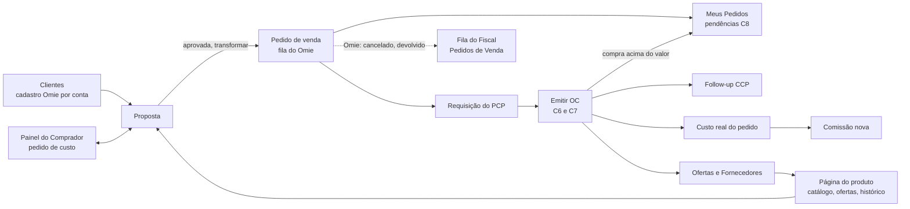

# Telas de Vendas, Orçamento e Compras no modelo novo

## Em uma frase

Esta nota mostra o que cada tela de Vendas, Orçamento e Compras faz hoje, como elas se ligam, onde se repetem e como deve ficar a nova página de proposta.

## Como usar esta nota

- Ache o setor no **Mapa rápido** e vá à seção 1. Desconectado: seção 2. Repetido: seção 3. Faltam: seção 4. Proposta: seção 5. Menu: seção 6.
- Colunas, filtros e o texto completo estão em "Detalhe técnico".

Substitui a versão de 23/10: **todas as páginas foram lidas**. Marcado ❓ o que não foi lido por dentro: botões no servidor, Cadastros, PCP e Meus Pedidos.

Selos: ✅ existe e foi lido · 🔴 não existe · 🟡 proposta · ❓ não conferido.

> [!info] Situação do front em 29/10/2026
> A leitura das 47 páginas é de 23/10. Conferido em 29/10 na `develop` do `av-hub` (`758d5f0`, `app/(protected)`), já mudou:
> - O menu enxuto (N16-107 e N16-108) está no código desde 27/10 (`a1493a8`, `d5fa9a6`): o Portal do Vendedor foi para dentro de Vendas; Orçamento tem Pedidos de custo, Produtos, Fornecedores e Parâmetros, com as telas antigas em abas, mais Custo por item.
> - A tela Clientes passou a ser o Acompanhamento de Clientes (N16-112, `1a48140`). Não há mais Relatório de Cotações como página; sobra o Relatório Gerencial.
> - O Histórico de compras saiu (N16-108); não há mais `/compras/historico-compras`.
> - O "Pedido no Omie" digitado à mão, o fechamento parcial e a perda saíram do front em 28/10 (`2008344`); a proposta foi refeita em 27 e 29/10 (grade de itens, condições no layout do Simulador, abas e análise de margem; `37c9cf2`, `88fbafe`).
> - Aprovar, cancelar e transformar em pedido já existem na API (`api-acos-vital`, 29/10), mas o BFF e a tela ainda não os usam.
> - Os nomes dos itens do menu moram no banco (`telas`): não conferi se "Aprovar OC" e "Reprovados" já foram criados ❓.
> - As linhas das tabelas abaixo são o registro da leitura de 23/10; onde isto muda o texto, a linha diz.

## Mapa rápido por setor

| Setor | Telas | Situação |
|---|---|---|
| Vendas | Propostas, Clientes, Relatórios, Pedidos de Venda do Omie: criar e acompanhar propostas | ✅ 🔴 |
| Orçamento | Painel do Comprador, Ofertas, Fornecedores, Catálogo, Parâmetros: manter o preço de compra | ✅ 🔴 |
| Compras | Requisições, Emitir OC, Ordens, Aprovações, Follow-up: da requisição à OC | ✅ 🔴 |
| Painéis | PCP, Dashboard de Vendas, Meus Pedidos: carteira do vendedor | ❓ |
| Faltam | Aprovar, transformar em pedido, pendências, fila do Fiscal, comissões (seção 4) | 🔴 |
| Proposta nova | Cinco blocos e um botão por estado (seção 5) | 🟡 |

## 1. O que cada tela faz hoje

### 1.1 Vendas

| Tela | Para que serve | Quem usa | Situação |
|---|---|---|---|
| Propostas, lista | Resumo e filtros; abre a nova proposta | Vendedor, gerente | ✅ Muda: estados e rótulos (seção 4); já lê a API do Hub |
| Proposta, formulário | Emissão, cliente, itens, condições, margem | Vendedor | 🟡 Reescrita em andamento (27 e 29/10, seção 5) |
| Proposta, "Pedido no Omie" | Dados para digitar no Omie à mão | Vendedor | ✅ **Saiu** do front em 28/10 (`2008344`): o pedido vai por API |
| Clientes, lista | Cards, propostas de 90 dias, contatos atrasados | Vendedor | ✅ Virou o Acompanhamento de Clientes (`/vendas/acompanhamento-clientes`, N16-112) |
| Cliente, ficha | Dados, compradores, estatísticas | Vendedor | ✅ Mantém na ficha do Acompanhamento; "Total fechado" e "Conversão" contam **propostas aprovadas** |
| Relatório de Cotações | Totais e conversão, com Excel | Gerência | Não existe mais como página na `develop` (conferido em 29/10) ❓ decisão de manter ou não |
| Relatório Gerencial | Resumo por responsável, empresa, unidade | Gerência | ✅ Mantém; "Perdidas" vira **Canceladas** |
| Pedidos de Venda (inativa no menu, N16-33) | Pedidos sincronizados do Omie | Vendedor; Fiscal (futuro) | ✅ Continua inativa, mas **valiosa**: base da fila do Fiscal (seção 4) |
| Notas Fiscais de Saída (inativa) | Notas de saída | — | ✅ Continua inativa |

### 1.2 Orçamento

| Tela | Para que serve | Quem usa | Situação |
|---|---|---|---|
| Painel do Comprador | Fila de pedidos de custo | Comprador | ✅ Mantém, agora em **Pedidos de custo** com o Pedido de cotação em aba; **tira "Vencem hoje" e "Atrasadas"** (N16-58), fica o tempo cronometrado |
| Responder solicitação | Escolhe a oferta vigente que vira o custo | Comprador | ✅ Mantém |
| Pedido de cotação | E-mail por fornecedor da categoria | Comprador | ✅ Mantém |
| Ofertas de fornecedor | Lança, importa, invalida e exporta ofertas | Orçamento | ✅ Mantém; ofertas das OCs entram sozinhas |
| Fornecedores, lista e ficha | Perfil de compras e ofertas | Orçamento | ✅ Mantém |
| Catálogo de produtos, lista e ficha | Produtos, preços, média de 90 dias | Orçamento | ✅ Vira a **página do produto** (`B2`) |
| Pesquisa de materiais | Menor custo e fornecedor vencedor | Orçamento | ✅ Mantém; **repete** parte do catálogo (seção 3) |
| Parâmetros de custo | ICMS, validade, janela do histórico | Orçamento | ✅ Mantém |
| Tabela da telha | Custo por classe e espessura | Orçamento | ✅ Mantém |
| Custo por item (`custo-itens`) | Itens, lotes e custo médio do pedido | Orçamento | ✅ Vira "Custo real do pedido"; o aviso de exemplo sai com dado real |
| Simulador de Orçamento | Custo, preço e margem sem pedido; **não grava** | Vendedor | ✅ Existe; **repete** a análise da proposta (seção 3) |
| Sincronização Omie | Só roda pelo botão | TI | ✅ Existe na `develop`; ferramenta de TI ❓ |
| Guia do fluxo do custo | Páginas "Para que serve" | Todos | 🔴 Descrevem o fluxo **antigo**; reescrever |

### 1.3 Compras

| Tela | Para que serve | Quem usa | Situação |
|---|---|---|---|
| Dashboard de compras | Fila, valor comprado, atrasos | Compras | ✅ Mantém |
| Requisições (lista e kanban) | Requisições do PCP ou manuais | Comprador | ✅ Mantém e **ganha a tarja de pedido cancelado** |
| Nova requisição | "Pedido de compra interno" | Comprador | ✅ Mantém; o pedido de venda vem do hub |
| Emitir OC | Monta a OC | Comprador | 🔴 **Sem imposto por item e sem a proposta**: precisa de `C6` e `C7` |
| Pedidos de venda da OC | "Para que é esta compra" | Comprador | ✅ Mantém. 🟡 Com a proposta, a ligação PV ↔ item deixa de ser digitada |
| Ordens (lista, kanban, detalhe) | OCs por status e origem | Comprador | ✅ Mantém; o detalhe ganha "compra acima do valor" (`C8`) |
| Aprovações | OCs acima do limite da unidade | Aprovador | ✅ Mantém. ⚠️ **Nome igual a outra coisa**: não é a aprovação do vendedor (`C8`) |
| Follow-up (CCP) | Acompanha as OCs aprovadas | CCP (PCP) | ✅ Mantém. 📝 **CCP é parte do PCP** (N14-24) |
| Pedido Omie (detalhe) | Pedido feito direto no Omie, só leitura | Comprador | ✅ Mantém |
| Histórico de compras | Compras por conta, período, produto | Comprador | **Saiu** (N16-108): a tela Ordens de compra mostra o histórico, com filtro por produto |
| Compradores | Liga comprador do Omie ao funcionário | Administrador | ✅ Mantém (Cadastros/Acessos) |

### 1.4 Painéis que a proposta deve respeitar

O **Painel PCP**, o **Dashboard de Vendas**, **Meus Pedidos** e **Pedidos da Equipe** mostram a carteira e o "Em avanço"; a proposta deve respeitá-los. ❓ Lidos só pelo nome dos componentes (texto completo em "Detalhe técnico").

## 2. Como as telas se conectam

**Ainda falta ligar** 🔴 (o que já está ligado fica em "Detalhe técnico"):

| Ligação | O que acontece hoje |
|---|---|
| Proposta → Pedido por API | O vendedor digita no Omie e volta para anotar o número. |
| Proposta → Emitir OC (`C6`) | Compras refaz o que o vendedor informou. A OC **não conhece a proposta**. |
| OC → imposto por item | O hub não guarda IPI, ICMS nem ST. |
| OC → custo real → comissão | Não existe. |
| Compra acima do valor → Meus Pedidos (`C8`) | O vendedor não sabe que a margem caiu. |
| Pedido cancelado → requisição, OC, PCP (tarja) | Cada setor descobre sozinho. |
| Pedido do Omie (`devolvido parcial`) → fila do Fiscal | A informação existe na tela inativa e ninguém é avisado. |
| Cliente → cadastro por conta Omie | O erro só aparece ao transformar em pedido. |
| Proposta ↔ Página do produto | O vendedor sai da proposta para consultar preço. |

## 3. Repetições e confusões, com a decisão proposta

| # | Onde | Decisão proposta 🟡 |
|---|---|---|
| 1 | Margem em três lugares | Um só cálculo, na API; a proposta é a casa |
| 2 | Preço do produto em quatro telas | Uma **página do produto** com abas |
| 3 | Duas condições de pagamento | **Um só campo**, com a lista da conta Omie ([[Mapa-IncluirPedido-Omie]] §5.1) |
| 4 | Estado de destino × UF do cliente | O destino vem do cliente ou da entrega; editar exige motivo |
| 5 | ICMS, IPI e ST digitados × Omie | ✅ **Decidido (N16-95):** o vendedor digita e o valor segue para o pedido |
| 6 | Revenda × Fabricação interna | Mantém, com texto de ajuda sobre a comissão **estimada** (N16-78) |
| 7 | **Dois "Aprovações"** em Compras | **"Aprovar OC"** (Compras) e **"Pendências"** (Meus Pedidos, `C8`) |
| 8 | "Custo" com três sentidos | **Custo cotado**, **Custo da oferta** e **Custo real** |
| 9 | Painel do Comprador com SLA | Tira "Vencem hoje" e "Atrasadas" (N16-58) |
| 10 | Relatórios com "Fechadas/Perdidas" | **Aprovadas/Canceladas** |
| 11, 12 | Guias do fluxo do custo; Sincronização Omie no menu | Reescrever os guias depois do fluxo novo; Sincronização só para TI ❓ |
| 13 | Unidades Mogi, Uberaba e Arujá | ✅ **Resolvido (N16-79):** três contas Omie, um só sistema |

## 4. Telas que faltam, com dono do dado

| Tela | Onde fica | Quem usa | Nó |
|---|---|---|---|
| Aprovar proposta | Dentro da proposta | Vendedor | `V0.5` |
| Transformar em pedido | Dentro da proposta | Vendedor | `V0.6` |
| Estado do pedido no Omie | Proposta e Meus Pedidos | Vendedor | `V0.7` |
| Página do produto | Orçamento e proposta | Vendedor, Orçamento, Compras | `B2` |
| Emitir OC com dados da proposta e imposto por item | Compras | Comprador | `C6`, `C7` |
| Pendências (compra acima do valor) | Meus Pedidos | Vendedor | `C8` |
| Reprovados sem solução | Compras | Comprador | `C8` |
| Tarja de pedido cancelado | Requisição, OC, PCP | Todos | `V0C` |
| **Fila do Fiscal** | Cadastros ou Fiscal | Fiscal, Controladoria | `K6` |
| Comissões novas | Comissões (novas) | Vendedor, Controladoria, Gerência, Fiscal | `K1` a `K6` |
| Configuração por conta Omie | Administração | TI | `V0.7` |
| **Calendário** (N16-104) | Cadastros | Marketing | datas |
| **Histórico de datas do pedido** (N16-104) | Meus Pedidos e Carteira do PCP | Vendedor, PCP | datas |
| **Pedido do Omie na tela do pedido** (N16-106) | Meus Pedidos | Vendedor | `V1`, `K1` |

## 5. A página de proposta

A tela de hoje é pesada (ordem confusa, item com cerca de 25 campos, botões do modelo antigo). O desenho novo 🟡 tem **uma ação principal por estado**, cinco blocos (quem e para quem, o que se vende, condições, custo de compra, resultado) e um resumo fixo com pendências clicáveis e o botão do estado: `Salvar`, `Marcar como aprovada`, `Transformar em pedido` (pede previsão de faturamento, Qualidade e faturar em partes; N16-88, N16-89). Pedido em partes ganha o bloco **Sequenciais**. Texto completo (5.1 a 5.4) em "Detalhe técnico".

## 6. Organização do menu

Menus de Vendas e Orçamento revistos em 27/10/2026 (N16-107, N16-108) e já aplicados no front (`av-hub` `a1493a8`, conferido em 29/10); o texto está em "Detalhe técnico". A tabela abaixo é a proposta original de 23/10 🟡: a de Vendas e Orçamento está feita, o resto (Compras, Comissões, Fiscal) segue como proposta.

| Menu | Entradas | Observação |
|---|---|---|
| **Vendas** | Propostas · Clientes · **Meus Pedidos** · Relatórios | Meus Pedidos: o vendedor responde `C8` |
| **Orçamento** | **Pedidos de custo** · **Produtos** · Fornecedores · **Parâmetros** | De 9 entradas para 4 |
| **Compras** | Requisições · Ordens · **Aprovar OC** · Follow-up (CCP) · **Reprovados** · Dashboard | "Aprovações" vira "Aprovar OC"; **sem Histórico** |
| **Comissões** | Módulo atual (não muda) + Comissões da proposta (novas) | Nada do atual é tocado |
| **Cadastros ou Fiscal** | Compradores · **Fila do Fiscal** · Sincronização Omie (TI) | |
| **Ocultas** | `propostas-delegacao`, `propostas-valores`, `custo-item`, `solicitacoes-custo` | Liberam capacidade, sem menu |

## 7. Ordem de construção

1. **Proposta nova** (seção 5): a tela de uso diário. Depende da condição de pagamento virar lista da conta; o imposto continua digitado (N16-95).
2. **Meus Pedidos com pendência `C8`**, junto com a frente "encerrar pedido zerado".
3. **Página do produto** (reaproveita Catálogo e Histórico).
4. **Emitir OC** com dados da proposta e imposto por item.
5. **Fila do Fiscal** (reaproveita Pedidos de Venda).
6. Comissões novas.

## Ver também

[[01-Proposta-de-Venda]] · [[02-Orcamento-Base-de-Preco]] · [[15-Custo-Real-e-Comissao]] · [[Mapa-IncluirPedido-Omie]]

## Detalhe técnico

Para quem mexe no código. Tudo o que saiu do texto principal está aqui.

O detalhe técnico desta nota fica em 2 notas à parte, para cada arquivo ficar abaixo de 25 KB (Bloco 5 da v3):

- [[Telas-e-Experiencia-do-Usuario-Detalhe-Tecnico-1]]: Como a auditoria foi feita · Texto completo e detalhe lido no código: Vendas · Texto completo e detalhe lido no código: Orçamento · Texto completo e detalhe lido no código: Compras · Painéis que a proposta deve respeitar: texto completo · Menu: tabela completa
- [[Telas-e-Experiencia-do-Usuario-Detalhe-Tecnico-2]]: Menu revisto em 27/10/2026 · Conexões entre telas: o que já está ligado · Repetições e confusões: texto completo · Telas que faltam: texto completo · A página de proposta: texto completo (seção 5) · Itens da proposta e campos do formulário (`PropostaForm.tsx`, `ItemProposta.tsx`) · Menu de desenvolvimento e ocultas
