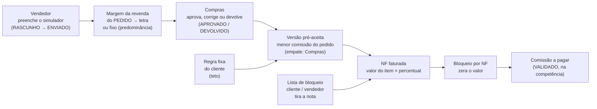

# Como o motor de comissão atual calcula: detalhe técnico (1/2)

**Em uma frase:** detalhe técnico da nota [[01-Motor-Atual-Como-Calcula]] (parte 1 de 2): Resumo em dez linhas; Visão do fluxo atual; 1. Quem faz o quê hoje; 2. Regra a regra.

**Onde estamos:** ← [[01-Motor-Atual-Como-Calcula]] (resumo e índice) · partes: **01-Motor-Atual-Como-Calcula-Detalhe-Tecnico-1** · [[01-Motor-Atual-Como-Calcula-Detalhe-Tecnico-2]]

## Resumo em dez linhas

1. O **vendedor** preenche um "simulador" por pedido, item a item: custo de compra, impostos, preço de venda. O simulador calcula a margem de cada item, só para informação.
2. A **margem líquida da revenda do pedido** dá uma **letra** (A, B, C ou D) e um percentual, que vale para todos os itens (N16-185).
3. **Predominância:** se a fabricação interna passa do corte (`pct_predominancia_fabricacao`, padrão 50%) da venda do pedido, todos os itens pagam o fixo da fabricação (2%); abaixo, todos pagam a letra (N16-186).
4. **Pedido no prejuízo** (margem da revenda ≤ 0) não paga nenhum item, nem a fabricação, que fica bloqueada até a Controladoria liberar (N16-185).
5. **Compras** abre a mesma simulação e pode gravar uma versão com o custo real. O pedido inteiro é pago pela versão de **menor comissão** (pré-aceita; empate, Compras) (N16-190).
6. Alguns clientes têm **regra fixa**: um teto de percentual, que muda conforme o markup do pedido.
7. A comissão só vira dinheiro **depois de faturar**: valor faturado do item × percentual da versão pré-aceita. É vista pelo mês em que é paga (competência, N16-187).
8. **Bloqueio por NF** zera a comissão daquela nota. **Lista de bloqueio** (cliente ou vendedor) tira a nota do cálculo.
9. Depois de enviar, o vendedor só cria versão nova se Compras devolver (N16-188). Ele vê só a comissão do vínculo próprio (N16-189).
10. Quem valida hoje é **Compras**; não existe etapa de Controladoria. Os **coordenadores** têm conta à parte.

## Visão do fluxo atual

## 1. Quem faz o quê hoje

| Quem | O que faz | Onde |
|---|---|---|
| Vendedor | Preenche, salva rascunho e envia o simulador do pedido | `av-hub` `components/Comissoes/Simulador/useSimuladorComissao.ts:810` (`const salvar = async`) |
| Compras | Aprova a simulação como está, cria uma versão com os custos corrigidos ou devolve | `av-hub` `components/Comissoes/Simulador/useSimuladorComissao.ts:858` (`const aprovarCompras = async`), fila em `comissoes/analise-simuladores/page.tsx` |
| Analista/Gerência | Acompanha o mês na Visão Geral (por pedido e por competência), confirma a predominância e bloqueia NF | `comissoes/visao-geral`, `comissoes/bloqueio-comissoes` |
| Coordenador | Recebe ajuda de custo e percentual sobre o faturamento do mês | `comissao_coordenadores`, `fn_dashboard_comissoes` |

✅ O simulador é **calculado no navegador** (`av-hub` `components/Comissoes/Simulador/useSimuladorComissao.ts:713` (`calcularSimulacao(form, parametros)`)) por uma função do front, `lib/simulador/motor.ts`. O banco guarda o resultado e só escolhe a versão que paga (view `vw_simulacao_resolvida`). O motor precisa sair do navegador (BL-078, nota 03).

## 2. Regra a regra

### R1. Custo líquido do item (o que a empresa gasta para ter o item)

**O que faz.** Soma o que se paga ao fornecedor, tira o ICMS que a empresa recupera e soma IPI, ST e frete de compra.

- Compra bruta = quantidade comprada × preço unitário de compra.
- ICMS recuperável = compra bruta × alíquota da **origem da compra** (zero se o item tem ST).
- IPI = compra bruta × % de IPI.
- Frete: ou **rateio** (`pct_rateio_logistica`, hoje 1,438975% sobre compra + IPI + ST) ou **valor** informado por linha.
- **Custo líquido** = compra bruta − ICMS recuperável + IPI + ST + frete.

**Exemplo.** 50 flanges a R$ 100 de custo, origem "Demais estados" (12%), sem IPI nem ST, frete por rateio:

| Passo | Conta | Valor |
|---|---|---|
| Compra bruta | 50 × 100 | R$ 5.000,00 |
| ICMS recuperável | 5.000 × 12% | R$ 600,00 |
| Frete (rateio) | 5.000 × 1,438975% | R$ 71,95 |
| **Custo líquido** | 5.000 − 600 + 0 + 0 + 71,95 | **R$ 4.471,95** |

**De onde vem.** ✅ `av-hub` `lib/simulador/motor.ts:286` (`const compraBruta`), `:298` (`const icmsRecuperar`), `:315` (`const custoLiquido`). Alíquotas: `simulador_parametros.icms_entrada` e `pct_rateio_logistica` (`dump:909-952`). A quantidade da compra é separada da quantidade da venda (`qtd_compra`, `dump:697-699`); o motor não converte unidade, cada lado usa o seu total.

### R2. Margem líquida do item e do pedido

**O que faz.** Pega o preço de venda do item e desconta custo líquido, despesas operacionais, impostos sobre a venda e a provisão de comissão. O que sobra, dividido pela venda, é a **margem do item**. Desde 18/11 ela **não decide nada**: mostra qual linha puxa o pedido para baixo. Quem decide é a **margem do pedido**: soma do lucro dos itens de revenda ÷ soma da venda de revenda. A fabricação interna fica fora dos dois lados (não tem custo de compra) (N16-185).

- Despesas operacionais: `pct_despesas_operacionais` (hoje 11,451734%).
- Impostos sobre a venda: ICMS efetivo do destino + PIS + COFINS + IRPJ + CSLL + adicional de IR. Com ICMS 12% a soma é **18,252%**.
- Provisão de comissão: `pct_comissao_provisao` (hoje 2%).
- Item "isento de imposto" zera o bloco de impostos inteiro.

**Exemplo** (mesmo item, venda a R$ 230 a unidade, destino Minas Gerais):

| Passo | Conta | Valor |
|---|---|---|
| Venda do item | 50 × 230 | R$ 11.500,00 |
| Despesas operacionais | 11.500 × 11,451734% | R$ 1.316,95 |
| Impostos | 11.500 × 18,252% | R$ 2.098,98 |
| Provisão de comissão | 11.500 × 2% | R$ 230,00 |
| Lucro do item | 11.500 − 4.471,95 − 1.316,95 − 2.098,98 − 230 | R$ 3.382,12 |
| **Margem do item** | 3.382,12 ÷ 11.500 | **29,41%** |

Num pedido só com este item, a margem do pedido também é 29,41%.

**De onde vem.** ✅ `av-hub` `lib/simulador/motor.ts:339` (`const lucroItem`), `:348` (`const margemCalculada`), `:351` (`ehFabricacao ? null`: fabricação sem margem), `:441` (`const margemLiquida`, a do pedido), `:101` (`export function pctImpostos`), `:140` (`export function icmsEfetivoVenda`). Gravado em `simulacao_itens.margem_item` e `simulacoes.margem_liquida`.

### R3. Letra e percentual do pedido

**O que faz.** A **margem do pedido** cai numa faixa. Cada faixa tem uma letra e um percentual. Os intervalos são "de X até antes da próxima faixa". A letra do pedido vale para **todos** os itens: item fraco dentro de pedido bom recebe a letra do pedido (N16-185). O protótipo antigo (`experimental/simulador-comissao`) já calculava assim; hoje é a regra vigente.

| Letra | Margem líquida da revenda do pedido | Percentual |
|---|---|---|
| A | 15% ou mais | 2,0% |
| B | 12% até menos de 15% | 1,3% |
| C | 9% até menos de 12% | 0,7% |
| D | 0% até menos de 9% | 0,5% |

**Exemplo.** Margem do pedido 29,41% → letra A → 2% em todos os itens. Comissão estimada: 11.500 × 2% = **R$ 230,00**.

**De onde vem.** ✅ `av-hub` `lib/simulador/motor.ts:172` (`export function faixaDaMargem`) e `:475` (`Comissão por PEDIDO`); a letra vai em `simulacao_itens.letra_item` de cada item e em `simulacoes.letra_equivalente`. Faixas em `simulador_parametros.faixas_comissao` (`dump:998-1000`, valores em `dump:1660`). O motor avisa quando há item de revenda no prejuízo dentro do pedido (`ITEM_PREJUIZO`), sem zerá-lo.

### R4. Predominância, fabricação interna e prejuízo

**O que faz.**
- **Peso da fabricação:** `pct_venda_fabricacao` = venda de fabricação interna ÷ venda do pedido × 100, por valor e não por número de linhas.
- **Fabricação predomina** (acima de `pct_predominancia_fabricacao`, padrão 50%) ou pedido sem revenda: todos os itens pagam o percentual fixo da fabricação (`pct_fabricacao_interna`, hoje 2%), revenda inclusive (`regra_aplicada = FABRICACAO_INTERNA`). 📝 N16-186
- **Revenda predomina:** todos os itens pagam a letra do pedido, fabricação inclusive (`LETRA`). 📝 N16-186
- **Pedido misto:** o motor aplica e avisa (`REGRA_PREDOMINANCIA`); a Controladoria confirma ao aprovar na Visão Geral.
- **Pedido no prejuízo** (margem da revenda do pedido ≤ 0): nenhum item paga. A revenda fica `PREJUIZO_PEDIDO`; a fabricação, `FABRICACAO_BLOQUEADA`, que a Controladoria pode liberar. O motor avisa `PEDIDO_PREJUIZO`. 📝 N16-185
- **`PREJUIZO`:** só o item sem preço de venda.

**Exemplo.** Pedido de R$ 10.000 com R$ 6.000 de fabricação (60%): 2% em tudo, R$ 200,00. Com R$ 3.000 de fabricação (30%) e revenda na letra C: 0,7% em tudo, R$ 70,00. Se a revenda fechar com margem −2%: R$ 0,00 em tudo.

**De onde vem.** ✅ `av-hub` `lib/simulador/motor.ts:449` (`const pctVendaFabricacao`), `:452` (`PREDOMINÂNCIA`), `:459` (`const fabricacaoPredomina`), `:463` (`const pedidoEmPrejuizo`), `:500` (`'FABRICACAO_BLOQUEADA' : 'PREJUIZO_PEDIDO'`), PRs #312, #313 e #327 do av-hub. Na API, as duas regras novas entram na lista aceita: `api-acos-vital` `src/schemas/core_comercial/aggregates/propostas/propostas.route.js:69` (`const REGRAS = [`), commit `7c05f92`; item com regra fora da lista dá 400 e não mais 500 (`src/schemas/core_comissionamento/tables/simulacoes/simulacoes.route.js:151` (`const itemInvalido`)). O corte é parâmetro com vigência: `src/schemas/core_comissionamento/tables/simulador_parametros/simulador_parametros.model.js:112` (`pct_predominancia_fabricacao:`), padrão 50; não há tela para mudá-lo (PS-063). O mesmo CHECK de regras no banco vem da migration `2026-11-18_comissao_grao_pedido`, fora do repositório (❓ PS-062).

### R5. Versão de Compras, devolução e trava do vendedor

**O que faz.** Compras abre a simulação do vendedor e, se o custo estiver errado, grava uma **segunda versão** (origem `COMPRAS`) com o custo correto. O motor roda de novo e dá a letra do pedido de Compras. A versão do vendedor passa a `CONTESTADO`; a de Compras fica `APROVADO`. Se Compras concorda, só aprova a versão do vendedor. Se devolve, a do vendedor fica `DEVOLVIDO` e a vez é dele.

**Estados da simulação:** `RASCUNHO` → `ENVIADO` → `APROVADO`, `CONTESTADO` ou `DEVOLVIDO`. Os três últimos são finais; versão enviada não muda, correção é versão nova.

**Trava do vendedor (N16-188).** Depois de enviar, o vendedor não mexe mais: versão nova de origem `VENDEDOR` (rascunho inclusive) ou rascunho antigo indo a `ENVIADO` só passam se a última versão enviada do vendedor não existe ou está `DEVOLVIDO`. Senão, 409 `VERSAO_VENDEDOR_FECHADA`. A regra é do banco (trigger `trg_simulacoes_trava_versao_vendedor`, migration `2026-11-19_comissao_trava_versao_vendedor`, ❓ PS-062).

**De onde vem.** ✅ `api-acos-vital` `src/schemas/core_comissionamento/tables/simulacoes/simulacoes.route.js:175` (`const versaoFechada`), commit `0e56354`; `:160` (`const semFaturamento`: enviar sem NF dá 409 `PEDIDO_SEM_FATURAMENTO`). Tela: `av-hub` `components/Comissoes/Simulador/useSimuladorComissao.ts:858` (`const aprovarCompras = async`).

### R6. Versão pré-aceita: o pedido paga pela menor comissão

**O que faz.** A view escolhe uma **versão** para o pedido inteiro: a de **menor comissão** do pedido, entre a do vendedor e a de Compras; no empate, a de Compras. Dela vêm percentual, tipo do item e composição de todas as linhas (`origem_pre_aceita`). Sem versão de Compras, vale a do vendedor. Antes de 23/11 era o `LEAST` percentual a percentual, item a item, que podia misturar as duas versões. 📝 N16-190

**Exemplo.** Vendedor: R$ 300 de comissão no pedido. Compras, com custo corrigido: R$ 210. Todas as linhas pagam pela versão de Compras. Custo real melhor que o cotado continua sem aumentar a comissão: vale a menor das duas.

**De onde vem.** ✅ `api-acos-vital` `src/schemas/core_comissionamento/views/vw_simulacao_resolvida/vw_simulacao_resolvida.model.js:136` (`origem_pre_aceita:`) e `:141` (`id_simulacao_pre_aceita:`); a escolha é da view `vw_simulacao_pre_aceita`, criada pela migration `2026-11-23_comissao_pre_aceita_devolvido` (❓ fora do repositório e do dump, PS-062). A `vw_comissao_master` traz `margem_item_vendedor` e `margem_item_compras` lado a lado (`vw_comissao_master.model.js:109` (`margem_item_vendedor:`)).

### R7. Regras fixas por cliente (teto)

**O que faz.** Alguns clientes têm um **teto** de percentual combinado. Cada cliente (por unidade) tem três números: comissão **padrão**, comissão **condicional** e a **margem** de gatilho. O teto vale assim: se o **markup bruto** do pedido for **maior ou igual** à margem de gatilho, o teto é a condicional; senão, a padrão. O teto só limita item pago pela **letra** (`LETRA`); fabricação predominante e prejuízo não passam por ele.

Atenção: o gatilho usa o **markup bruto** do pedido, `(total da NF − compra bruta) ÷ compra bruta`, e **não** a margem líquida da letra. No pedido 26616 as duas dão 115,24% e 16,37% (`dump:891-894`). No novo modelo o campo `margem` passa a se chamar `gatilho_markup_pct` para não confundir.

**Exemplo.** Cliente com padrão 0,5%, condicional 1,3% e gatilho 100%. Pedido com markup bruto de 127,87%: usa a condicional (1,3%). Pedido de letra A (2%) fica em **1,3%** em todos os itens de letra.

**De onde vem.** ✅ A view aplica o teto pelo markup da versão pré-aceita (`vw_simulacao_resolvida.model.js`, colunas `pct_teto` e `regra_fixa_aplicada`). Regra em `regras_comissoes_fixas` (`dump:589-603`). ⚠️ O motor do front **tem** um trecho que aplica o teto (`av-hub` `lib/simulador/motor.ts:549` (`const usaCondicional`)), mas a tela chama o motor **sem** a regra fixa (`av-hub` `components/Comissoes/Simulador/useSimuladorComissao.ts:713` (`calcularSimulacao(form, parametros)`)): na prática o teto só é aplicado pela view.

### R8. Comissão em reais: sobre o faturado, por item

**O que faz.** O dinheiro só existe depois de faturar. Para cada item que saiu em uma NF: `valor da comissão = valor faturado do item × percentual da versão pré-aceita ÷ 100`, arredondado a 2 casas. Item **ainda não faturado fica sem valor (nulo, pendente), nunca zero**.

**Exemplo.** Item faturado em R$ 5.709,01 a 0,5% → 28,545 → **R$ 28,55**.

**De onde vem.** ✅ `vw_simulacao_resolvida` (`valor_comissao`; comentário do model, linhas 16-18: faturado nulo é pendente). O faturado casa por `codigo_empresa` + `codigo_item_omie`, não pelo código do pedido Omie, que muda quando o Omie recria o pedido (`dump:863-865`).

### R9. Comissão por NF, situação e competência

**O que faz.** Soma os itens da NF. O percentual efetivo da NF é **ponderado** pelo valor dos itens. A **situação** da NF segue a precedência `BLOQUEADA` > `SEM_SIMULADOR` > `VALIDADO` / `ITENS_FORA_DO_SIMULADOR` > `DEVOLVIDO` > `RASCUNHO` > `AGUARDANDO_COMPRAS`. `DEVOLVIDO` (23/11) diz que Compras devolveu e a vez é do vendedor. Só `VALIDADO` entra em "a pagar". A validação é **do pedido**: aprovado uma vez, vale para todas as NFs.

Também conta os itens da NF **sem vínculo** com a simulação (`qtd_itens_sem_vinculo`): é o aviso do caso "simulou 8, faturou 10".

**Competência (N16-187).** Cada nota tem `mes_competencia`, o mês em que a comissão é paga: o da emissão, ou o mês ainda aberto no dia do desbloqueio, se a nota foi desbloqueada depois do fechamento (dia de fechamento da unidade em `calendario_comissao`, padrão 10). As rotas aceitam `competencia=AAAA-MM` (o resumo também `AAAA`), exclusivo com `mes`, `ano`, `data_inicio`, `data_fim` e `is_track_record`.

**Peso da fabricação.** `/comissoes_nf` e `/comissoes_master` trazem `venda_revenda`, `venda_fabricacao` e `pct_venda_fabricacao` do pedido e filtram por `com_fabricacao`, `misto` e `pct_venda_fabricacao_min`/`_max`.

**De onde vem.** ✅ `api-acos-vital` `src/schemas/core_comissionamento/competencia.js:41` (`export function lerCompetencia`), `src/schemas/core_comissionamento/recorte.js:132` (`export function lerFiltroFabricacao`), `vw_comissao_nf.model.js:71` (`pct_venda_fabricacao:`), commits `0244b1a` e `e363da5`. ❓ As colunas vêm das migrations `2026-11-18_comissao_competencia` e `2026-11-19_comissao_escopo_fabricacao`, fora do repositório (PS-062).

### R10. O que o vendedor vê

**O que faz.** Minhas Comissões lê as mesmas views da Visão Geral, com `meus=true`, pela competência. A API recorta pelo **vínculo próprio** do usuário: o auxiliar não vê a comissão do titular, nem o diligenciador a dos que diligencia; sem vínculo próprio, a resposta vem **vazia** (antes, 403). Quem entra só por Minhas Comissões tem o recorte sempre, com ou sem `meus=true` (N16-189).

**De onde vem.** ✅ `api-acos-vital` `src/schemas/core_comissionamento/recorte.js:9` (`export const SQL_VINCULOS_PROPRIOS`), `:65` (`export async function lerRecorteVendedor`), `src/middlewares/escopoVendedor.js:121` (`simulacao_resolvida:`), commit `06bb146`. ✅ BFF: `av-hub` `app/api/comissoes/minhas-comissoes/route.ts:152` (`/comissoes_nf?`), PR #334; os itens da nota vêm de `/api/comissoes/minhas-comissoes/itens`, sobre `/comissoes_master` (`av-hub` `lib/api/itensDaNota.ts:84`, `/comissoes_master?`). A tela saiu do `/faturamento_planilha`. ✅ No simulador, a coluna de comissão em reais só aparece na visão de Compras (`av-hub` `components/Comissoes/Simulador/useSimuladorComissao.ts:171` (`mostrarComissao = modoCompras`)).

❓ O BFF antigo cortava o valor em reais antes da aprovação de Compras; o novo repassa o `valor_comissao` da view, e a tela o mostra por nota. Se a view zera o valor antes da validação não dá para conferir: a SQL está fora do repositório (PS-062). ✅ Desde 23/11 as telas mostram `DEVOLVIDO`, que a `vw_comissao_nf` voltou a distinguir (`av-hub` `lib/domain/comissoes-minhas-comissoes.ts:59` (`DEVOLVIDO: {`), PR #337; PS-064 fechada). Sobra um comentário velho que fala em 403 sem vínculo (`app/api/comissoes/minhas-comissoes/route.ts:33` (`devolve 403`)).

### R11. Bloqueio por NF

**O que faz.** Uma NF pode ser **bloqueada**: o valor da comissão daquela nota vira zero, com um motivo em texto livre. Desbloquear é marcar "não bloqueada" (a linha fica, com quem mexeu); a data do desbloqueio decide a competência (R9). Não existe chave para a NF: o número é digitado com zeros à esquerda (`00051698`) e, se vier sem os zeros, **o bloqueio nunca casa e nada avisa**.

**Dados no dump:** 2 linhas, **ambas desbloqueadas**, sem motivo (`dump:1570-1571`).

**De onde vem.** ✅ `bloqueio_comissoes` (`dump:410-420`), uso em `vw_comissao_master` (`dump:1338-1347, 1368`). O motivo é opcional (`dump:465-468`). A master guarda `valor_comissao_sem_bloqueio`, o que a nota pagaria sem o bloqueio (`vw_comissao_master.model.js:123` (`valor_comissao_sem_bloqueio:`)).

### R12. Listas de bloqueio: cliente e vendedor

**O que faz.** Cliente na lista de bloqueio, ou vendedor na lista, **faz a NF sair do cálculo**: a nota não aparece na lista de comissões. Não confundir com `blacklist_vendedor_g5` do faturamento, que é outra coisa (cascata de deduções da venda líquida).

**Dados no dump:** 1 cliente e 8 vendedores, sem observação (`dump:1549, 1556-1563`).

**De onde vem.** ✅ `blacklist_comissoes_destinatario` e `blacklist_comissoes_vendedores` (`dump:333-342, 372-381`), usadas nos `NOT EXISTS` da `vw_comissao_master` (`dump:1305-1309`). Não têm data: valem para sempre, sobre qualquer NF, inclusive de meses já pagos.

### R13. Valor máximo e valor pré-aceito

**O que faz.** Para planejar o mês, a Visão Geral mostra o **valor máximo possível** (pior caso): valor do item × o menor entre a maior faixa vigente (2%) e o maior percentual da regra fixa do cliente; nota validada mostra o valor real. Desde 23/11 o resumo também traz o **valor pré-aceito**: quanto provavelmente vai ser pago, pela versão pré-aceita, aprovada ou não.

**De onde vem.** ✅ `dump:1361-1365` e comentário `:1410-1419`; `vw_comissao_resumo_mensal.model.js:45` (`valor_comissao_pre_aceito:`).

### R14. Resumo mensal e cartões

**O que faz.** Mostra por mês e por vendedor: notas por situação (com `qtd_devolvido` desde 23/11), faturado, comissão a pagar (só `VALIDADO`), valor máximo, valor pré-aceito, bloqueado e economia de Compras. A linha de total e as linhas por vendedor vêm juntas (`is_total`); somar sem filtrar duplica.

**Bloqueado.** `valor_comissao_bloqueado` deixou de ser sempre zero: é o pré-aceito das notas bloqueadas, o que pagariam sem o bloqueio (bloqueada sem simulação entra com 0). ✅ `vw_comissao_resumo_mensal.model.js:37` (`valor_comissao_bloqueado:`) e `:43` (`qtd_devolvido:`). ❓ A SQL nova está na migration `2026-11-23_comissao_pre_aceita_devolvido`, fora do repositório (PS-062); no dump antigo a conta era `valor_faturado_nf × 0` (`dump:1522`).

### R15. Coordenadores

**O que faz.** Coordenadores não dependem de proposta. Cada um tem **ajuda de custo** (valor fixo) e um **percentual**, com data de vigência. Duas famílias:
- **Gerência:** ranking próprio; comissão = percentual ÷ 100 × **faturamento total do mês** (todas as vendas líquidas).
- **Exceção:** entra no ranking dos vendedores, com a mesma conta.

`total = ajuda de custo + comissão − bloqueado`. O **bloqueio por NF não vale para coordenador** (decisão do Nathan de 06/10/2026, contrato 38): a função é sempre chamada com bloqueio desligado. O ranking ordena por total e, em empate, por `ordem_desempate`, depois por nome.

**Exemplo (valores inventados; os reais ficam no banco):** faturamento do mês R$ 10.000.000; percentual 0,30%; ajuda de custo R$ 4.000. Comissão = 0,30 ÷ 100 × 10.000.000 = R$ 30.000; total = R$ 34.000.

**Mudar valor** = fechar a vigência e abrir outra, para meses passados não mudarem. Se a pessoa tem duas vigências no mês (troca no meio), vale a que começou por último. Toda alteração fica num histórico que **não pode ser editado nem apagado**.

**Dados no dump:** 5 de gerência e 1 de exceção, todos com vigência desde 01/01/2000 (carga do `coordenadores.json`, `dump:1578-1583`). Os valores nominais não são copiados aqui.

**De onde vem.** ✅ `fn_dashboard_comissoes` (`dump:111-287`; conta do coordenador em `:179-194`), `fn_comissao_coordenadores_mes` (`dump:85-95`), tabela e travas (`dump:475-498, 1693`), histórico e imutabilidade (`dump:35-54, 70-76, 1883-1890`). ✅ Bloqueio desligado: `fn_dashboard_comissoes.route.js:20-22, 50`. ✅ A tela `dash-comissoes` ainda lê `lib/comissoes/coordenadores.json` do repositório e calcula no navegador (`LOG-42`, [[Comissoes]]). A tabela `comissao_coordenadores` **não tem rota na API**; só a função de leitura.

### R16. Vendedores do dashboard

**O que faz.** A lista de vendedores do dashboard (`dash-comissoes`) vem do **relatório provisório do mês** (`comissoes_provisoria`, um JSON que um gerador externo grava), e não das views novas. A comissão e o bloqueio ali "como o gerador mandou".

**De onde vem.** ✅ `fn_dashboard_comissoes` (`dump:158-161, 197-214`), `comissoes_provisoria.route.js` (PUT grava o JSON). ❓ Quem é o gerador (o "sistema Python" que o código cita) não está nos repositórios lidos.

R17 e R18 continuam em [[01-Motor-Atual-Como-Calcula-Detalhe-Tecnico-2#2. Regra a regra (continuação)]].
