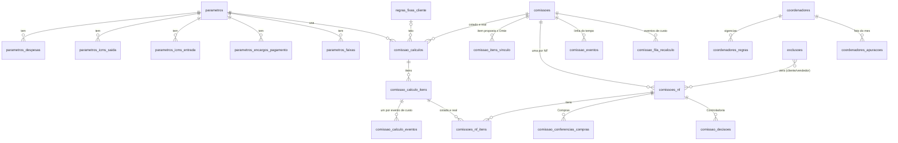

# Modelo novo: schema `core_comissao`: detalhe técnico (1/4)

**Em uma frase:** detalhe técnico da nota [[03-Modelo-Novo-core_comissao]] (parte 1 de 4): O que o módulo faz, em uma frase por etapa; Princípios; Convenções de nome; Visão geral; Em camadas; Entradas do motor e a tela do simulador (N16-19); Valores fixos (`CHECK`); Índices e chaves únicas principais.

**Onde estamos:** ← [[03-Modelo-Novo-core_comissao]] (resumo e índice) · partes: **03-Modelo-Novo-core_comissao-Detalhe-Tecnico-1** · [[03-Modelo-Novo-core_comissao-Detalhe-Tecnico-2]] · [[03-Modelo-Novo-core_comissao-Detalhe-Tecnico-3]] · [[03-Modelo-Novo-core_comissao-Detalhe-Tecnico-4]]

## O que o módulo faz, em uma frase por etapa

1. **Proposta salva (V0.3)**: o motor calcula a comissão **estimada** por item e no total, com o custo que o vendedor pôs. 📝 N16-10
2. **Proposta aprovada**: a estimativa **congela** (a proposta não muda mais). 📝 N16-03, N16-17
3. **Custo real chega** (evento por requisição, OC ou lote): o motor **recalcula sozinho**, sem tocar no preço do cliente. 📝 N16-09, N16-10
4. **NF faturada**: a comissão **fecha por NF** e chega à Controladoria **já calculada**. 📝 N16-10
5. **Controladoria, Gerência ou Coordenação decidem** (aprovar, desaprovar, bloquear e desbloquear, cortar ou alterar, por valor ou percentual, sem teto), **sempre com justificativa**; ninguém decide sobre a própria comissão. 📝 N16-10, N16-44, N16-45
6. **Vendedor**: vê a comissão que **ele colocou** até a decisão; depois vê a comissão **real com a justificativa**. Se Compras compra por mais que o valor da proposta, ele **aprova ou reprova** a compra por produto (`C8`, N16-60 a N16-67, que superam N16-18); a comissão real cai se aprova. 📝 N16-10, N16-46
7. **Proposta cancelada**: a estimativa vira **histórico** que o vendedor consulta. 📝 N16-02
8. **Nota cancelada, devolvida ou recusada** (`K6`): abate a comissão na mesma proporção (se paga, entra na próxima apuração). Devolução total vem do Omie; a **parcial** o Fiscal ou a Controladoria informam (item, quantidade, valor), com **pendência** até lá. 📝 N16-47, N16-74
9. **Pedido cancelado** (N16-68 a N16-71): o comprado vai ao Estoque e deixa de ser custo do pedido; a comissão estimada vira histórico; no faturado em parte, o faturado fica e o saldo segue as regras. 📝

## Princípios

1. **Nada é sobrescrito.** Cada cálculo é uma linha nova e imutável (`comissao_calculos`); recálculo por custo real não apaga o cotado. Cancelada vira histórico sem esforço.
2. **O que o vendedor vê é decidido no banco e na API**, por view e por tela, não na interface.
3. **Regra de negócio em tabela tipada, não em JSON.** JSON só para log (`avisos`, `dados` de evento, `auditoria`).
4. **Vigência em tudo que é parâmetro** (parâmetros, regra fixa, exclusões, coordenadores), com `EXCLUDE` contra sobreposição. Mudar valor = fechar e abrir.
5. **Justificativa obrigatória** onde há decisão humana (decisão da Controladoria, exclusão, cancelamento).
6. **Chave estável**: `codigo_nf_omie` (PK da NF), ids de proposta e de item, códigos controlados. Nunca número com zeros à esquerda nem nome.
7. **O motor é puro**: mesma entrada, mesma saída, com `versao_motor` gravada.
8. **Custo real só reduz o percentual, nunca o aumenta** (menor entre cotado e real), como hoje. 📝 N16-11
9. **Preço da proposta não muda** com o custo real; só margem e comissão. 📝 N16-17
10. **Depois da decisão nada recalcula**: a NF decidida é uma foto.
11. **Cada evento de custo carrega as suas condições** (fornecedor, condição de pagamento, encargo, frete, origem do ICMS, IPI, ST, DIFAL). O custo líquido de cada evento sai da mesma fórmula do motor e o item soma os eventos. O encargo da condição de pagamento **não** entra no custo: entra no preço sugerido, como no motor atual (N16-22). Só a venda tem um conjunto de condições por pedido. 📝 N16-20
12. **Mesmas entradas do simulador** (N16-19): toda entrada e toda saída da tela do simulador é coluna do modelo (tabela "Entradas do motor e a tela" abaixo). 📝 N16-19

## Convenções de nome

| Tema | Convenção | Exemplo |
|---|---|---|
| Schema | `core_comissao` | |
| Tabela | plural, `snake_case`, sem acento (padrão do Hub) | `comissoes`, `comissoes_nf` |
| Tabela filha | prefixo da mãe | `parametros_faixas`, `comissao_calculo_itens` |
| View | `vw_comissao_<assunto>` | `vw_comissao_nf_fila` |
| Função | `fn_<verbo>_<assunto>` | `fn_comissao_decidir` |
| PK | `id uuid DEFAULT uuidv7()` | |
| FK | `id_<singular>` | `id_comissao`, `id_parametros` |
| Unidade | `codigo_empresa uuid` (convenção do Hub, FK `core.unidades`) | |
| Percentual | pontos percentuais (2 = 2%), sufixo `_pct`, `numeric(7,4)` | `comissao_pct` |
| Dinheiro | `numeric(15,2)`; unitário `numeric(15,4)`; quantidade `numeric(15,4)` | |
| Estado e tipo | `varchar` + `CHECK ... IN (...)`, valores em `MAIÚSCULAS_COM_UNDERSCORE` (padrão do Hub, sem `ENUM` do Postgres) | `AGUARDANDO_DECISAO` |
| Vigência | `vigencia_inicio date`, `vigencia_fim date` (nulo = aberta), `EXCLUDE` gist | |
| Auditoria | `created_at/by`, `updated_at/by` (`set_updated_at`); `deleted_at/by` onde há exclusão lógica | |
| Log | tabela só de `INSERT`, com trigger `fn_log_imutavel` | `comissao_decisoes` |
| Unidade de medida | sufixo explica (`_pct`, `_valor`, `_total`, `_unitario_medio`) | `custo_real_unitario_medio` |

Mudança de nome em relação ao módulo atual: `margem` → `gatilho_markup_pct`; `pct_*` → `*_pct`; `blacklist_*` → `exclusoes`; `bloqueio_comissoes` → decisão `BLOQUEAR`; `simulacoes` → `comissao_calculos` (`COTADO`/`REAL`).

## Visão geral

Fora do schema, ligadas por chave: `core_comercial.propostas` e `proposta_item`, `core_comercial.pedidos` e `pedidos_itens`, `core_comercial.custos_eventos` e a view `core_comercial.vw_pedido_item_custo` (nomes **no singular**, conferidos em 16/10), `core_vendas_faturamento.notas_fiscais` e `produto_vendas` (NF e itens faturados), `core.unidades`, `core.funcionarios`, `auth.usuarios`. As chaves de `core_comercial` entram no bloco 9 do DDL, depois do SQL de proposta e pedido.

## Em camadas

| Camada | Tabelas | Quem escreve |
|---|---|---|
| **Parâmetros** (poucos, mudam raro, vigência) | `parametros` + 5 filhas, `regras_fixas_cliente`, `exclusoes`, `coordenadores`, `coordenadores_regras` | Tela de parâmetros (Controladoria) |
| **Dossiê** (uma por proposta) | `comissoes`, `comissao_itens_vinculo` | API ao salvar a proposta; vínculo quando o Omie devolve os itens do pedido |
| **Cálculo** (imutável) | `comissao_calculos`, `comissao_calculo_itens`, `comissao_calculo_eventos` | Motor, por `fn_calculo_gravar` |
| **NF** (uma por nota faturada) | `comissoes_nf`, `comissoes_nf_itens` | Job de faturamento, por `fn_comissao_nf_fechar` |
| **Conferência e decisão** (imutáveis) | `comissao_conferencias_compras` (🟡 OQ-28), `comissao_decisoes` | Compras, por `fn_comissao_conferir_compras`; Controladoria, por `fn_comissao_decidir` |
| **Rastro** | `comissao_eventos`, `comissao_fila_recalculo`, `auditoria`, `coordenadores_apuracoes` | Funções e triggers |

## Entradas do motor e a tela do simulador (N16-19)

A tela da proposta e a tela da Controladoria usam o **mesmo motor e as mesmas regras** do simulador atual, em **tabelas novas e isoladas** (N16-21: nada do `core_comissionamento` é tocado) (`tela-simulador-comissao.png`, `av-hub\app\(protected)\comissoes\simulador\page.tsx`). Toda caixa e toda coluna da tela existe como coluna. A coluna **"FAB."** da imagem é uma caixa de seleção (`av-hub` `components/Comissoes/Simulador/EditorItem.tsx:40` (`const fabricacao = rascunho.tipo_item === 'FABRICACAO_INTERNA'`); desde novembro o item é editado num painel, não mais numa linha): marca o item de **fabricação interna** (`tipo_item = FABRICACAO_INTERNA`), não é o nome do fabricante.

| Na tela | Entrada ou saída | Onde mora no módulo novo | Origem no simulador atual |
|---|---|---|---|
| Parâmetros: Maio/23 | parâmetros do mês | `parametros.descricao`, `vigencia_inicio` (sempre dia 1, `ck_parametros_mes`), `comissao_calculos.id_parametros` | `simulador_parametros` (`dump:909-952`), `av-hub` `components/Comissoes/Simulador/CondicoesComerciais.tsx:52` (`Parâmetros:`) |
| Unidade | entrada | `comissoes.codigo_empresa` | `simulacoes.codigo_empresa` |
| Número do pedido, Cliente, Vendedor, Itens | contexto | `comissoes.numero_pedido`, `codigo_cliente`, `codigo_vendedor_omie`; `comissao_calculos.qtd_itens` | `simulacoes.numero_pedido` etc. |
| Estado de destino, ICMS 18% | entrada e snapshot | `comissao_calculos.estado_destino` (código de `parametros_icms_saida.destino`), `icms_destino_pct` | `simulacoes.estado_destino` (texto) |
| Condição de pagamento, encargo 1,5% | entrada e snapshot | `comissao_calculos.condicao_pagamento`, `encargo_pagamento_pct` | `simulacoes.condicao_pagamento` |
| Com impostos | entrada | `comissao_calculos.isento_imposto` | `simulacoes.isento_imposto` |
| Frete na compra (rateio ou valor) e total | entrada e derivado | `comissao_calculos.frete_compra_tipo`, `frete_compra_total`; por item `comissao_calculo_itens.frete_compra_valor` | `simulacoes.frete_compra_tipo/valor` |
| Valor ST (venda) | entrada | `comissao_calculos.valor_st_venda` | `simulacoes.valor_st_venda` |
| Imposto retido / DIFAL | entrada | `comissao_calculos.imposto_retido_difal` | `simulacoes.imposto_retido_difal` |
| Frete na venda | entrada | `comissao_calculos.frete_venda` | `simulacoes.frete_venda` |
| Item: descrição e código | entrada | `comissao_calculo_itens.descricao`, `codigo_produto` | `simulacao_itens.descricao`, `codigo_produto` |
| Item: FAB. | entrada | `tipo_item` | `simulacao_itens.tipo_item` |
| Compra: QTD e UM | entrada | `qtd_compra`, `unidade_compra` | `qtd_compra`, `unidade_compra` |
| Compra: PREÇO | entrada | `preco_unit_compra_cotado` | `preco_unit_compra` |
| Compra: ORIGEM | entrada | `origem_compra` (código) | `origem_compra` (texto) |
| Compra: % IPI, ST, FRETE | entrada | `ipi_pct`, `valor_st`, `frete_compra_valor` | `pct_ipi`, `valor_st`, `frete_compra_valor` |
| Compra: FORNECEDOR | entrada | `fornecedor` | `fornecedor` |
| Venda: QTD e PREÇO | entrada | `qtd`, `unidade`, `preco_unit_venda` | `qtd`, `preco_unit_venda` |
| Resultado: CUSTO LÍQ. | saída | `custo_liquido` (cotado) e, no real, soma dos eventos (`comissao_calculo_eventos.custo_liquido`) | `custo_liquido` |
| Resultado: SUGERIDO | saída | `preco_unit_sugerido`, `preco_total_sugerido` | `preco_unit_sugerido` |
| Resultado: MARGEM e LETRA | saída | `margem_item_pct`, `letra_item` | `margem_item`, `letra_item` |
| Chip Comissão | saída | `comissao_pct`, `valor_comissao_estimado` | `pct_comissao` |
| Rodapé: CUSTO | total | `comissao_calculos.custo_total` | `custo_total` |
| Rodapé: VENDA | total | `valor_liquido` | `valor_liquido` |
| Rodapé: TOTAL DA NF | total | `total_nf` | `total_nf` |
| Rodapé: SUGERIDO | total | `venda_sugerida` | `venda_sugerida` |
| Rodapé: MARK-UP REAL | total | `markup_real` (revenda sobre custo, `av-hub` `lib/simulador/motor.ts:598` (`markup_real`)) | `markup_real` |
| Rodapé: MARK-UP S/ COMPRA | total | `markup_bruto_pct` (o "AC8", `motor.ts:470-471`) | `markup_bruto` |
| Rodapé: MARGEM e letra do pedido | total | `margem_liquida_pct`, `letra_equivalente` | `margem_liquida`, `letra_equivalente` |

Colunas que o modelo da rodada anterior **não tinha** e que foram acrescentadas: `comissao_calculos.icms_destino_pct`, `encargo_pagamento_pct`, `frete_compra_total`, `markup_projetado`, `markup_real`; `comissao_calculo_itens.codigo_produto`, `preco_total_sugerido`. A origem dessas entradas no lado da proposta (`core_comercial`) é o anexo `0003-entradas-do-motor-em-core_vendas_faturamento.sql`; o modelo de 16/10 ainda não tinha a origem da compra, a quantidade e a unidade de compra, o IPI, a ST e o frete da compra por item, o destino do ICMS, a condição com encargo e o DIFAL.

## Valores fixos (`CHECK`)

| Coluna | Valores |
|---|---|
| `comissoes.estado` | `ESTIMADA`, `CONGELADA`, `EM_ACOMPANHAMENTO`, `ENCERRADA`, `CANCELADA` |
| `comissoes_nf.estado` | `AGUARDANDO_DECISAO`, `APROVADA`, `DESAPROVADA`, `BLOQUEADA`, `CORTADA`, `ALTERADA`, `NF_CANCELADA` |
| `comissoes_nf.compras_estado` | `PENDENTE`, `CONFIRMADA`, `CONTESTADA` (🟡 OQ-28) |
| `comissao_conferencias_compras.tipo` | `CONFIRMAR`, `CONTESTAR` |
| `comissao_calculo_eventos.origem` | `OC_MATERIAL`, `LOTE_ESTOQUE`, `MATERIA_PRIMA_FABRICACAO`, `MAO_DE_OBRA_OC_SERVICO` (as mesmas de `core_comercial.custos_eventos`) |
| `comissao_calculo_eventos.frete_tipo`, `comissao_calculos.frete_compra_tipo` | `RATEIO`, `VALOR` |
| `comissao_calculos.tipo` | `COTADO` (custo da proposta), `REAL` (custo real do pedido) |
| `comissao_calculos.gatilho` | `PROPOSTA_SALVA`, `CUSTO_REAL`, `REPROCESSAMENTO` |
| `comissao_decisoes.tipo` | `APROVAR`, `DESAPROVAR`, `BLOQUEAR`, `CORTAR`, `ALTERAR` |
| `comissao_calculo_itens.tipo_item` | `REVENDA`, `FABRICACAO_INTERNA` |
| `comissao_calculo_itens.regra_aplicada` | `PREJUIZO`, `FABRICACAO_INTERNA`, `LETRA`, `TETO_PADRAO`, `TETO_CONDICIONAL` |
| `origem_compra` | `SP`, `SP_REDUZIDA`, `OUTRA_UF`, `IMPORTACAO_SP`, `IMPORTACAO_OUTRA_UF`, `SIMPLES` |
| `exclusoes.tipo` | `CLIENTE`, `VENDEDOR` |
| `coordenadores_regras.tipo` | `GERENCIA`, `EXCECAO` |
| `comissoes_nf.motivo_zerado` | `CLIENTE_EXCLUIDO`, `VENDEDOR_EXCLUIDO` |

## Índices e chaves únicas principais

| Tabela | Chave ou índice | Para quê |
|---|---|---|
| `comissoes` | `UNIQUE (id_proposta)`, `UNIQUE (id_pedido_venda)` | Uma comissão por proposta e por pedido |
| `comissoes` | `(codigo_empresa, codigo_vendedor_omie, estado)` | Tela do vendedor |
| `comissao_calculos` | `UNIQUE (id_comissao, sequencia)`; `(id_comissao, tipo, sequencia DESC)` | Último cálculo de cada tipo |
| `comissao_calculo_itens` | `UNIQUE (id_calculo, ordem)`, `UNIQUE (id_calculo, id_item_proposta)`, `(id_calculo, codigo_item_omie)` | Casar item faturado com item calculado |
| `comissao_calculo_eventos` | `UNIQUE (id_calculo_item, ordem)`; `(id_custo_evento)` | Drill-down por evento; achar o cálculo de um evento de custo |
| `comissao_itens_vinculo` | `UNIQUE (id_comissao, id_item_proposta)`, `UNIQUE (id_comissao, codigo_item_omie)` | Casar o `codigo_item_omie` da NF com o item da proposta |
| `comissao_conferencias_compras` | `UNIQUE (id_comissao_nf, sequencia)` | Histórico da conferência de Compras |
| `comissoes_nf` | `UNIQUE (codigo_empresa, codigo_nf_omie)`; `(codigo_empresa, estado, data_emissao)` | Fila da Controladoria |
| `comissao_decisoes` | `UNIQUE (id_comissao_nf, sequencia)`; `(decidido_por, decidido_em DESC)` | Histórico por NF e por quem decidiu |
| `comissao_fila_recalculo` | único parcial `(id_comissao, motivo) WHERE processado_em IS NULL` | Junta eventos repetidos |
| `parametros`, `regras_fixas_cliente`, `exclusoes`, `coordenadores_regras` | `EXCLUDE gist` por vigência | Sem sobreposição |
| `auditoria` | `(tabela, id_registro, feito_em)` | Quem mudou o quê |
