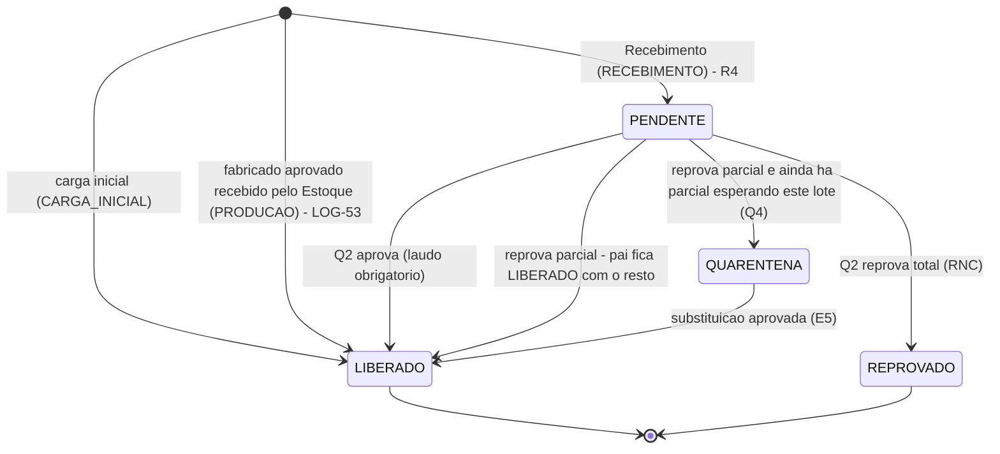

# Modelo de Estoque e custo do lote

Como o Estoque do MES guarda e movimenta o material e como o custo acompanha o lote. Tabelas: [[Banco-MES]]. Telas: [[MES-Front]]. Nós do 0b: E1 a E6, R4, Q1 a Q4 ([[00-Fluxo-Mestre-0b]]). Contratos: [[Contratos-da-v2|API-008]], [[Contratos-da-v2|API-007]], [[Contratos-da-v2|LOG-47]]. Selos: [[Regras-do-Vault]]. As mudanças de 15 a 28/10 (custo da OC, custo manual, `GET /itens/custo`, lote do fabricado) estão **só na `develop`** do `api-pcp`; a `main` parou em 08/10. Números de linha desta nota são de 14/10, exceto onde dito.

## Conceitos

| Conceito | Tabela | Regra |
|---|---|---|
| **Material** | `materiais` | snapshot do produto do av-hub, chave `(codigo_empresa, codigo_produto_omie)`; "mesmo produto" entre filiais = `codigo_produto` legível ✅ `estoque-operacao.service.ts:230-237` |
| **Lote** | `lotes` | unidade de rastreio, código `LT-AAAAMMDD-NNNN`, sempre de um material; pode ter lote pai (cisão) |
| **Saldo** | `saldos_estoque` | quantidade do lote por **localização** (único `(id_lote, id_localizacao)`); nunca fica negativo: toda mudança passa pelo motor do Estoque, que recusa a retirada maior que o saldo (409), e o banco também recusa (N16-184) ✅ `api-pcp` `src/estoque/motor/motor-estoque.ts:227` (`Saldo insuficiente nessa localização`) |
| **Movimento** | `movimentos_estoque` | razão só de inserção: `ENTRADA`, `SAIDA`, `TRANSFERENCIA`, `AJUSTE`, sempre com motivo e usuário |
| **Reserva** | `reservas_estoque` | parte do lote prometida a uma parcial; `ATIVA` → `CONSUMIDA` (baixa na retirada) ou `LIBERADA` |
| **Retirada** | `retiradas`, `retirada_itens` | o que o Estoque separa e confirma para a Expedição ou a Produção; a baixa acontece na confirmação (N16-193) |
| **Custo** | `lote_custo` | 1 para 1 com o lote; obrigatório na carga inicial, pendente (`custo_pendente`) no recebimento sem custo, ausente no fabricado (N16-181, N16-166) |

Filial: o lote pertence à filial **do material** (`materiais.codigo_empresa`); o depósito também tem `codigo_empresa`. O estoque de uma parcial só enxerga lotes da mesma filial do pedido (`pedidos.id_unidade`) ✅ `api-pcp` `src/estoque/operacao/estoque-operacao.service.ts:114-162` (`Lotes que podem atender uma parcial`). Estoque em outra filial aparece só como aviso (`outrasFiliais`), sem transferência automática (transferência entre filiais: [[Transferencia-entre-Filiais]]).

## Fórmulas (conferidas)

- **Saldo do lote** = soma de `saldos_estoque.quantidade` de todas as localizações.
- **Reservado** = soma, das reservas `ATIVA` do lote, de `quantidade − quantidade_consumida` ✅ `estoque-operacao.helpers.ts:34-46` (`reservadoPorLote`).
- **Disponível** = `max(saldo − reservado, 0)` **só se o lote está `LIBERADO`**; lote em outro status tem disponível 0 ✅ `estoque-operacao.service.ts:391-395`.
- **Saldo disponível da parcial (E1)** = lotes `LIBERADO` do mesmo produto e da mesma filial, com disponível > 0, mais antigos primeiro; os comprados pela própria requisição do item vêm primeiro e marcados `daRequisicao` ✅ `:161-199`.
- A tela de Saldo só mostra depósitos que o perfil visualiza (`perfil_depositos.pode_visualizar`) e até 1 000 linhas ✅ `:61-99`.

## Ciclo de vida do lote

| Evento | O que o código faz | Nó | Código |
|---|---|---|---|
| **Fabricado aprovado** (LOG-53) | a inspeção de saída aprova (`aprovar-saida`) e a parcela volta ao Estoque `EM_TRANSITO`; o Estoque informa a localização (`receber-fabricado`): acha ou cria o lote `PRODUCAO` da OP e do produto (`LIBERADO`, **sem custo**), soma a parcela, grava `ENTRADA` e saldo, reserva o lote para a própria parcela e marca `RECEBIDO` | Q8 → E5 | ✅ `itens-parciais.service.ts:1267,1403` |
| **Carga inicial** | cria lote `LIBERADO` (`origem = CARGA_INICIAL`), saldo na localização e movimento `ENTRADA`; custo obrigatório (N16-181) | — | ✅ `api-pcp` `src/estoque/operacao/estoque-operacao.service.ts:642` (`a carga inicial não aceita lote sem custo`) |
| **Recebimento (conferência bateu)** | por item da requisição: lote `PENDENTE` (`origem = RECEBIMENTO`, `quarentena_desde = agora`, `id_requisicao_item`, NF e fornecedor), saldo na localização e `ENTRADA`; soma `quantidade_recebida`; requisição `RECEBIDA` ou `RECEBIDA_PARCIAL`; a parte da parcial coberta vai para a Qualidade (split se chegou parte; o resto volta a Compras · CCP) | R4 | ✅ `compras.service.ts:472-600` |
| **Qualidade aprova** | lote `PENDENTE` → `LIBERADO` (laudo, `liberado_by`, `liberado_em`); devolve ao Estoque as parciais prontas da requisição (`devolverAoEstoqueParciaisProntas`) | Q2 → E5 | ✅ `api-pcp` `src/qualidade/qualidade.service.ts:75-92` (`async aprovar(`) |
| **Qualidade reprova** | total: lote `REPROVADO` com `motivo_reprovacao` e evidência; **parcial: cisão** (lote filho `REPROVADO` com `id_lote_pai`, saldo movido por `SAIDA` no pai e `ENTRADA` no filho, mesmo custo), pai `LIBERADO` com o resto, **ou `QUARENTENA` se ainda há parcial esperando o lote**; abre `rncs` (`nota_devolucao_pendente = true`); a parte reprovada da parcial volta a Compras; `quantidade_recebida` da requisição é decrementada (recompra) | Q3, Q4 | ✅ `api-pcp` `src/qualidade/qualidade.service.ts:94-265` (`async reprovar(`); desde o LOG-58 a reprovação também avisa o Compras no Hub, na mesma transação, `:226` (`await enfileirarAvisoRecompraRnc(tx, {`) |
| **Atender pelo estoque** (E3) | para cada alocação `(lote, quantidade)`: valida mesmo material e filial, lote `LIBERADO`, disponível suficiente; cria `reservas_estoque` `ATIVA`; divide a parcial (parte atendida segue para a Expedição, restante vai à compra ou ao roteiro) | E3, E4 | ✅ `itens-parciais.service.ts:607-720`, `estoque-operacao.helpers.ts:102-175` (`reservarParaParcial`) |
| **Baixa da reserva** | `consumirReservasDaParcial`: consome as reservas `ATIVA` mais antigas, tira o saldo do lote por localização (maior saldo primeiro), grava `SAIDA` com `id_reserva`, soma `quantidade_consumida`, `CONSUMIDA` quando zera; 409 se o saldo físico não cobre | E6 (hoje) | ✅ `estoque-operacao.helpers.ts:272` (`consumirReservasDaParcial`) |
| **Estorno** | `estornarConsumosDaParcial` devolve o saldo à mesma localização (`ENTRADA`) e volta a reserva a `ATIVA` (Embalagem desfaz o recebimento ou devolve ao Estoque) | — | ✅ `estoque-operacao.helpers.ts:329-419` (`estornarConsumosDaParcial`) |
| **Liberar reserva** | `PATCH /estoque/reservas/:id/liberar` ou ao excluir a ordem: `ATIVA` → `LIBERADA` com motivo | — | ✅ `estoque-operacao.helpers.ts:572` (`export async function liberarReservas(`) |
| **Transferência e ajuste** | `POST /estoque/movimentos` com `TRANSFERENCIA` (entre localizações e depósitos) ou `AJUSTE` | — | ✅ `estoque-operacao.service.ts:624-717` |

## Onde a baixa acontece hoje e onde deveria

| | Desde 23/11 (`develop`) | Parcial atendida antes de 23/11 |
|---|---|---|
| Quem baixa | o **Estoque**, ao confirmar a **retirada** que o atendimento abriu (N16-120, N16-193) | a Embalagem, ao **receber** a parcial, e, por garantia, na entrega |
| Código | ✅ `api-pcp` `src/estoque/retirada/retirada.ts:146` (`await registrarSaidaDoLote(tx, {`) | `itens-parciais.service.ts:332` e `entregas.service.ts:72` (no-op se já consumida) |
| Efeito no saldo | `SAIDA` com `id_reserva`, `id_retirada_item` e `peso_kg` | `SAIDA` com `id_reserva` |

A matéria-prima também sai pela retirada, e a sobra volta por devolução ao mesmo lote com o custo da saída. Ver [[12-Estoque-Despacho]].

## Tudo que é fabricado ou comprado vai para o Estoque

- **Comprado:** já vai. Lote `PENDENTE` → Qualidade → `LIBERADO` → parcial volta ao Estoque ✅.
- **Fabricado:** **vira lote desde 27/10** (LOG-53, `develop`). `OrigemLote.PRODUCAO` (migration `20261028120000`), um lote por OP e material (`lotes.id_pedido_op`, índice único), `itens_parciais.id_lote_fabricado` e `fabricado_aprovado_em` ✅ `prisma/models/estoque.prisma:11-17`, `itens-parciais.service.ts:1403`. O lote nasce **sem custo**; o custo do fabricado depende do custo da matéria-prima e ainda não existe ❓ regra de custo do fabricado (hoje o av-hub assume 2% fixo para fabricação).

## Custo do lote

### Modelo ✅ (`lote_custo`, dump `:786`)

| Campo | Significado |
|---|---|
| `origem` | `CARGA_INICIAL`, `OC` ou `MANUAL` (as três têm escritor na `develop`) |
| `custo_liquido_unitario` `(15,6)` | BRL por unidade **do lote**; é o que se soma |
| `valor_unitario`, `moeda`, `cotacao`, `desconto_pct` | dados da OC de origem |
| `icms_recuperar_unit`, `ipi_unit`, `st_unit`, `frete_unit` | componentes; **vazios no Ciclo 1** (D5: custo sem impostos e sem frete) |
| `id_item_oc` | item da OC que originou o lote |
| `cotacao_a_conferir` | verdadeiro quando a cotação da OC é manual (`cotacao_origem = manual`) |
| `atualizado_por_id`, `atualizado_em` | auditoria |

Fórmula do contrato (D5): `custo_liquido_unitario = valor_unitario × (1 − desconto_pct/100) × (cotacao ?? 1)` no Ciclo 1; com impostos no Ciclo 2 (`− icms_recuperar_unit + ipi_unit + st_unit`) ✅ [[Contratos-da-v2|API-008]] §1.

**Imposto por item (PS-014, 🟡 aberta, 📝 N14-23).** O Ciclo 1 segue **sem imposto** (ICMS, IPI, ST e frete). Mas em breve será preciso ter **todos os cenários, também com impostos**, e é preciso pensar desde já em como adequar o modelo. Hoje a OC não tem imposto por item (`ordens_compra_itens` só tem `valor_unitario`, `desconto`, `valor_desconto`, `valor_total_item`: [[Banco-AvHub]]), então a **fonte do imposto** (digitado na OC, vindo do Omie, ou tabela fiscal) é a decisão em aberto. O que precisa ser desenhado (Nathan e Gustavo, BL-053): de onde vem o imposto por item na OC; como `lote_custo` passa a receber `icms_recuperar_unit`, `ipi_unit`, `st_unit` e `frete_unit` (as colunas já existem, vazias); como o custo do item e o `GET /itens/custo` mostram os dois cenários (sem imposto e com imposto) sem quebrar o contrato do Ciclo 1 (`custo_sem_impostos: true`). Os contratos não são editados: se o API-008 precisar mudar, só o [[Contratos-da-v2]] aponta a pendência.

**Desenho decidido em 29/10/2026 (N16-144).** OC de pedido de venda ou recompra traz o imposto da parte de compras do item do pedido; OC de estoque ou uso interno, o Comprador digita; o Comprador pode editar antes de aprovar. Uma linha da OC por pedido, sem média. O frete do cabeçalho é rateado pelas linhas na proporção do valor e vira `frete_unit`. No Recebimento o lote copia da linha da OC `icms_recuperar_unit`, `ipi_unit`, `st_unit`, `frete_unit` e uma coluna nova, `difal_unit`. O contrato só será escrito quando o desenvolvimento começar. A fórmula do custo com imposto segue o motor do comissionamento, e cada setor confere as mudanças na implementação.

### O que existe no código e o que não existe

| Item | Estado | Evidência |
|---|---|---|
| Tabela, model e migration `20261009140000_lote_custo` (PR #53) | ✅ | `prisma/models/estoque.prisma` |
| Custo na **carga inicial** (`custoUnitario` > 0; vazio ou 0 = sem custo), só com `estoque-custo` editar | ✅ | `estoque-operacao.service.ts` (`cargaInicial`) |
| Visibilidade: o custo só sai em `GET /estoque/saldo` e `GET /estoque/lotes/:id` para quem tem `estoque-custo` visualizar | ✅ | `estoque-operacao.service.ts` |
| **Cisão** copia o custo do pai para o filho | ✅ | `estoque-operacao.helpers.ts:648` (`copiarCustoParaFilho`) |
| **Custo da OC no Recebimento** (`origem = OC`): o MES lê `GET /ordens-compra/referencia` (projeção `oc_referencia`) e grava `lote_custo` ao criar o lote; unidade da OC diferente da do material = lote sem custo, "custo a informar" (D2); OC sem valor unitário = sem custo | ✅ `develop`, 15 a 16/10 | `compra-oc.ts:100-122`, `compras.service.ts:1045`, `recebimento.service.ts:1148` |
| Rota `MANUAL` (`PUT /estoque/lotes/:id/custo`) com `estoque-custo` editar e motivo (mínimo 3 caracteres); guarda o custo de antes em `lote_custo_historico` | ✅ `develop`, 27/10 | `estoque-operacao.controller.ts:102-103`, `estoque-operacao.service.ts:719` |
| Snapshot do custo na `SAIDA` (`movimentos_estoque.custo_unitario`) | ✅ `develop`, 27/10 | `estoque-operacao.helpers.ts:442-475`; migration `20261027130000_itens_custo` |
| `GET /itens/custo` para o av-hub (sem impostos; só item com reserva no Estoque; fabricado fica de fora) | ✅ `develop`, 27/10 | `integracao-avhub/itens-custo.ts`, `integracao-avhub.controller.ts:29` |
| Marca `custo_alterado_em` no item (alimenta `alterado_desde`) | ✅ `develop`, 27/10 | `estoque-operacao.helpers.ts:53-62`, `itens_pedido.custo_alterado_em` |
| Custo do **fabricado** (lote `PRODUCAO`) | 🔴 nasce sem custo | `itens-parciais.service.ts:1401` |

### Regras decididas em 14/10 (contrato 008) 📝

Código na `develop` desde 16 e 27/10; só a D2 foi reconferida linha a linha em 29/10 (✅ `compra-oc.ts:100-107`). As demais ficam ❓ até alguém conferir ramo a ramo.

- **Uma OC é de um único fornecedor**; o lote é **por produto dentro da OC**: requisições da mesma OC e do mesmo produto formam **um lote**. O mesmo produto em **duas OCs** forma **lotes separados**, cada um com o seu custo (D1).
- A sobra de compra para estoque fica **no mesmo lote** e herda o custo e o `id_item_oc`.
- **OC fechada não muda depois que o lote chega** (D3): o custo gravado na entrada não é atualizado pela OC.
- **Unidade (D2):** unidade da OC diferente da do lote = lote nasce **sem custo**, sinalizado "unidade diferente da OC"; quem tem `estoque-custo` informa pela rota `MANUAL`. Nunca grava custo na unidade errada. Fator de conversão fica para o Ciclo 2 ❓ Compras.
- **Correção de custo depois da baixa (D4):** vale para o saldo e as reservas abertas; as unidades já baixadas mantêm o custo do snapshot.
- **Pedido manual nunca participa do custo** (D6).
- O custo é **obrigatório na carga inicial** (N16-181). No recebimento sem custo, o lote entra com `custo_pendente` e aparece em alerta até alguém informar; o fabricado segue sem custo (N16-166). Fora a carga inicial, a falta de custo não bloqueia recebimento, reserva, retirada nem faturamento.

### Custo do item do pedido (E3) e o que o av-hub recebe

Definição do contrato (`GET /itens/custo`, uma linha por filial + pedido + **produto**):

- `custo_total = Σ quantidade × custo_liquido_unitario` dos lotes das reservas `ATIVA` e `CONSUMIDA` do item (a `LIBERADA` não conta); parte baixada usa o snapshot da `SAIDA`, a ainda reservada usa o custo atual do lote.
- `custo_medio = custo_total / quantidade_com_custo` (média ponderada pelos lotes).
- `completo = true` só quando `quantidade_com_custo = quantidade` do item.
- Item de fabricação não tem reserva e fica de fora (o av-hub trata como 2% fixos até J2 a J4) ✅ `itens-custo.ts:5-8`.

Exemplo ✅ do contrato: 20 flanges = 10 × R$ 10,00 (carga inicial) + 5 × R$ 12,00 (OC-A) + 5 × R$ 15,00 (OC-B) → `custo_total` R$ 235,00, `custo_medio` R$ 11,75, `completo = true`.

No av-hub o dado cai em `core_vendas_faturamento.itens_pedido_custo` (estado atual, uma linha por produto do pedido) e é lido por `GET /itens_pedido_custo` com a permissão `custo-itens` ([[Banco-AvHub]], [[AV-Hub-API]]). O hub **não calcula comissão** com isso ainda (etapas 2 e 3 do LOG-47 são Ciclo 2).

## Lista do que falta para o Robert (estoque e custo)

1. Custo do fabricado (lote `PRODUCAO` sem custo) ❓.
2. Levar a `develop` do `api-pcp` à produção (a `main` parou em 08/10): custo da OC, custo manual, `GET /itens/custo` e lote do fabricado só existem lá.
3. O módulo `fluxo` da Torre ([[Rastreabilidade-e-Torre-de-Fluxo]]) 🔴.
4. Decidir se a tabela `fornecedores` (projeção) entra ou sai ([[Diferencas-Codigo-x-Banco]]).
5. Imposto por item no lote (N16-144): `difal_unit` no `lote_custo` e a cópia de `icms_recuperar_unit`, `ipi_unit`, `st_unit`, `frete_unit` da linha da OC, quando o desenvolvimento começar 📝.
