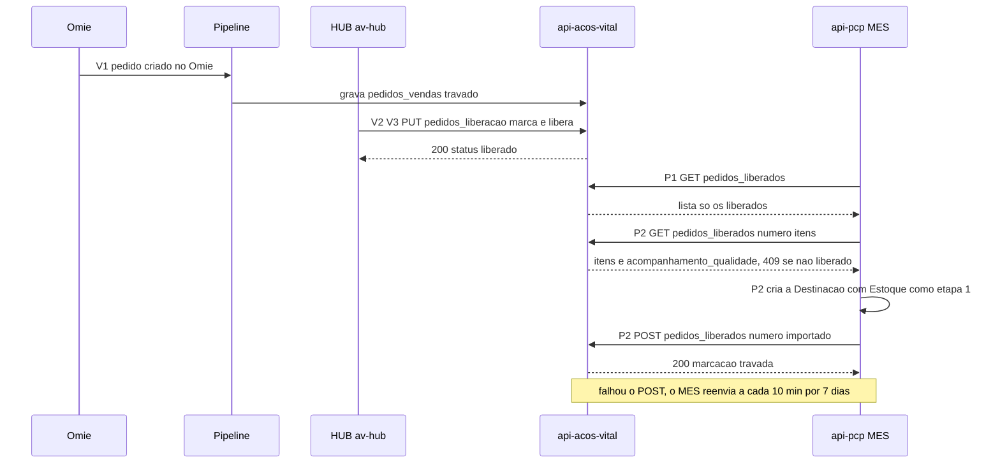
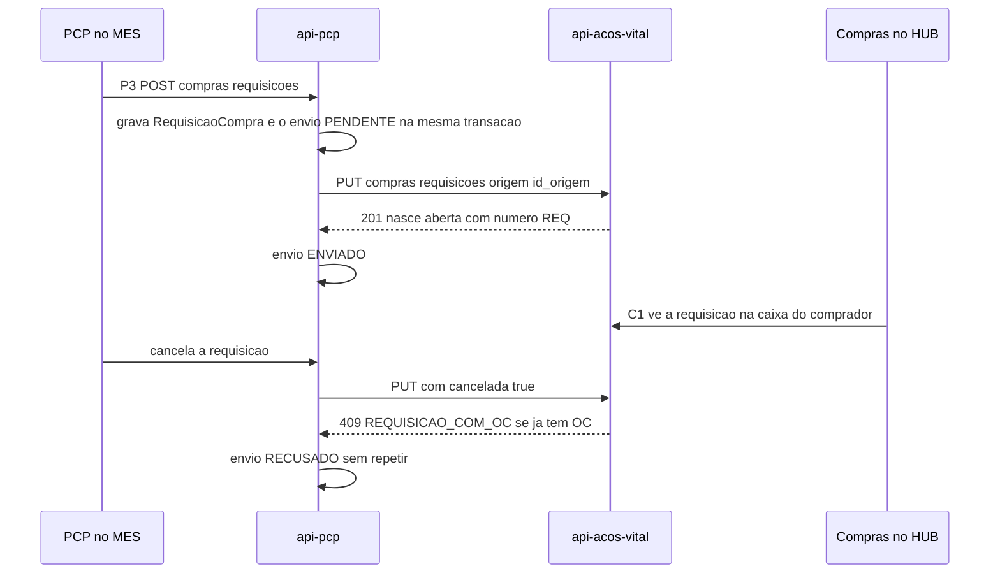
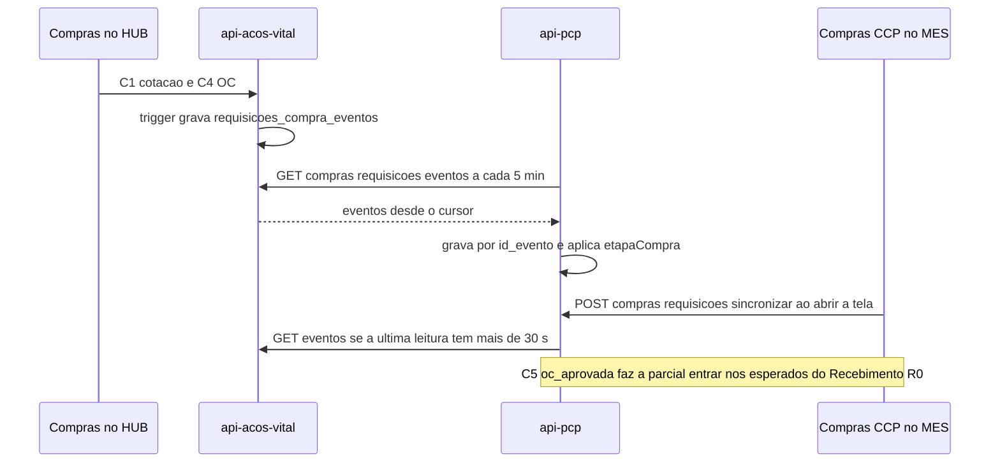

# Integração av-hub ↔ MES: detalhe técnico (1/2)

**Em uma frase:** detalhe técnico da nota [[Integracao-AvHub-MES]] (parte 1 de 2): Regras que valem para todos os fluxos; Tabela-resumo; INT-01 Liberação do pedido (contrato 26); INT-02 Requisição de compra, ida (contrato 34); INT-03 Marcos da requisição, volta (contrato 35).

**Onde estamos:** ← [[Integracao-AvHub-MES]] (resumo e índice) · partes: **Integracao-AvHub-MES-Detalhe-Tecnico-1** · [[Integracao-AvHub-MES-Detalhe-Tecnico-2]]

## Regras que valem para todos os fluxos

- **Mecanismo:** REST com `x-api-key`. Dois bancos separados, nenhum acesso cruzado. Quem tem o dado expõe, quem precisa lê e grava projeção própria 📝 ([[Registro-de-Decisoes]], DEC-2). O padrão de leitura é polling com cursor, sem webhook.
- **Exceção da ida:** a requisição de compra é **empurrada** pelo MES (`PUT`, fila de saída), não puxada ✅ (`api-pcp` `envio-avhub.service.ts:129-175`). O contrato 003 (hub puxa do MES) ficou sem consumidor (ver INT-08 abaixo).
- **`codigo_empresa` em todo payload** 📝 (DEC-1): a filial vem do pedido, nunca da fábrica.
- **Idempotência por chave natural, não por token:** upsert por id de origem ou por id do evento. Reler uma janela nunca duplica.
- **Fronteira de dado:** o dado comercial (fornecedor, condição de pagamento) fica no av-hub. Para o MES vai o necessário para conferir e, desde o contrato 007, preço, moeda e cotação por item (para o custo do lote).
- **Nenhuma regra em variável de ambiente** para jobs novos (regra do Nathan): intervalo, página e janela são constantes no código; só endereço e segredo ficam em ambiente ✅ (`item_estado_projetado.job.js:44-49`).

## Tabela-resumo

| ID | Fluxo | Contrato | Direção e rota | Nós 0b | Estado |
|---|---|---|---|---|---|
| INT-01 | Liberação do pedido | [[Contratos-da-v2\|LOG-26]] | HUB→av-hub `PUT /pedidos_liberacao/:codigo_empresa/:numero_pedido`; MES←av-hub `GET /pedidos_liberados`, `GET /pedidos_liberados/:numero/itens`; MES→av-hub `POST /pedidos_liberados/:numero/importado` | V2 V3 P1 P2 | ✅ ponta a ponta no código; chave de escopo mínimo 🔴 |
| INT-02 | Requisição de compra, ida | [[Contratos-da-v2\|LOG-34]] | MES→av-hub `PUT /compras/requisicoes/origem/:id_origem` | P3 | ✅ |
| INT-03 | Marcos da requisição, volta | [[Contratos-da-v2\|LOG-35]] | MES←av-hub `GET /compras/requisicoes/eventos` | C1 a C5 R0 | ✅ para requisição do MES; 🔴 para requisição só do av-hub |
| INT-04 | Referência da OC | [[Contratos-da-v2\|API-004]], [[Contratos-da-v2\|API-007]], [[Contratos-da-v2\|SQL-011]], [[Contratos-da-v2\|SQL-012]] | MES←av-hub `GET /ordens-compra/referencia` | C4 R0 R1 R4 | ✅ lado do hub; ✅ job K4 do MES na `develop` (15/10); uso na tela 🔴 |
| INT-05 | Status por item | [[Contratos-da-v2\|API-005]], [[Contratos-da-v2\|API-006]], [[Contratos-da-v2\|SQL-010]] | av-hub←MES `GET /itens/status` | todos | ✅ |
| INT-06 | Custo real por item | [[Contratos-da-v2\|API-008]], [[Contratos-da-v2\|LOG-47]] | av-hub←MES `GET /itens/custo` | E3 R4 | ✅ lado do hub; ✅ rota do MES na `develop` (27/10); fora da `main` |
| INT-07 | Torre de Fluxo | [[Contratos-da-v2\|LOG-46]] | av-hub←MES `GET /fluxo/eventos` e proxy `/fluxo/*` | os 9 setores | ✅ lado do hub; 🔴 MES sem o módulo `fluxo` |
| INT-08 | Requisições lidas do MES | [[Contratos-da-v2\|API-003]] | MES `GET /requisicoes-compra` | — | legado sem consumidor |
| INT-09 | Requisições do Compras com pedido de venda | [[Contratos-da-v2\|API-009]] | MES←av-hub `GET /compras/requisicoes/referencia` | C0 P1 P2 P3 E1 | ✅ lado do hub e job do MES na `develop` (23/10, `9e75df5`) |

Detalhe da Torre: [[Rastreabilidade-e-Torre-de-Fluxo]].

## INT-01 Liberação do pedido (contrato 26)

**Para quê:** o pedido chega do Omie travado e só vai para o PCP depois que o vendedor marca se a Qualidade acompanha desde o início e libera. Nós V2, V3, P1, P2.

| Passo | Rota | Quem chama | Chave ou auth | Detalhe |
|---|---|---|---|---|
| Libera | `PUT /pedidos_liberacao/:codigo_empresa/:numero_pedido` corpo `{acompanhamento_qualidade, updated_by}` | HUB (BFF) | Bearer do usuário | 404 `PEDIDO_FORA_DA_LIBERACAO`, 409 `PEDIDO_IMPORTADO_MES` ✅ `pedidos_liberacao.route.js:164`, `:194`, `:222` |
| Lista a Triagem | `GET /pedidos_liberados?codigo_empresa=&mes=&ano=&page=&limit=` | MES (Triagem do Pedido, ao abrir) | `API_KEY` do MES | sob demanda, sem job ✅ `omie-integracao.ts:331-338`, `pedidos-carteira.service.ts:65` |
| Itens do pedido | `GET /pedidos_liberados/:numero/itens?codigo_empresa=` | MES (Destinação do Pedido) | `API_KEY` | 409 `PEDIDO_NAO_LIBERADO` barra a criação ✅ `pedidos.service.ts:245-248`, `pedidos_liberados.route.js:53` |
| Confirma | `POST /pedidos_liberados/:numero/importado?codigo_empresa=` corpo `{referencia}` | MES, depois de criar a Destinação | `API_KEY` | idempotente; a partir daí a marcação trava ✅ `omie-integracao.ts:393-425` |

- **Cursor e periodicidade:** não há job. A Triagem e a Destinação leem na hora. `alterado_desde` existe na rota, mas o MES não o usa.
- **Idempotência:** o `importado` vale a primeira `referencia` (número da ordem de produção, campo `Pedidos.ordemProducao`). O MES grava `Pedidos.importadoAvhubEm` ✅ `pedidos.service.ts:133`.
- **Falha e retentativa:** se o `importado` falha, a Destinação já existe e o MES **reenvia a cada 10 min** (`AVHUB_REENVIO_IMPORTADO_MIN`, padrão 10) para pedidos dos últimos 7 dias, 20 por rodada ✅ `pedidos.service.ts:63-81`. Sem o `importado` o vendedor ainda pode mudar a marcação.
- **Se o av-hub cai:** a Triagem responde 422 "Não foi possível carregar a carteira de pedidos" ✅ `omie-integracao.ts:354-360`; a Destinação não cria ordem; nada se perde.
- **Se o MES cai:** o vendedor segue liberando; os pedidos acumulam como `liberado` (status da view `vw_pedidos_liberacao`: `pendente`, `liberado`, `importado`).
- **Pedido anterior à data de corte** 📝 (N16-142, 29/10): fica fora do MES e termina no sistema antigo; falta só uma mensagem clara no lugar do erro 404 nos itens 🔴.
- **Pendências:** data de corte `parametros_vendas.data_inicio_liberacao`: `2026-09-01` no banco de teste 📝 (Nathan, 09/11/2026), a definir em produção ao publicar a Liberação (BL-025); `auth.rotas_telas` para as rotas ❓ Gustavo; chave própria do MES com escopo mínimo: o recurso existe no código, falta cadastrar a lista e ligar o modo `exigir` ❓ Gustavo ([[Chaves-e-Autenticacao]]).

## INT-02 Requisição de compra, ida (contrato 34)

**Para quê:** o PCP pede compra de material de um pedido e o av-hub (Compras) passa a ver a requisição. Nó P3.

- **Rota:** `PUT {API_URL}/compras/requisicoes/origem/{id_origem}` ✅ `envio-avhub.service.ts:130`. `id_origem` = id do `RequisicaoCompraItem`. Uma requisição do MES com N materiais vira N requisições no av-hub.
- **Corpo:** `codigo_empresa`, `material`, `quantidade`, `unidade_medida`, `prazo_necessidade` e opcionais (`numero_requisicao_mes`, `descricao`, `acabado_sugerido`, `solicitante`, `observacao`, `codigo_pedido_omie`, `numero_pedido_venda`, `cancelada`) ✅ `requisicao-avhub.envio.ts:40-62`. O PUT não leva `id_item_parcial`.
- **Chave:** `AVHUB_MES_INTEGRACAO_KEY` no MES = um valor de `MES_INTEGRACAO_KEYS` no hub. Só abre esta rota; qualquer outra dá 403 `CHAVE_MES_ROTA_NAO_PERMITIDA` ✅ `apiKeyAuth.js:94-100`.
- **Respostas do hub** ✅ `requisicoes_compra.route.js:221-260`: 201 criou (nasce `aberta`, número `REQ-…`); 200 atualizou (sem OC); 200 `{aplicado:false, motivo:"com_oc"}` ou `"cancelada"`; 409 `REQUISICAO_COM_OC` ao cancelar requisição com OC; 400 campo inválido; 500 se falta a função de banco `fn_requisicao_mes_aplicar`.
- **Fila de saída (outbox):** a requisição e o envio nascem na mesma transação em `integracao_avhub_envios` (`PENDENTE`, `ENVIADO`, `RECUSADO`, `FALHOU`; `integracao.prisma:290-320`). Dispara logo após criar ou cancelar e a cada `AVHUB_ENVIO_INTERVALO_SEG` (padrão 60 s). Espera crescente 1, 2, 5, 10, 30, 60 min ✅ `envio-avhub.service.ts:21`.
- **Tratamento:** 200/201 vira `ENVIADO` e espelha id, número e status no item; 409 vira `RECUSADO` e não repete (o log avisa Compras) ✅ `:164-169`; 400 vira `FALHOU`; 401, 403, 404 e 5xx reagendam. Sem a chave definida, a fila espera com aviso no log ✅ `:98-102`.
- **Cancelamento** também vai pela fila e só vale sem OC.
- **Se o av-hub cai:** nada se perde; a fila acumula e retoma. **Se o MES cai:** o hub não recebe requisição nova.
- **Precisão:** o MES guarda 4 casas e o hub 3 (10,1234 vira 10,123).
- **Pendência:** o SQL de `fn_requisicao_mes_aplicar` (migration 034) existe em produção, mas não está versionado 🔴 Gustavo.

## INT-03 Marcos da requisição, volta (contrato 35)

**Para quê:** o MES saber em que ponto do circuito de Compras está cada requisição dele, sem receber o dado comercial. Nós C1 a C5 e R0. A tela Compras · CCP do MES é só leitura e espelha esses marcos.

- **Rota:** `GET /compras/requisicoes/eventos?alterado_desde=&apos_id=&codigo_empresa=&limit=` (limite padrão 200, máximo 500). Resposta `{quantidade, tem_mais, proximo:{alterado_desde, apos_id}, data:[…]}` ✅ `requisicoes_compra.route.js:289`.
- **Chave:** `API_KEY` do MES (admin ou de `auth.chaves_servico`). A chave do 34 dá 403 aqui.
- **Cursor:** (`registrado_em`, `id_evento`). O MES guarda o cursor `requisicoes-eventos` em `integracao_avhub_cursores` e relê 2 min para trás a cada rodada ✅ `eventos-avhub.service.ts:25`. Primeira leitura desde `2026-01-01`.
- **Periodicidade:** 5 min (`AVHUB_EVENTOS_INTERVALO_MIN`) e uma rodada 10 s depois de subir; até 50 páginas de 200 por rodada ✅ `:25-27`. **Sob demanda:** `POST /compras/requisicoes/sincronizar` (`compras.controller.ts:57`) — a tela Compras · CCP chama ao abrir e no "Atualizar" (`FilaSetor.tsx:370-396`); pula se a última leitura boa tem menos de 30 s e rodadas simultâneas compartilham a mesma ✅ `eventos-avhub.service.ts:31,80`.
- **Idempotência:** o evento é gravado por `id_evento`; reler não reprocessa.
- **Falha:** evento que não aplica fica gravado com `ERRO:` em `acao`, sem `processadoEm`, e a leitura segue ✅ `eventos-avhub.service.ts:150-181`. Falha de rede reagenda sem mexer no cursor.
- **Só existem eventos de requisição com `id_origem`** (a do MES). Requisição criada só no av-hub não gera evento: `id_origem` é `NOT NULL` em `requisicoes_compra_eventos` (Dump Avhub), e isso fica assim: o MES enxerga a **OC** dessa requisição pela referência (INT-04; ver "Requisito: o MES lê as OCs do hub").

Tratamento de cada `tipo` pelo MES (`requisicao-avhub.eventos.ts:234-318`, `etapaCompra`):

| `tipo` | Efeito no MES |
|---|---|
| `requisicao_recebida` | `AGUARDANDO_COMPRADOR` |
| `requisicao_reaberta` | `AGUARDANDO_COMPRADOR`; se o Compras cancelou e a parcial ainda está em Requisições, a requisição volta a `ABERTA` e a parcial a Compras; senão só anota |
| `em_cotacao` | `EM_COTACAO` |
| `oc_criada`, `oc_enviada_aprovacao` | `EM_APROVACAO`, grava `numeroOc` |
| `oc_removida` | `EM_COTACAO`, zera OC, aprovação e previsão |
| `oc_aprovada` | `COM_FORNECEDOR`, grava `ocAprovadaEm`, OC e previsão; a parcial vira **esperada** do Recebimento (R0) |
| `oc_no_omie` | grava `numeroPedidoOmie` |
| `fornecedor_confirmou` | só marco |
| `previsao_alterada` | atualiza `previsaoChegada` |
| `despachada` | `EM_TRANSITO`, grava `despachadaEm`, `nfFornecedor`, transportadora |
| `ocorrencia` | `ocorrenciaAberta = (dados.status === 'aberta')` |
| `oc_cancelada` | `AGUARDANDO_COMPRADOR`, limpa OC, Omie, previsão, despacho e NF |
| `requisicao_cancelada` | origem `mes` só confirma; origem `compras` com todos os materiais cancelados vira `CANCELADA` (`canceladaPor='compras'`) e a parcial volta a Requisições; só parte, anota |

Autor e comprador do marco (migration 035b do av-hub) vêm dentro de `dados` ✅ `requisicao-avhub.eventos.ts:47-48`.

