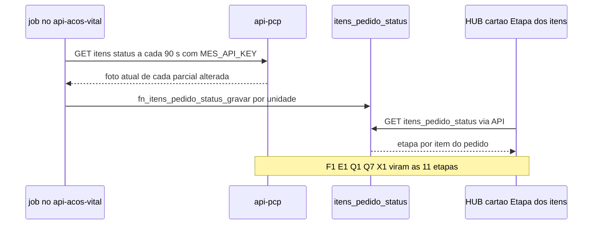
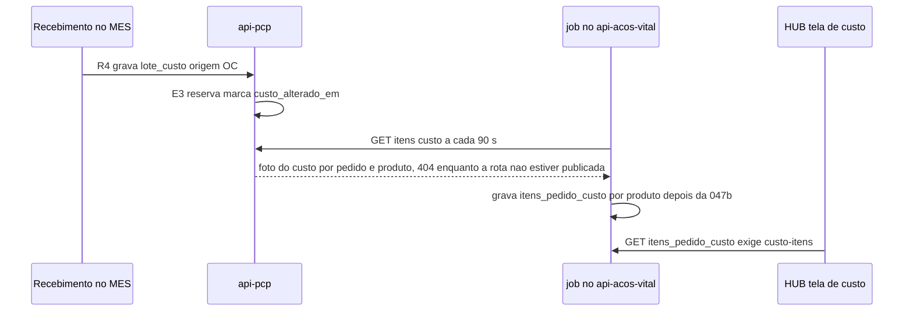
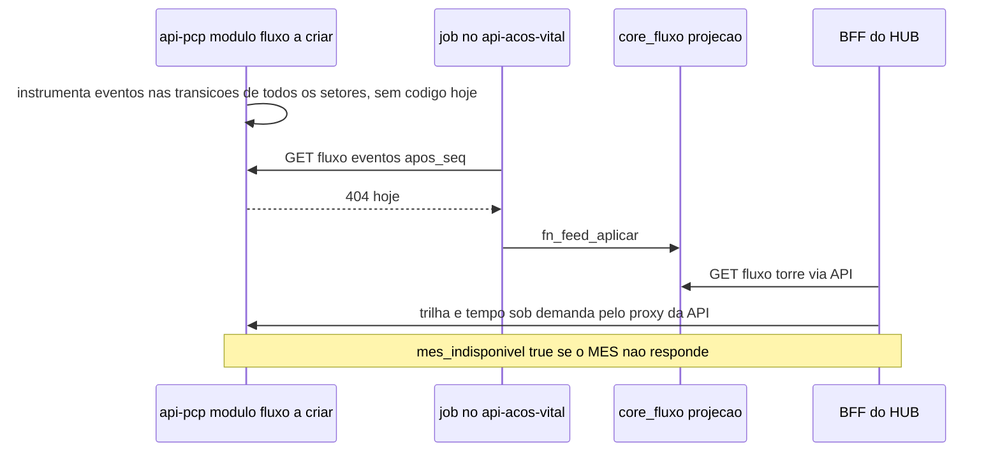

# Integração av-hub ↔ MES: detalhe técnico (2/2)

**Em uma frase:** detalhe técnico da nota [[Integracao-AvHub-MES]] (parte 2 de 2): INT-04 Referência da OC (contratos 004 e 007); INT-05 Status por item (contratos 005 e 006); INT-06 Custo real por item (contratos 008 e 47); INT-07 Torre de Fluxo (contrato 46); INT-08 `GET /requisicoes-compra` (003, legado); Requisito: o MES lê as OCs do hub (requisição só do av-hub, C0); Outras pontes com o MES; O que acontece quando o outro lado cai; O que falta desenvolver; Pendências.

**Onde estamos:** ← [[Integracao-AvHub-MES]] (resumo e índice) · partes: [[Integracao-AvHub-MES-Detalhe-Tecnico-1]] · **Integracao-AvHub-MES-Detalhe-Tecnico-2**

## INT-04 Referência da OC (contratos 004 e 007)

**Para quê:** (1) o Recebimento conferir contra o que foi comprado e o lote nascer com custo (nós C4, R0, R1, R4); hoje o Recebimento confere contra a **NF** 📝, e o cruzamento com a OC espera o job abaixo; (2) o PCP ver a OC de cada pedido e o Estoque ver o **saldo futuro** das OCs de estoque, inclusive as de requisição criada só no hub (C0, N14-20; ver "Requisito: o MES lê as OCs do hub").

- **Rota no hub:** `GET /ordens-compra/referencia?alterado_desde=&codigo_empresa=&apos_id=&page=&limit=` (`alterado_desde` obrigatório; limite padrão 100, máximo 500) ✅ `vw_ordens_compra_referencia_mes.route.js:44-89`, montada em `core_vendas_faturamento/index.js:199`. Entram OC `aprovada` e as canceladas depois de aprovadas. `alterado_em` é o maior `updated_at` da OC, dos itens e dos vínculos (trigger da migration `api004`). A regra mora no banco.
- **Valores (contrato 007):** a resposta traz `moeda`, `cotacao_moeda`, `cotacao_data`, `cotacao_origem`, `valor_frete`, `valor_seguro` na OC e `valor_unitario`, `desconto_pct`, `valor_desconto`, `valor_total_item` em cada item ✅ `vw_ordens_compra_referencia_mes.route.js:51-53`. A rota tolera banco sem a migration `api007` (200 sem os campos) e responde 500 sem a `api004` ❓ se aplicadas em produção (Gustavo, SQL em [[Contratos-da-v2|SQL-012]]). Desde a `api007b` (26/10, `a7fda49`) a OC traz também `codigo_fornecedor`, `nome_fornecedor` e `cnpj_fornecedor` ✅ (pedido do Robert); segue sem condição de pagamento, categoria nem conta corrente.
- **Chave de leitura:** `API_KEY` do MES; a chave do 34 dá 403.
- **Cursor e periodicidade:** `proximo` (`alterado_desde` + `apos_id`) com sobreposição de 5 minutos, a cada 5 min ✅ (`oc-referencia-avhub.service.ts`). Idempotência no MES por `(codigo_empresa, id_ordem_compra)` e itens por `(id_ordem_compra, id_item_oc)`; item que sumiu da OC é marcado `removido_em`; OC cancelada ou item removido desfaz os vínculos de origem do hub.
- **O MES consome ✅ (na `develop`, não na `main`):** `oc-referencia-avhub.service.ts` (K4, `114ba89`, 15/10) lê a referência a cada 5 min (`AVHUB_OC_INTERVALO_MIN`, 0 desliga) e na subida, com cursor `ordens-compra-referencia`, 500 por página, até 40 páginas, e grava a projeção `oc_referencia` e `oc_referencia_itens`; o Recebimento já cria o lote com o custo da OC (BL-005, desde 19/10). O que falta é **usar** a projeção: OC do pedido para o PCP (BL-049) e saldo futuro do Estoque (BL-050). Dono: Robert, backlog [[Backlog-por-Frente]] (BL-001, BL-006).
- **Ajuste pendente do 004:** `id_origem` em cada item (pedido do Robert em 30/09) 🔴 Gustavo conferir.
- **Se o hub cai:** o job reagenda e a página que falhou é relida na rodada seguinte; o Recebimento segue pela NF. **Se o MES cai:** a OC fica no hub.

```mermaid
sequenceDiagram
    participant API as api-acos-vital
    participant JOB as job K4 no MES
    participant MES as api-pcp
    participant REC as Recebimento
    API->>API: C4 OC aprovada e trigger atualiza alterado_em
    JOB->>API: GET ordens-compra referencia com chave de leitura
    API-->>JOB: OC com itens, id_origem e valores
    JOB->>MES: UPSERT projecao oc_referencia
    REC->>MES: R0 R1 confere contra a NF e cruza com a OC
    REC->>MES: R4 cria o lote com custo da OC
    Note over JOB,MES: o job K4 e o custo da OC no lote existem na develop do MES; a conferencia com a OC (R1) segue pela NF
```

## INT-05 Status por item (contratos 005 e 006)

**Para quê:** o vendedor ver a etapa de cada item do pedido. Todos os nós, resumido em 11 etapas.

- **Rota no MES:** `GET /itens/status?alterado_desde=&codigo_empresa=&incluir_deletados=&limit=` (limite padrão 500, máximo 1000) ✅ `integracao-avhub.controller.ts:26`, `integracao-avhub.service.ts:114-156`. Resposta: foto atual por parcial (`id_item_parcial`, `pedido_venda`, `ordem_producao`, `codigo_produto_omie`, `etapa`, `setor`, `status`, `quantidade_na_etapa`, `atendido_pelo_estoque`, `ocorrido_em`).
- **Chave:** `MES_API_KEY` (AvhubApiKeyGuard, fail-closed: sem a variável responde 401) ✅ `avhub-api-key.guard.ts:14-16`.
- **Job no hub:** `itens_pedido_status.job.js`, a cada 90 s (`MES_STATUS_INTERVALO_SEG`), uma unidade por vez, página de 1000, cursor por unidade, `pg_try_advisory_xact_lock`; falha desfaz a transação e o cursor não anda; 401 ou 403 seguidos viram alerta no log; grava por `fn_itens_pedido_status_gravar` (migration `api005`) ✅ `itens_pedido_status.job.js:9-37`, iniciado em `app.js:207`.
- **Rota de leitura no hub:** `GET /itens_pedido_status?codigo_empresa=&pedido_venda=&historico=`; lê só a tabela local; escopo "dono do pedido", 403 se sem dono (contrato 006).
- **Idempotência:** chave `(codigo_empresa, id_item_parcial, etapa, ocorrido_em)`; o vendedor vê a etapa de maior `ocorrido_em`.
- **Vocabulário `etapa` (11 valores)** ✅ `integracao-avhub.service.ts:158-183` (`etapaDoItem`): `qualidade.reprovado`, `estoque.atendimento`, `compras.requisicao`, `compras.fechamento`, `recebimento.conferencia`, `qualidade.quarentena`, `qualidade.inspecao`, `expedicao.concluido`, `expedicao.embalagem`, `fabrica.execucao`, `fabrica.espera`. O HUB traduz em `lib/domain/etapas-item.ts:30-41`; etapa desconhecida aparece com o código cru. Ver [[Estados-e-Status]].
- **Front:** cartão "Etapa dos itens" (`EtapaDosItens`, BFF `app/api/pedidos-venda/[fonte]/…/etapas/route.ts`); avisa se o job parou há mais de 10 min.
- **Se o MES cai:** o job falha e tenta de novo; o cartão mostra a última foto e o aviso de dado velho. **Se o hub cai:** o MES não percebe (só responde a leituras).
- **Pendências:** `compras.fechamento` ainda é "Em compra", sem cotação, aprovação e trânsito 🔴 Robert + Nathan (BL-009); migration `api005` no banco ❓ Gustavo; teste ponta a ponta do cartão ❓ Nathan.



## INT-06 Custo real por item (contratos 008 e 47)

**Para quê:** o custo do item do pedido = média dos lotes reservados (nó E3), usado pelo hub no Ciclo 2 para o simulador e a comissão ([[Contratos-da-v2|LOG-47]]).

- **Rota no MES** ✅ (`integracao-avhub.controller.ts`, `itens-custo.ts`, `6c11147`, 27/10, só na `develop`): `GET /itens/custo?alterado_desde=&codigo_empresa=&apos_id=&limit=`, array puro, uma linha por filial + pedido + **produto** (`codigo_produto_omie`; linhas repetidas do pedido são somadas), com `quantidade`, `quantidade_com_custo`, `custo_total`, `custo_medio`, `completo`, `cotacao_a_conferir`, `lotes[]`, `alterado_em` ([[Contratos-da-v2|API-008]]). Entram só pedidos do Omie e itens que têm ou tiveram reserva no Estoque; fabricado fica de fora até o custo da matéria-prima; só entra o que mudou há mais de 180 s (janela de segurança). BL-004 feito pelo Robert.
- **Job no hub** ✅ `itens_pedido_custo.job.js`: a cada 90 s por unidade, cursor `alterado_em` + `id`; **404 do MES avisa e tenta a cada 10 min** (produção ainda sem a rota: `main` do MES parou em 08/10); sem a migration 047b o job nem chama o MES.
- **Rota de leitura no hub:** `GET /itens_pedido_custo?codigo_empresa=&numero_pedido=` exige sempre `custo-itens:pode_visualizar`; a tela nasce sem perfil, então responde 403 a todos 🔴 Gustavo (BL-020). Devolve `custo_sem_impostos: true` (custo do Ciclo 1 não tem ICMS, IPI nem ST).
- **Chave:** `MES_API_KEY` (a mesma do INT-05).
- **Banco:** a função `fn_itens_pedido_custo_gravar` ainda grava por `item integer` no Dump Avhub; a migration 047b troca para produto. 🔴 Gustavo aplicar (BL-019). A API já exige a 047b.
- **Pedido manual nunca participa do custo** 📝 (D6 do contrato 008): ele não chega ao MES (sem parcelas nem itens; a carteira só pega `sequencial = 0`) e o hub o descarta ao gravar o custo ✅ ([[Backlog-por-Frente]] BL-026, resolvido pelo desenho em 09/11).
- **Do lado do MES** (`develop`): o Recebimento já grava `lote_custo` com origem `OC` quando a unidade da OC bate (BL-005, 19/10, `97b9adc`); unidade diferente ou OC fora da projeção gera lote sem custo e sinalizado; o custo também pode ser informado ou corrigido à mão em `PUT /estoque/lotes/:id/custo` (27/10) ([[Modelo-Estoque-e-Custo-do-Lote]]).



## INT-07 Torre de Fluxo (contrato 46)

Resumo; o desenho completo (envelope, projeção, telas) está em [[Rastreabilidade-e-Torre-de-Fluxo]].

- **Feed no MES (a criar):** `GET /fluxo/eventos?apos_seq=&limite=` com cursor `seq` monotônico. O MES não tem módulo `fluxo` nem tabela de eventos 🔴 Robert (BL-003; conferido em 29/10 na `develop`: nenhuma pasta `fluxo` em `api-pcp/src`).
- **Job no hub** ✅ `item_estado_projetado.job.js`: lê o feed a cada 90 s, página de 1000, janela de 200 `seq` relidos, trava por fonte; **404 do MES avisa e repete a cada 10 min**; aplica por `core_fluxo.fn_feed_aplicar`. O cliente HTTP do MES é `utils/mesFluxo.js`.
- **Rotas do hub** ✅ `item_estado_projetado.route.js`: `GET /fluxo/torre`, `/fluxo/sla-etapas`, `/fluxo/itens/:id/tempo`, `/fluxo/itens/:id`. Trilha, tempo e SLA são proxy do MES (a chave fica na API); MES fora do ar devolve 200 com `mes_indisponivel: true`.
- **Chave:** `MES_API_KEY`, `MES_API_URL` (mesma do INT-05).
- **Permissão:** telas `torre-fluxo` e `torre-fluxo-trilha`, concedidas só ao perfil de testes do time de TI pela 046b ❓ aplicada; nenhum perfil de negócio as tem 🔴 Gustavo/Nathan (BL-021).
- **Front:** o HUB tem as telas da Torre (`/torre-fluxo`, ranking, tempo e item) e o BFF `/api/fluxo/*`, **sobre dados de teste** (fixtures); consideradas ok pelo Nathan em 29/10 (BL-022). Dependem do feed do MES e dos perfis (BL-021).



## INT-08 `GET /requisicoes-compra` (003, legado)

`GET /requisicoes-compra` e `GET /itens/status` ficam no mesmo controller do MES, protegidos por `MES_API_KEY` ✅ `integracao-avhub.controller.ts`. A primeira rota era o antigo desenho "o hub puxa a requisição". Foi substituída pelo INT-02 e **nenhum job do hub a consome** ✅ (nenhuma referência em `api-acos-vital/src`). Fica como código morto 🔴 Robert decidir remover (BL-032; conferido em 29/10, a rota ainda está no controller do MES). O comentário "JOB DE POLLING do MES" no `api-acos-vital` está velho (Gustavo, BL-033).

## Requisito: o MES lê as OCs do hub (requisição só do av-hub, C0)

Compras cria requisição de necessidade própria no HUB (nó C0, `POST /compras/requisicoes`, número por trigger, permissão `compras.pode_criar`) ✅ `requisicoes_compra.route.js:384`. A **requisição** não chega ao MES (sem `id_origem` não há evento do contrato 35) e **não precisa chegar**. 📝 Decisão N14-20 (14/10): o MES lê a **OC**, pela referência (INT-04), e com ela:

- **OC vinculada a pedido de venda:** o PCP vê, no MES, que já existe ordem de compra para aquele pedido (Triagem, Destinação e Atendimento). Fonte: `destino[]` do item com `tipo = pedido_venda` e `numero_pedido_venda`.
- **OC de itens de estoque (sem pedido):** o Estoque do MES mostra o **saldo futuro**: as OCs em andamento e a parte que preenche o estoque (`destino` com `tipo = estoque`), somada ao saldo atual.
- **Entrada da mercadoria:** o Recebimento do MES exige requisição do MES; é preciso um caminho para a OC sem requisição ([[07-Recebimento]], "Mercadoria de OC sem requisição do MES").

✅ No hub já existe: `ordens_compra.finalidade` (`estoque`, `pedidos_venda`, `recompra`, `uso_interno`), `ordens_compra_itens_vinculos`, a view `vw_pedido_venda_itens_compra`, `GET /compras/pedidos-venda/:numero` e `/:numero/compras`, e a referência com `destino[]` e `finalidade` (arquivos em [[06-Circuito-de-Compra]]). 🔴 Falta no MES: o job K4 (BL-001), a projeção da OC, as telas e o cálculo do saldo futuro (BL-049, BL-050, BL-051). Falta no hub só conferir se a referência (que traz só OC aprovada) e uma consulta por produto e por pedido bastam (BL-028). Dono: Robert (MES), Gustavo se a API precisar expor por produto ou pedido, Nathan se precisar de tela no HUB (BL-041). Pendência [[Pontas-Soltas]] (PS-003, resolvida em 14/10).

## Outras pontes com o MES

- **MES→Omie:** o MES nunca fala com o Omie. A sinalização de faturamento (ligação do nó O1) não existe 🔴 ([[14-Fiscal-Omie]]). Decidido em 29/10: quem avisa o Fiscal é a Logística, ao fechar a carga (N16-132, depende da consolidação de carga `X3`, que não existe), e o MES só mostra um aviso de "faturado antes da entrega", sem bloquear (N16-133); hoje o MES nem sabe se o pedido foi faturado.
- **Avisos do MES ao hub (novos, sem contrato):** recompra por RNC de lote 100% reprovado (N16-127) e reabertura do recebimento pelo PCP (N16-137). Hoje só o MES sabe e a OC do hub segue "atendida" 🔴.
- **Pipeline→av-hub→Omie:** a única escrita no Omie é o envio da OC pela pipeline (`GET /compras/ordens/fila-omie`, `PATCH /compras/ordens/:id/sincronizacao`); não passa pelo MES. Ver [[Omie-Integracao-Estado]] e [[Pipeline-Omie]].
- **Pedido manual** ([[Contratos-da-v2|LOG-45]]) não percorre o fluxo do MES.

## O que acontece quando o outro lado cai

| Cai | Efeito | Recuperação |
|---|---|---|
| av-hub (`api-acos-vital`) | Triagem e Destinação do Pedido falham com mensagem; a fila de requisição acumula; o polling de marcos reagenda; o "importado" é reenviado a cada 10 min por 7 dias | automática ao voltar; depois de 7 dias o "importado" não é mais reenviado, sem alerta 🔴 BL-034 |
| MES (`api-pcp`) | O vendedor segue liberando; os jobs de status, custo e Torre falham e repetem (90 s; 10 min em 404); o HUB mostra "dado velho" após 10 min | automática ao voltar; cursores não andam em falha |
| Banco do MES vazio ou sem migrations | a `main` do MES parou em 08/10 e o banco de produção não tem as migrations da `develop` (job da OC, custo por item, OP e lote do fabricado só na `develop`) | merge `develop`→`main` antes do piloto 📝 ([[Riscos]], RS-002) |

## O que falta desenvolver

| Item | Dono | Nós | Backlog |
|---|---|---|---|
| Subir a `develop` do MES (job da OC, custo no recebimento, `GET /itens/custo`, OP e lote do fabricado) para a `main` | Robert | todos | BL-035 |
| Módulo `fluxo` e feed `GET /fluxo/eventos` | Robert | todos | BL-003 |
| MES ler as OCs do hub: OC do pedido, saldo futuro e entrada da mercadoria sem requisição do MES | Robert (+ Gustavo, + Nathan se precisar de tela) | C0 R0 E1 | BL-006, BL-028, BL-049, BL-050, BL-051 |
| Etapa de compra mais fina no 005 | Robert | C1 a C5 | BL-009 |
| Lista de rotas e modo `exigir` nas chaves do MES e da pipeline | Gustavo | — | BL-018, BL-057 |
| Conceder `torre-fluxo` e `custo-itens` aos perfis | Gustavo | — | BL-020, BL-021 |
| Tela de custo no HUB: simulador, Compras e Orçamento | Nathan | — | BL-023 |
| Avisos MES para hub (RNC, reabertura do recebimento) | Robert + Gustavo | R0 R1 | N16-127, N16-137 |

Lista completa: [[Backlog-por-Frente]].

## Pendências

- Quem marca a requisição como atendida no fluxo do MES: hoje `resumirRequisicao` fecha por OC e recebimento; confirmar regra com o Robert ([[Pontas-Soltas]] PS-011).
- Teste ponta a ponta do cancelamento de requisição (marcos do 35) ❓ Robert (PS-012).
- Retentativa do `importado` depois de 7 dias ❓ (PS-013).
